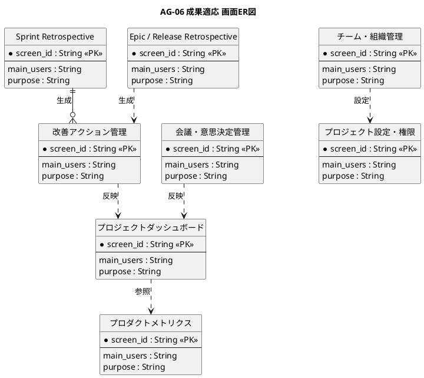

# 画面ER図

成果適応業務領域が提供する画面の関係を示すER図です。

## 1. 目的

本書は、AG-06 成果適応業務領域のシステムレイヤーで提供する画面エンティティ間の関係を示すER図です。

## 2. PlantUML ER図



## 3. 日本語版 ER図

```plantuml
@startuml
title AG-06 成果適応 画面ER図（日本語版）
hide circle
skinparam linetype ortho
skinparam shadowing false
skinparam entity {
  BackgroundColor #F8FAFC
  BorderColor #475569
  FontColor #0F172A
}
skinparam packageStyle rectangle

entity "プロジェクトダッシュボード" as ProjectDashboard {
  * 画面ID : String <<PK>>
  --
  主な利用者 : String
  画面の目的 : String
}

entity "Sprint Retrospective" as SprintRetrospective {
  * 画面ID : String <<PK>>
  --
  主な利用者 : String
  画面の目的 : String
}

entity "Epic / Release Retrospective" as EpicRetrospective {
  * 画面ID : String <<PK>>
  --
  主な利用者 : String
  画面の目的 : String
}

entity "改善アクション管理" as ImprovementAction {
  * 画面ID : String <<PK>>
  --
  主な利用者 : String
  画面の目的 : String
}

entity "プロダクトメトリクス" as ProductMetrics {
  * 画面ID : String <<PK>>
  --
  主な利用者 : String
  画面の目的 : String
}

entity "会議・意思決定管理" as MeetingDecision {
  * 画面ID : String <<PK>>
  --
  主な利用者 : String
  画面の目的 : String
}

entity "チーム・組織管理" as TeamOrg {
  * 画面ID : String <<PK>>
  --
  主な利用者 : String
  画面の目的 : String
}

entity "プロジェクト設定・権限" as ProjectSettings {
  * 画面ID : String <<PK>>
  --
  主な利用者 : String
  画面の目的 : String
}

' プロジェクトダッシュボードからプロダクトメトリクスへ
プロジェクトダッシュボード ..> プロダクトメトリクス : 参照

' Sprint Retrospectiveから改善アクション管理へ
Sprint Retrospective ||--o{ 改善アクション管理 : 生成

' Epic / Release Retrospectiveから改善アクション管理へ
Epic / Release Retrospective ..> 改善アクション管理 : 生成

' 改善アクション管理からプロジェクトダッシュボードへ
改善アクション管理 ..> プロジェクトダッシュボード : 反映

' 会議・意思決定管理からプロジェクトダッシュボードへ
会議・意思決定管理 ..> プロジェクトダッシュボード : 反映

' チーム・組織管理からプロジェクト設定・権限へ
チーム・組織管理 ..> プロジェクト設定・権限 : 設定

@enduml
```

## 4. 画面エンティティ一覧

| 画面エンティティ     | 画面ID  | 画面名                   | 主な利用者         | 画面の目的                                               |
|----------------------|---------|--------------------------|--------------------|----------------------------------------------------------|
| ProjectDashboard     | SCR-001 | プロジェクトダッシュボード | 全員             | プロジェクト状況、注意事項、次の意思決定を把握する       |
| SprintRetrospective  | SCR-022 | Sprint Retrospective     | チーム、SM         | Keep/Problem/Try等で改善案を出し、投票・アクション化する |
| EpicRetrospective    | SCR-023 | Epic / Release Retrospective | PO、チーム、関係者 | Epic・Releaseの計画対実績、品質、変更、学びを振り返る   |
| ImprovementAction    | SCR-024 | 改善アクション管理       | チーム、SM、PO     | 改善アクションの担当、期限、状態、効果確認を管理する     |
| ProductMetrics       | SCR-025 | プロダクトメトリクス     | PO、チーム         | 成果指標、利用状況、フロー指標、品質の推移を確認する     |
| MeetingDecision      | SCR-026 | 会議・意思決定管理       | PO、SM、関係者     | ステアリング会議等の議題、決定、アクション、課題を管理する |
| TeamOrg              | SCR-027 | チーム・組織管理         | 管理者、SM         | 社内部門、パートナー企業、メンバー、役割を管理する       |
| ProjectSettings      | SCR-028 | プロジェクト設定・権限   | 管理者             | プロジェクト設定、アクセス権、ワークフロー等を管理する   |

## 5. 主要な関係

- **プロジェクトダッシュボード → プロダクトメトリクス**：プロジェクト状況の可視化
- **Sprint Retrospective → 改善アクション管理**：振り返りからの改善アクション生成
- **Epic / Release Retrospective → 改善アクション管理**：大規模振り返りからの改善アクション生成
- **改善アクション管理 → プロジェクトダッシュボード**：改善状況の反映
- **会議・意思決定管理 → プロジェクトダッシュボード**：決定事項の反映
- **チーム・組織管理 → プロジェクト設定・権限**：組織構成に基づく権限設定
