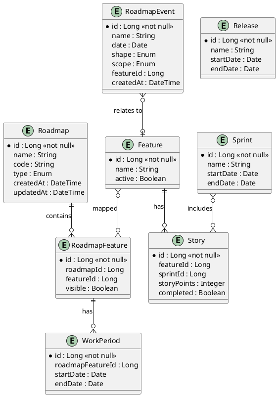
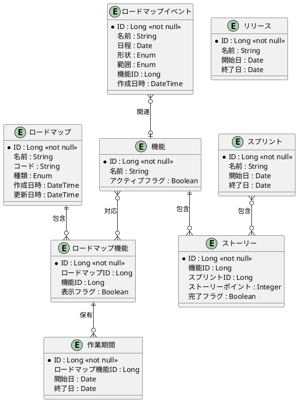

# ER図

ロードマップ管理業務領域（AG-07）のエンティティ関係図をPlantUMLで定義します。

## 英語版

## 日本語版

## 情報一覧

| 情報ID | 情報名 | 主キー | 主要属性 |
|--------|--------|--------|----------|
| INF-RM-01 | ロードマップ | id | name, code, type, createdAt, updatedAt |
| INF-RM-03 | ロードマップ機能 | id | roadmapId, featureId, visible |
| INF-RM-04 | 作業期間 | id | roadmapFeatureId, startDate, endDate |
| INF-RM-05 | ロードマップイベント | id | name, date, shape, scope, featureId |
| INF-RM-07 | 機能 | id | name, active |
| INF-RM-08 | スプリント | id | name, startDate, endDate |
| INF-RM-09 | リリース | id | name, startDate, endDate |
| INF-RM-10 | ストーリー | id | featureId, sprintId, storyPoints, completed |

## 関係一覧

| 親エンティティ | 子エンティティ | 関係 | 種類 |
|----------------|----------------|------|------|
| ロードマップ | ロードマップ機能 | 1対多 | 包含 |
| ロードマップ機能 | 作業期間 | 1対多 | 保有 |
| 機能 | ロードマップ機能 | 多対多 | 対応 |
| 機能 | ストーリー | 1対多 | 包含 |
| スプリント | ストーリー | 1対多 | 包含 |
| ロードマップイベント | 機能 | 多対1 | 関連 |
