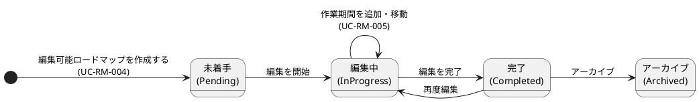

# ステートマシン図 - ロードマップ

ロードマップの状態遷移をPlantUMLで視覚化します。

## 状態遷移図

## 状態一覧

| 状態名                | 説明                                 | 遷移元 | 遷移先             | トリガーUC |
|-----------------------|--------------------------------------|--------|--------------------|------------|
| 未着手 (Pending)      | 編集可能ロードマップが作成された状態 | -      | 編集中             | UC-RM-004  |
| 編集中 (InProgress)   | ロードマップの編集が進行中の状態     | 未着手 | 完了, 編集中       | UC-RM-005  |
| 完了 (Completed)      | ロードマップの編集が完了した状態     | 編集中 | 編集中, アーカイブ | -          |
| アーカイブ (Archived) | ロードマップがアーカイブされた状態   | 完了   | -                  | -          |
