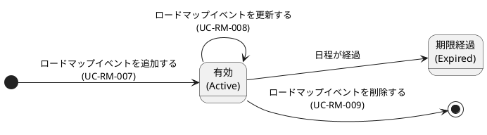

# ステートマシン図 - ロードマップイベント

ロードマップイベントの状態遷移をPlantUMLで視覚化します。

## 状態遷移図

## 状態一覧

| 状態名             | 説明                                     | 遷移元 | 遷移先         | トリガーUC           |
|--------------------|------------------------------------------|--------|----------------|----------------------|
| 有効 (Active)      | ロードマップイベントが有効な状態         | -      | 有効, 期限経過 | UC-RM-007, UC-RM-008 |
| 期限経過 (Expired) | ロードマップイベントの日程が経過した状態 | 有効   | -              | -                    |
