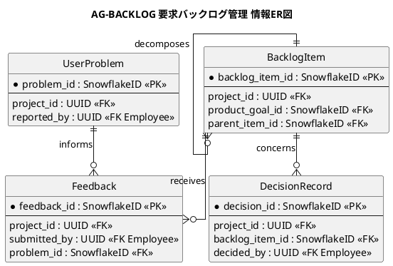
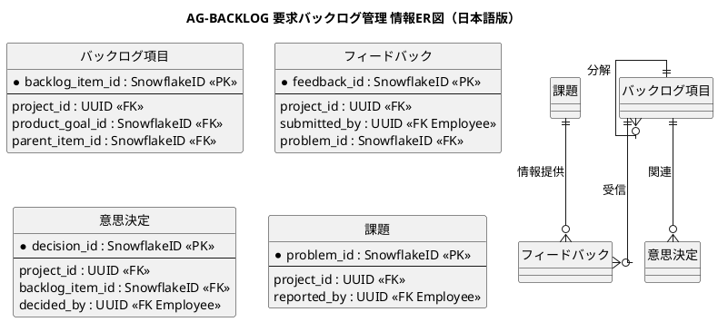

# 情報ER図

要求・プロダクトバックログ管理業務領域で扱う情報の関係を示すER図です。

## 1. 目的

本書は、AG-BACKLOG 要求バックログ管理業務領域のシステムレイヤーで扱う情報エンティティ間の関係を示すER図です。

## 2. PlantUML ER図

## 3. 日本語版 ER図

## 4. エンティティ一覧

| エンティティ   | 情報名 (ID)                | 説明                                   |
|----------------|----------------------------|----------------------------------------|
| BacklogItem    | バックログ項目 (INF-BL-01) | Epic、Feature、Story、欠陥などの項目   |
| Feedback       | フィードバック (INF-BL-03) | 利用者からの意見・評価                 |
| DecisionRecord | 意思決定 (INF-BL-05)       | 決定内容、根拠、決定者                 |
| UserProblem    | 課題 (INF-DIS-03)          | 業務上の困りごとや繰り返し発生する問題 |

## 5. 主要な関係

- **BacklogItem → BacklogItem**：Epic、Feature、Storyの階層関係（バックログ階層: INF-BL-06）
- **BacklogItem → Feedback**：項目に対する利用者からのフィードバック
- **BacklogItem → DecisionRecord**：項目に関する意思決定の記録
- **UserProblem → Feedback**：課題に対するフィードバック

## 6. 参照エンティティ

以下のエンティティは他の業務領域で定義され、参照として使用されます。

| エンティティ | 所属業務領域 | 説明           |
|--------------|--------------|----------------|
| Project      | 共通         | プロジェクト   |
| ProductGoal  | AG-DISCOVERY | プロダクト目標 |
| Employee     | 共通         | 従業員         |
