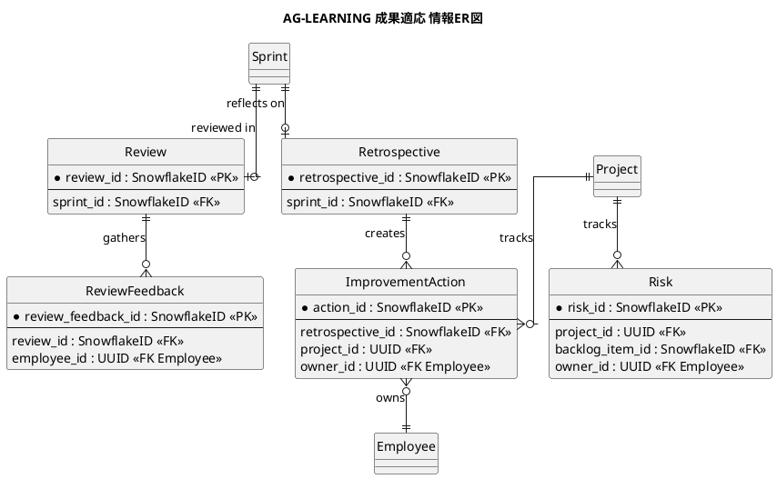
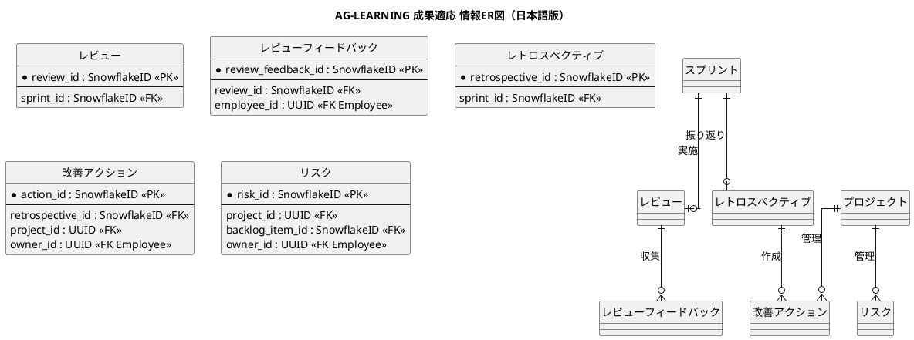

# 情報ER図

成果計測・フィードバックによる適応業務領域で扱う情報の関係を示すER図です。

## 1. 目的

本書は、AG-LEARNING 成果適応業務領域のシステムレイヤーで扱う情報エンティティ間の関係を示すER図です。

## 2. PlantUML ER図

## 3. 日本語版 ER図

## 4. エンティティ一覧

| エンティティ      | 情報名 (ID)                    | 説明                                   |
|-------------------|--------------------------------|----------------------------------------|
| Review            | Sprint Review記録 (INF-LR-01)  | 成果、フィードバック、決定、未解決事項 |
| ReviewFeedback    | 利用者レビュー結果 (INF-LR-07) | 対象者、シナリオ、期限、結果           |
| Retrospective     | Retrospective記録 (INF-LR-02)  | 学び、改善候補、決定事項               |
| ImprovementAction | 改善アクション (INF-LR-03)     | 改善の担当、期限、状態、効果           |
| Risk              | リスク (INF-LR-06)             | 依存関係、課題、遅延リスク             |

## 5. 主要な関係

- **Sprint → Review**：スプリント終了時の成果レビュー
- **Review → ReviewFeedback**：レビュー時の利用者フィードバック
- **Sprint → Retrospective**：スプリント終了時の振り返り
- **Retrospective → ImprovementAction**
  ：振り返りから派生した改善アクション（改善アクションとRetrospective: INF-LR-10）
- **Project → ImprovementAction**：プロジェクトレベルの改善アクション管理
- **Project → Risk**：プロジェクトのリスク管理

## 6. 参照エンティティ

以下のエンティティは他の業務領域で定義され、参照として使用されます。

| エンティティ | 所属業務領域 | 説明           |
|--------------|--------------|----------------|
| Sprint       | AG-SPRINT    | スプリント     |
| BacklogItem  | AG-BACKLOG   | バックログ項目 |
| Employee     | 共通         | 従業員         |
| Project      | 共通         | プロジェクト   |
