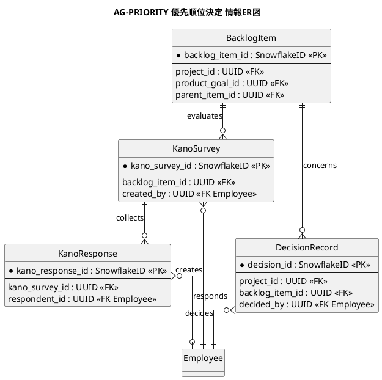
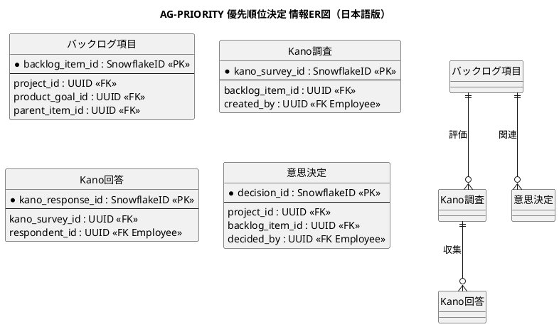

# 情報ER図

価値・要求の優先順位決定業務領域で扱う情報の関係を示すER図です。

## 1. 目的

本書は、AG-PRIORITY 優先順位決定業務領域のシステムレイヤーで扱う情報エンティティ間の関係を示すER図です。

## 2. PlantUML ER図

## 3. 日本語版 ER図

## 4. エンティティ一覧

| エンティティ   | 情報名 (ID)                | 説明                                 |
|----------------|----------------------------|--------------------------------------|
| BacklogItem    | バックログ項目 (INF-BL-01) | Epic、Feature、Story、欠陥などの項目 |
| KanoSurvey     | Kano質問票 (INF-PR-02)     | 充足質問・不充足質問のペア           |
| KanoResponse   | Kano回答 (INF-PR-03)       | 各質問に対する回答                   |
| DecisionRecord | 優先判断理由 (INF-PR-05)   | 優先順位決定の根拠・決定者・影響範囲 |

## 5. 主要な関係

- **BacklogItem → KanoSurvey**：バックログ項目に対するKano調査
- **KanoSurvey → KanoResponse**：調査に対する回答（Kano分類結果: INF-PR-04）
- **BacklogItem → DecisionRecord**：項目の優先順位に関する意思決定
- **Employee → KanoSurvey**：調査の作成者
- **Employee → KanoResponse**：回答者（匿名回答も可）

## 6. 参照エンティティ

以下のエンティティは他の業務領域で定義され、参照として使用されます。

| エンティティ | 所属業務領域 | 説明           |
|--------------|--------------|----------------|
| Project      | 共通         | プロジェクト   |
| ProductGoal  | AG-DISCOVERY | プロダクト目標 |
| Employee     | 共通         | 従業員         |
