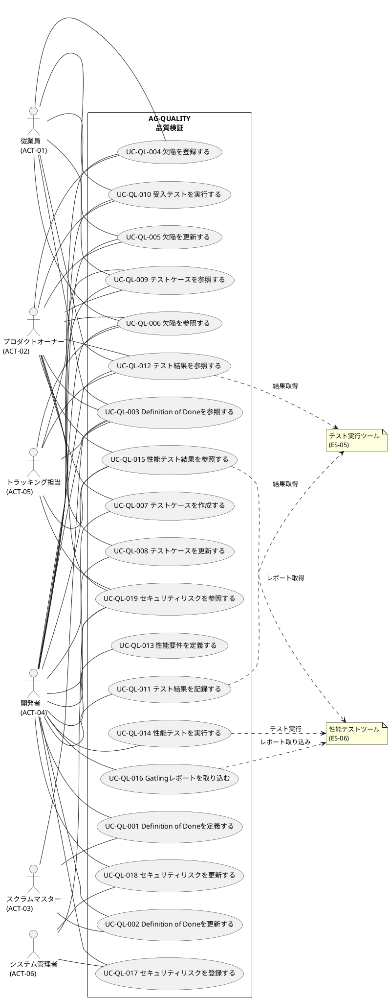

# ユースケース図

プロダクト品質・受入・性能検証業務領域のユースケース図を示します。

## 関連情報

- アクター: 従業員 (ACT-01)、プロダクトオーナー (ACT-02)、スクラムマスター (ACT-03)、開発者 (ACT-04)
  、トラッキング担当 (ACT-05)、システム管理者 (ACT-06)
- 外部システム: テスト実行ツール (ES-05)、性能テストツール (ES-06)
- ユースケース数: 19
