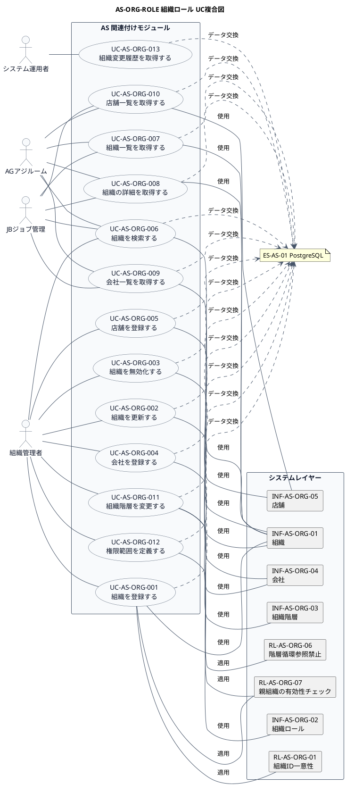

# UC複合図

AS-ORG-ROLE 組織ロール業務領域で扱うユースケース、画面、イベント、情報、条件を関連づけた図です。

## 1. 目的

本書は、AS-ORG-ROLE 組織ロール業務領域のシステム境界レイヤーで扱うユースケース、画面、イベント、情報、条件を関連づけたUC複合図です。

## 2. PlantUML UC複合図

## 3. ユースケース一覧

| ユースケースID | ユースケース名 | 説明 | 関連アクター |
|----------------|----------------|------|--------------|
| UC-AS-ORG-001 | 組織を登録する | 新しい組織・部署を登録する | AC-AS-01 |
| UC-AS-ORG-002 | 組織を更新する | 組織・部署の基本情報を更新する | AC-AS-01 |
| UC-AS-ORG-003 | 組織を無効化する | 組織・部署を廃止する | AC-AS-01 |
| UC-AS-ORG-004 | 会社を登録する | 新しい会社を登録する | AC-AS-01 |
| UC-AS-ORG-005 | 店舗を登録する | 新しい店舗を登録する | AC-AS-01 |
| UC-AS-ORG-006 | 組織を検索する | 条件に合致する組織を検索する | AC-AS-01, AC-AS-03, AC-AS-04 |
| UC-AS-ORG-007 | 組織一覧を取得する | 組織の一覧をページネーションで取得する | AC-AS-01, AC-AS-03, AC-AS-04 |
| UC-AS-ORG-008 | 組織の詳細を取得する | 指定した組織の詳細情報を取得する | AC-AS-01, AC-AS-03, AC-AS-04 |
| UC-AS-ORG-009 | 会社一覧を取得する | 会社の一覧を取得する | AC-AS-01, AC-AS-03, AC-AS-04 |
| UC-AS-ORG-010 | 店舗一覧を取得する | 店舗の一覧を取得する（会社コードフィルタ対応） | AC-AS-01, AC-AS-03, AC-AS-04 |
| UC-AS-ORG-011 | 組織階層を変更する | 組織の階層構造を変更する | AC-AS-01 |
| UC-AS-ORG-012 | 権限範囲を定義する | 組織単位での権限範囲を定義する | AC-AS-01 |
| UC-AS-ORG-013 | 組織変更履歴を取得する | 組織の変更履歴を取得する | AC-AS-01, AC-AS-02 |

## 4. 情報一覧

| 情報ID | 情報名 | 説明 | 関連ユースケース |
|--------|--------|------|------------------|
| INF-AS-ORG-01 | 組織 | 組織・部署の基本情報 | UC-AS-ORG-001〜003, 006〜008 |
| INF-AS-ORG-02 | 組織ロール | 組織に付与される組織ロール | UC-AS-ORG-001, 011 |
| INF-AS-ORG-03 | 組織階層 | 組織の階層構造（親・子関係） | UC-AS-ORG-011 |
| INF-AS-ORG-04 | 会社 | 会社の基本情報 | UC-AS-ORG-004, 009 |
| INF-AS-ORG-05 | 店舗 | 店舗の基本情報 | UC-AS-ORG-005, 010 |

## 5. 条件一覧

| 条件ID | 条件名 | 説明 | 関連ユースケース |
|--------|--------|------|------------------|
| RL-AS-ORG-01 | 組織ID一意性 | 組織IDはシステム内で一意であること | UC-AS-ORG-001 |
| RL-AS-ORG-06 | 階層循環参照禁止 | 組織階層に循環参照がないこと | UC-AS-ORG-011 |
| RL-AS-ORG-07 | 親組織の有効性チェック | 親組織は有効な組織であること | UC-AS-ORG-001, 011 |

## 6. 参照情報

- ユースケース一覧: `03.システム境界/ユースケース一覧.md`
- 情報一覧: `04.システム/01.情報/情報一覧.md`
- 条件一覧: `04.システム/03.条件/条件一覧.tsv`
