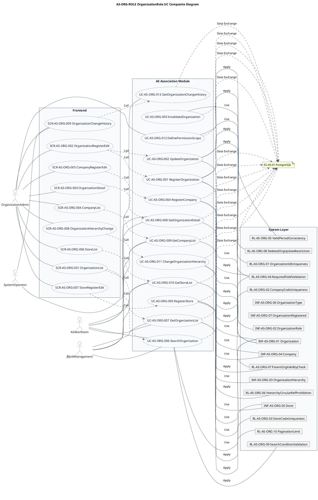
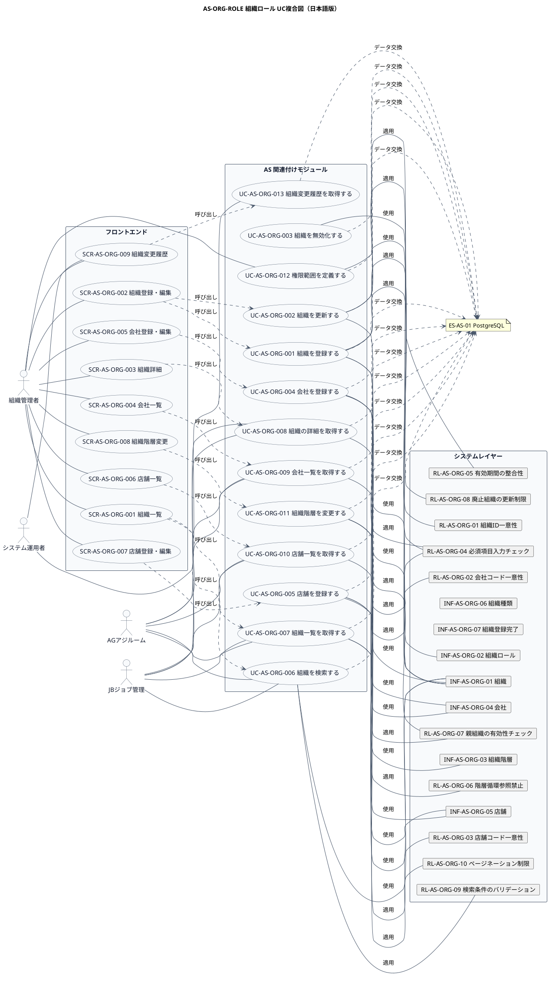

# UC複合図

AS-ORG-ROLE 組織ロール業務領域で扱うユースケース、画面、イベント、情報、条件を関連づけた図です。

## 1. 目的

本書は、AS-ORG-ROLE 組織ロール業務領域のシステム境界レイヤーで扱うユースケース、画面、イベント、情報、条件を関連づけたUC複合図です。

## 2. PlantUML UC複合図（英語版）

## 3. 日本語版 UC複合図

## 4. ユースケース一覧

| ユースケースID | ユースケース名 | 英語名 | 説明 | 関連アクター |
|----------------|----------------|--------|------|--------------|
| UC-AS-ORG-001 | 組織を登録する | RegisterOrganization | 新しい組織・部署を登録する | AC-AS-01 |
| UC-AS-ORG-002 | 組織を更新する | UpdateOrganization | 組織・部署の基本情報を更新する | AC-AS-01 |
| UC-AS-ORG-003 | 組織を無効化する | InvalidateOrganization | 組織・部署を廃止する | AC-AS-01 |
| UC-AS-ORG-004 | 会社を登録する | RegisterCompany | 新しい会社を登録する | AC-AS-01 |
| UC-AS-ORG-005 | 店舗を登録する | RegisterStore | 新しい店舗を登録する | AC-AS-01 |
| UC-AS-ORG-006 | 組織を検索する | SearchOrganization | 条件に合致する組織を検索する | AC-AS-01, AC-AS-03, AC-AS-04 |
| UC-AS-ORG-007 | 組織一覧を取得する | GetOrganizationList | 組織の一覧をページネーションで取得する | AC-AS-01, AC-AS-03, AC-AS-04 |
| UC-AS-ORG-008 | 組織の詳細を取得する | GetOrganizationDetail | 指定した組織の詳細情報を取得する | AC-AS-01, AC-AS-03, AC-AS-04 |
| UC-AS-ORG-009 | 会社一覧を取得する | GetCompanyList | 会社の一覧を取得する | AC-AS-01, AC-AS-03, AC-AS-04 |
| UC-AS-ORG-010 | 店舗一覧を取得する | GetStoreList | 店舗の一覧を取得する（会社コードフィルタ対応） | AC-AS-01, AC-AS-03, AC-AS-04 |
| UC-AS-ORG-011 | 組織階層を変更する | ChangeOrganizationHierarchy | 組織の階層構造を変更する | AC-AS-01 |
| UC-AS-ORG-012 | 権限範囲を定義する | DefinePermissionScope | 組織単位での権限範囲を定義する | AC-AS-01 |
| UC-AS-ORG-013 | 組織変更履歴を取得する | GetOrganizationChangeHistory | 組織の変更履歴を取得する | AC-AS-01, AC-AS-02 |

## 5. 画面一覧

| 画面ID | 画面名 | 英語名 | 説明 | 関連ユースケース |
|--------|--------|--------|------|------------------|
| SCR-AS-ORG-001 | 組織一覧 | OrganizationList | 組織・部署の検索・一覧表示・ページネーション | UC-AS-ORG-006, UC-AS-ORG-007 |
| SCR-AS-ORG-002 | 組織登録・編集 | OrganizationRegisterEdit | 新しい組織・部署の登録と既存組織の情報編集 | UC-AS-ORG-001, UC-AS-ORG-002 |
| SCR-AS-ORG-003 | 組織詳細 | OrganizationDetail | 組織の詳細情報と階層構造の確認 | UC-AS-ORG-008 |
| SCR-AS-ORG-004 | 会社一覧 | CompanyList | 会社の検索・一覧表示 | UC-AS-ORG-009 |
| SCR-AS-ORG-005 | 会社登録・編集 | CompanyRegisterEdit | 新しい会社の登録と既存会社の情報編集 | UC-AS-ORG-004 |
| SCR-AS-ORG-006 | 店舗一覧 | StoreList | 店舗の検索・一覧表示（会社コードフィルタ対応） | UC-AS-ORG-010 |
| SCR-AS-ORG-007 | 店舗登録・編集 | StoreRegisterEdit | 新しい店舗の登録と既存店舗の情報編集 | UC-AS-ORG-005 |
| SCR-AS-ORG-008 | 組織階層変更 | OrganizationHierarchyChange | 組織の階層構造の変更 | UC-AS-ORG-011 |
| SCR-AS-ORG-009 | 組織変更履歴 | OrganizationChangeHistory | 組織の変更履歴の確認 | UC-AS-ORG-013 |

## 6. イベント一覧

| イベントID | イベント名 | 英語名 | 説明 | 関連ユースケース |
|------------|------------|--------|------|------------------|
| EVT-AS-ORG-001 | 組織登録完了 | OrganizationRegistered | 新しい組織が登録されたとき | UC-AS-ORG-001 |
| EVT-AS-ORG-002 | 組織更新完了 | OrganizationUpdated | 組織の基本情報が更新されたとき | UC-AS-ORG-002 |
| EVT-AS-ORG-003 | 組織廃止完了 | OrganizationDeleted | 組織が廃止されたとき | UC-AS-ORG-003 |
| EVT-AS-ORG-004 | 会社登録完了 | CompanyRegistered | 新しい会社が登録されたとき | UC-AS-ORG-004 |
| EVT-AS-ORG-005 | 店舗登録完了 | StoreRegistered | 新しい店舗が登録されたとき | UC-AS-ORG-005 |
| EVT-AS-ORG-006 | 組織階層変更完了 | OrganizationHierarchyChanged | 組織の階層構造が変更されたとき | UC-AS-ORG-011 |
| EVT-AS-ORG-007 | 権限範囲定義完了 | PermissionScopeDefined | 組織の権限範囲が定義されたとき | UC-AS-ORG-012 |

## 7. 情報一覧

| 情報ID | 情報名 | 英語名 | 説明 | 関連ユースケース |
|--------|--------|--------|------|------------------|
| INF-AS-ORG-01 | 組織 | Organization | 組織・部署の基本情報 | UC-AS-ORG-001〜003, 006〜008 |
| INF-AS-ORG-02 | 組織ロール | OrganizationRole | 組織に付与される組織ロール | UC-AS-ORG-001, 011 |
| INF-AS-ORG-03 | 組織階層 | OrganizationHierarchy | 組織の階層構造（親・子関係） | UC-AS-ORG-011 |
| INF-AS-ORG-04 | 会社 | Company | 会社の基本情報 | UC-AS-ORG-004, 009 |
| INF-AS-ORG-05 | 店舗 | Store | 店舗の基本情報 | UC-AS-ORG-005, 010 |
| INF-AS-ORG-06 | 組織種類 | OrganizationType | 組織の種類（会社、部署、店舗など） | UC-AS-ORG-001, 004, 005 |
| INF-AS-ORG-07 | 組織登録完了 | OrganizationRegistered | 組織が登録されたことを示すイベント | UC-AS-ORG-001, 004, 005 |

## 8. 条件一覧

| 条件ID | 条件名 | 英語名 | 説明 | 関連ユースケース |
|--------|--------|--------|------|------------------|
| RL-AS-ORG-01 | 組織ID一意性 | OrganizationIdUniqueness | 組織IDはシステム内で一意であること | UC-AS-ORG-001 |
| RL-AS-ORG-02 | 会社コード一意性 | CompanyCodeUniqueness | 会社コードは重複できないこと | UC-AS-ORG-004 |
| RL-AS-ORG-03 | 店舗コード一意性 | StoreCodeUniqueness | 店舗コードは会社内で一意であること | UC-AS-ORG-005 |
| RL-AS-ORG-04 | 必須項目入力チェック | RequiredFieldValidation | 登録時に必須項目が入力されていること | UC-AS-ORG-001, 004, 005 |
| RL-AS-ORG-05 | 有効期間の整合性 | ValidPeriodConsistency | 有効開始日 ≤ 有効終了日であること | UC-AS-ORG-001, 002 |
| RL-AS-ORG-06 | 階層循環参照禁止 | HierarchyCircularRefProhibition | 組織階層に循環参照がないこと | UC-AS-ORG-011 |
| RL-AS-ORG-07 | 親組織の有効性チェック | ParentOrgValidityCheck | 親組織は有効な組織であること | UC-AS-ORG-001, 011 |
| RL-AS-ORG-08 | 廃止組織の更新制限 | DeletedOrgUpdateRestriction | 廃止された組織は更新できないこと | UC-AS-ORG-002 |
| RL-AS-ORG-09 | 検索条件のバリデーション | SearchConditionValidation | 検索条件は有効な値であること | UC-AS-ORG-006 |
| RL-AS-ORG-10 | ページネーション制限 | PaginationLimit | 一覧取得のページサイズは1〜100件の範囲であること | UC-AS-ORG-007 |

## 9. 参照情報

- ユースケース一覧: `03.システム境界/ユースケース一覧.md`
- 画面一覧: `04.システム/04.画面/画面一覧.md`
- イベント一覧: `../05 実装準備/イベント一覧.tsv`
- 情報一覧: `04.システム/01.情報/情報一覧.md`
- 条件一覧: `04.システム/03.条件/条件一覧.tsv`
