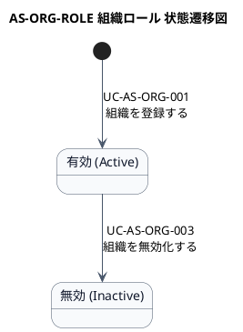

# ステートマシン図

AS-ORG-ROLE 組織ロール業務領域で扱う情報の状態遷移を示す状態モデル図です。

## 1. 目的

本書は、AS-ORG-ROLE 組織ロール業務領域のシステムレイヤーで扱う情報の状態遷移を示す状態モデル図（ステートマシン図）です。

## 2. PlantUML 状態遷移図

## 3. 状態一覧

| 状態名 (ID) | 英語名 | 説明 |
|-------------|--------|------|
| 有効 (ST-AS-ORG-001) | Active | 組織が有効な状態 |
| 無効 (ST-AS-ORG-002) | Inactive | 組織が無効化された状態（廃止） |

## 4. 遷移一覧

| 遷移ID | 元状態 | 遷移先状態 | トリガー | 関連ユースケース | 説明 |
|--------|--------|------------|----------|------------------|------|
| TR-AS-ORG-01 | [*] | 有効 | 組織登録 | UC-AS-ORG-001 | 新しい組織を登録すると有効状態になる |
| TR-AS-ORG-02 | 有効 | 無効 | 組織廃止 | UC-AS-ORG-003 | 組織を廃止すると無効状態になる |

## 5. 参照情報

- ステート一覧: `04.システム/02.ステート/ステート一覧.tsv`
- 関連ユースケース: `03.システム境界/ユースケース一覧.md`
