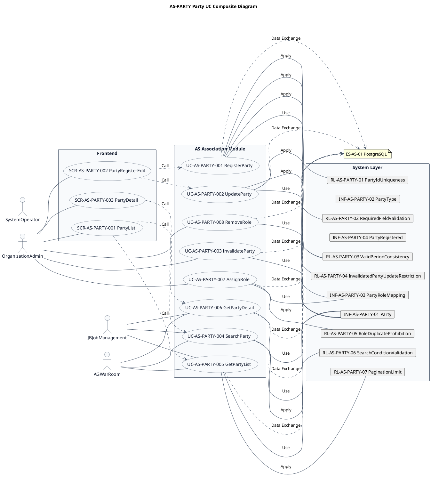
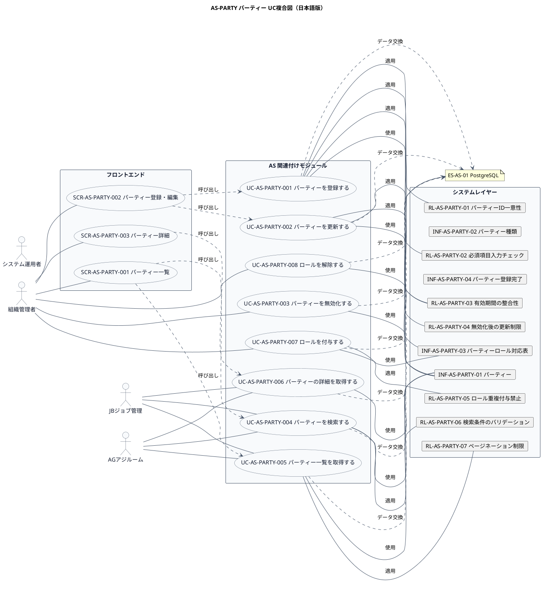

# UC複合図

AS-PARTY パーティー業務領域で扱うユースケース、画面、イベント、情報、条件を関連づけた図です。

## 1. 目的

本書は、AS-PARTY パーティー業務領域のシステム境界レイヤーで扱うユースケース、画面、イベント、情報、条件を関連づけたUC複合図です。

## 2. PlantUML UC複合図（英語版）

## 3. 日本語版 UC複合図

## 4. ユースケース一覧

| ユースケースID | ユースケース名 | 英語名 | 説明 | 関連アクター |
|----------------|----------------|--------|------|--------------|
| UC-AS-PARTY-001 | パーティーを登録する | RegisterParty | 新しい実体(Party)を登録する | AC-AS-01 |
| UC-AS-PARTY-002 | パーティーを更新する | UpdateParty | パーティーの基本情報を更新する | AC-AS-01 |
| UC-AS-PARTY-003 | パーティーを無効化する | InvalidateParty | パーティーを無効化する | AC-AS-01 |
| UC-AS-PARTY-004 | パーティーを検索する | SearchParty | 条件に合致するパーティーを検索する | AC-AS-01, AC-AS-03, AC-AS-04 |
| UC-AS-PARTY-005 | パーティー一覧を取得する | GetPartyList | パーティーの一覧をページネーションで取得する | AC-AS-01, AC-AS-03, AC-AS-04 |
| UC-AS-PARTY-006 | パーティーの詳細を取得する | GetPartyDetail | 指定したパーティーの詳細情報を取得する | AC-AS-01, AC-AS-03, AC-AS-04 |
| UC-AS-PARTY-007 | ロールを付与する | AssignRole | パーティーにロールを付与する | AC-AS-01 |
| UC-AS-PARTY-008 | ロールを解除する | RemoveRole | パーティーからロールを解除する | AC-AS-01 |

## 5. 画面一覧

| 画面ID | 画面名 | 英語名 | 説明 | 関連ユースケース |
|--------|--------|--------|------|------------------|
| SCR-AS-PARTY-001 | パーティー一覧 | PartyList | パーティーの検索・一覧表示・ページネーション | UC-AS-PARTY-004, UC-AS-PARTY-005 |
| SCR-AS-PARTY-002 | パーティー登録・編集 | PartyRegisterEdit | 新しいパーティーの登録と既存パーティーの情報編集 | UC-AS-PARTY-001, UC-AS-PARTY-002 |
| SCR-AS-PARTY-003 | パーティー詳細 | PartyDetail | パーティーの詳細情報と関連ロールの確認 | UC-AS-PARTY-006 |

## 6. イベント一覧

| イベントID | イベント名 | 英語名 | 説明 | 関連ユースケース |
|------------|------------|--------|------|------------------|
| EVT-AS-PARTY-001 | パーティー登録完了 | PartyRegistered | 新しいPartyが登録されたとき | UC-AS-PARTY-001 |
| EVT-AS-PARTY-002 | パーティー更新完了 | PartyUpdated | Partyの基本情報が更新されたとき | UC-AS-PARTY-002 |
| EVT-AS-PARTY-003 | パーティー無効化完了 | PartyInvalidated | Partyが無効化されたとき | UC-AS-PARTY-003 |
| EVT-AS-PARTY-004 | ロール付与完了 | RoleAssigned | Partyにロールが付与されたとき | UC-AS-PARTY-007 |
| EVT-AS-PARTY-005 | ロール解除完了 | RoleRemoved | Partyからロールが解除されたとき | UC-AS-PARTY-008 |

## 7. 情報一覧

| 情報ID | 情報名 | 英語名 | 説明 | 関連ユースケース |
|--------|--------|--------|------|------------------|
| INF-AS-PARTY-01 | パーティー | Party | 組織・人・会社・店舗などの実体を抽象化した基本情報 | UC-AS-PARTY-001〜006 |
| INF-AS-PARTY-02 | パーティー種類 | PartyType | パーティーの種類（個人、法人、組織など） | UC-AS-PARTY-001 |
| INF-AS-PARTY-03 | パーティーロール対応表 | PartyRoleMapping | パーティーとロールの対応関係 | UC-AS-PARTY-007, 008 |
| INF-AS-PARTY-04 | パーティー登録完了 | PartyRegistered | パーティーが登録されたことを示すイベント | UC-AS-PARTY-001 |

## 8. 条件一覧

| 条件ID | 条件名 | 英語名 | 説明 | 関連ユースケース |
|--------|--------|--------|------|------------------|
| RL-AS-PARTY-01 | パーティーID一意性 | PartyIdUniqueness | パーティーIDはシステム内で一意であること | UC-AS-PARTY-001 |
| RL-AS-PARTY-02 | 必須項目入力チェック | RequiredFieldValidation | 登録時に必須項目が入力されていること | UC-AS-PARTY-001 |
| RL-AS-PARTY-03 | 有効期間の整合性 | ValidPeriodConsistency | 有効開始日 ≤ 有効終了日であること | UC-AS-PARTY-001, 002 |
| RL-AS-PARTY-04 | 無効化後の更新制限 | InvalidatedPartyUpdateRestriction | 無効化されたパーティーは更新できないこと | UC-AS-PARTY-002 |
| RL-AS-PARTY-05 | ロール重複付与禁止 | RoleDuplicateProhibition | 同じロールを重複して付与できないこと | UC-AS-PARTY-007 |
| RL-AS-PARTY-06 | 検索条件のバリデーション | SearchConditionValidation | 検索条件は有効な値であること | UC-AS-PARTY-004 |
| RL-AS-PARTY-07 | ページネーション制限 | PaginationLimit | 一覧取得のページサイズは1〜100件の範囲であること | UC-AS-PARTY-005 |

## 9. 参照情報

- ユースケース一覧: `03.システム境界/ユースケース一覧.md`
- 画面一覧: `04.システム/04.画面/画面一覧.md`
- イベント一覧: `../05 実装準備/イベント一覧.tsv`
- 情報一覧: `04.システム/01.情報/情報一覧.md`
- 条件一覧: `04.システム/03.条件/条件一覧.tsv`
