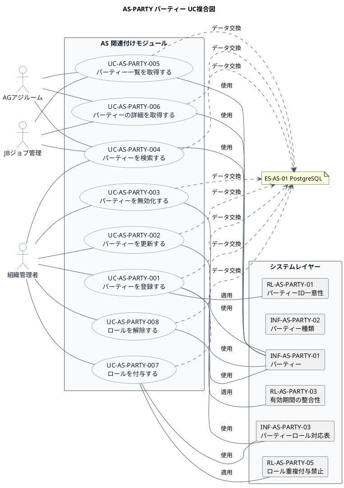

# UC複合図

AS-PARTY パーティー業務領域で扱うユースケース、画面、イベント、情報、条件を関連づけた図です。

## 1. 目的

本書は、AS-PARTY パーティー業務領域のシステム境界レイヤーで扱うユースケース、画面、イベント、情報、条件を関連づけたUC複合図です。

## 2. PlantUML UC複合図

## 3. ユースケース一覧

| ユースケースID | ユースケース名 | 説明 | 関連アクター |
|----------------|----------------|------|--------------|
| UC-AS-PARTY-001 | パーティーを登録する | 新しい実体(Party)を登録する | AC-AS-01 |
| UC-AS-PARTY-002 | パーティーを更新する | パーティーの基本情報を更新する | AC-AS-01 |
| UC-AS-PARTY-003 | パーティーを無効化する | パーティーを無効化する | AC-AS-01 |
| UC-AS-PARTY-004 | パーティーを検索する | 条件に合致するパーティーを検索する | AC-AS-01, AC-AS-03, AC-AS-04 |
| UC-AS-PARTY-005 | パーティー一覧を取得する | パーティーの一覧をページネーションで取得する | AC-AS-01, AC-AS-03, AC-AS-04 |
| UC-AS-PARTY-006 | パーティーの詳細を取得する | 指定したパーティーの詳細情報を取得する | AC-AS-01, AC-AS-03, AC-AS-04 |
| UC-AS-PARTY-007 | ロールを付与する | パーティーにロールを付与する | AC-AS-01 |
| UC-AS-PARTY-008 | ロールを解除する | パーティーからロールを解除する | AC-AS-01 |

## 4. 情報一覧

| 情報ID | 情報名 | 説明 | 関連ユースケース |
|--------|--------|------|------------------|
| INF-AS-PARTY-01 | パーティー | 組織・人・会社・店舗などの実体を抽象化した基本情報 | UC-AS-PARTY-001〜006 |
| INF-AS-PARTY-02 | パーティー種類 | パーティーの種類（個人、法人、組織など） | UC-AS-PARTY-001 |
| INF-AS-PARTY-03 | パーティーロール対応表 | パーティーとロールの対応関係 | UC-AS-PARTY-007, 008 |

## 5. 条件一覧

| 条件ID | 条件名 | 説明 | 関連ユースケース |
|--------|--------|------|------------------|
| RL-AS-PARTY-01 | パーティーID一意性 | パーティーIDはシステム内で一意であること | UC-AS-PARTY-001 |
| RL-AS-PARTY-03 | 有効期間の整合性 | 有効開始日 ≤ 有効終了日であること | UC-AS-PARTY-001, 002 |
| RL-AS-PARTY-05 | ロール重複付与禁止 | 同じロールを重複して付与できないこと | UC-AS-PARTY-007 |

## 6. 参照情報

- ユースケース一覧: `03.システム境界/ユースケース一覧.md`
- 情報一覧: `04.システム/01.情報/情報一覧.md`
- 条件一覧: `04.システム/03.条件/条件一覧.tsv`
