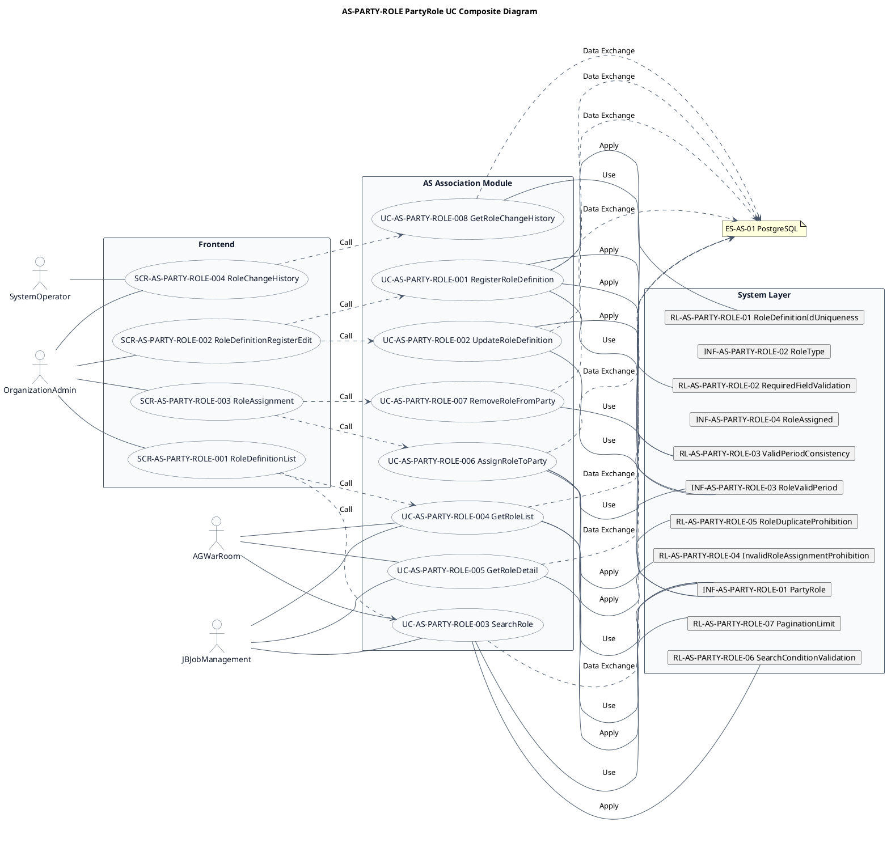
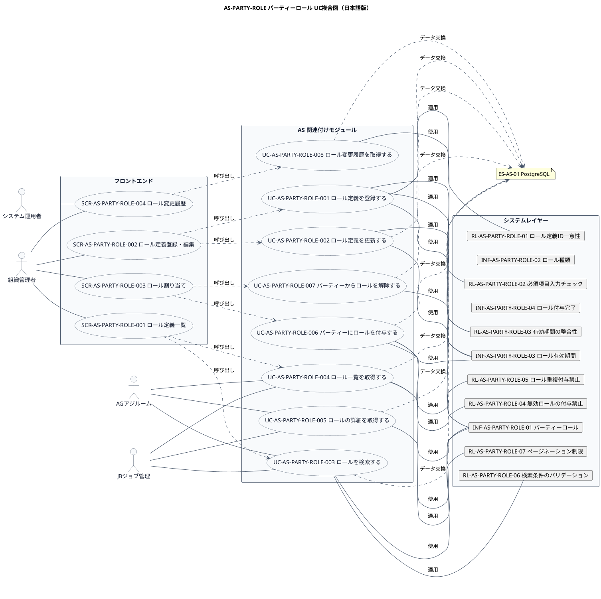

# UC複合図

AS-PARTY-ROLE パーティーロール業務領域で扱うユースケース、画面、イベント、情報、条件を関連づけた図です。

## 1. 目的

本書は、AS-PARTY-ROLE パーティーロール業務領域のシステム境界レイヤーで扱うユースケース、画面、イベント、情報、条件を関連づけたUC複合図です。

## 2. PlantUML UC複合図（英語版）

## 3. 日本語版 UC複合図

## 4. ユースケース一覧

| ユースケースID | ユースケース名 | 英語名 | 説明 | 関連アクター |
|----------------|----------------|--------|------|--------------|
| UC-AS-PARTY-ROLE-001 | ロール定義を登録する | RegisterRoleDefinition | 新しいロール定義を登録する | AC-AS-01 |
| UC-AS-PARTY-ROLE-002 | ロール定義を更新する | UpdateRoleDefinition | ロール定義を更新する | AC-AS-01 |
| UC-AS-PARTY-ROLE-003 | ロールを検索する | SearchRole | 条件に合致するロールを検索する | AC-AS-01, AC-AS-03, AC-AS-04 |
| UC-AS-PARTY-ROLE-004 | ロール一覧を取得する | GetRoleList | ロールの一覧をページネーションで取得する | AC-AS-01, AC-AS-03, AC-AS-04 |
| UC-AS-PARTY-ROLE-005 | ロールの詳細を取得する | GetRoleDetail | 指定したロールの詳細情報を取得する | AC-AS-01, AC-AS-03, AC-AS-04 |
| UC-AS-PARTY-ROLE-006 | パーティーにロールを付与する | AssignRoleToParty | パーティーにロールを付与する | AC-AS-01 |
| UC-AS-PARTY-ROLE-007 | パーティーからロールを解除する | RemoveRoleFromParty | パーティーからロールを解除する | AC-AS-01 |
| UC-AS-PARTY-ROLE-008 | ロール変更履歴を取得する | GetRoleChangeHistory | ロールの有効期間変更履歴を取得する | AC-AS-01, AC-AS-02 |

## 5. 画面一覧

| 画面ID | 画面名 | 英語名 | 説明 | 関連ユースケース |
|--------|--------|--------|------|------------------|
| SCR-AS-PARTY-ROLE-001 | ロール定義一覧 | RoleDefinitionList | ロール定義の検索・一覧表示・ページネーション | UC-AS-PARTY-ROLE-003, UC-AS-PARTY-ROLE-004 |
| SCR-AS-PARTY-ROLE-002 | ロール定義登録・編集 | RoleDefinitionRegisterEdit | 新しいロール定義の登録と既存ロール定義の情報編集 | UC-AS-PARTY-ROLE-001, UC-AS-PARTY-ROLE-002 |
| SCR-AS-PARTY-ROLE-003 | ロール割り当て | RoleAssignment | パーティーへのロール付与・解除 | UC-AS-PARTY-ROLE-006, UC-AS-PARTY-ROLE-007 |
| SCR-AS-PARTY-ROLE-004 | ロール変更履歴 | RoleChangeHistory | ロールの変更履歴の確認 | UC-AS-PARTY-ROLE-008 |

## 6. イベント一覧

| イベントID | イベント名 | 英語名 | 説明 | 関連ユースケース |
|------------|------------|--------|------|------------------|
| EVT-AS-PARTY-ROLE-001 | ロール定義登録完了 | RoleDefinitionRegistered | 新しいロール定義が登録されたとき | UC-AS-PARTY-ROLE-001 |
| EVT-AS-PARTY-ROLE-002 | ロール定義更新完了 | RoleDefinitionUpdated | ロール定義が更新されたとき | UC-AS-PARTY-ROLE-002 |
| EVT-AS-PARTY-ROLE-003 | パーティーロール付与完了 | PartyRoleAssigned | パーティーにロールが付与されたとき | UC-AS-PARTY-ROLE-006 |
| EVT-AS-PARTY-ROLE-004 | パーティーロール解除完了 | PartyRoleRemoved | パーティーからロールが解除されたとき | UC-AS-PARTY-ROLE-007 |

## 7. 情報一覧

| 情報ID | 情報名 | 英語名 | 説明 | 関連ユースケース |
|--------|--------|--------|------|------------------|
| INF-AS-PARTY-ROLE-01 | パーティーロール | PartyRole | パーティーに付与されるロールの定義 | UC-AS-PARTY-ROLE-001〜005 |
| INF-AS-PARTY-ROLE-02 | ロール種類 | RoleType | ロールの種類（人ロール、組織ロールなど） | UC-AS-PARTY-ROLE-001 |
| INF-AS-PARTY-ROLE-03 | ロール有効期間 | RoleValidPeriod | ロールの有効期間管理 | UC-AS-PARTY-ROLE-006〜008 |
| INF-AS-PARTY-ROLE-04 | ロール付与完了 | RoleAssigned | ロールが付与されたことを示すイベント | UC-AS-PARTY-ROLE-006 |

## 8. 条件一覧

| 条件ID | 条件名 | 英語名 | 説明 | 関連ユースケース |
|--------|--------|--------|------|------------------|
| RL-AS-PARTY-ROLE-01 | ロール定義ID一意性 | RoleDefinitionIdUniqueness | ロール定義IDはシステム内で一意であること | UC-AS-PARTY-ROLE-001 |
| RL-AS-PARTY-ROLE-02 | 必須項目入力チェック | RequiredFieldValidation | 登録時に必須項目が入力されていること | UC-AS-PARTY-ROLE-001 |
| RL-AS-PARTY-ROLE-03 | 有効期間の整合性 | ValidPeriodConsistency | 有効開始日 ≤ 有効終了日であること | UC-AS-PARTY-ROLE-001, 002 |
| RL-AS-PARTY-ROLE-04 | 無効ロールの付与禁止 | InvalidRoleAssignmentProhibition | 無効化されたロールは付与できないこと | UC-AS-PARTY-ROLE-006 |
| RL-AS-PARTY-ROLE-05 | ロール重複付与禁止 | RoleDuplicateProhibition | 同じロールを重複して付与できないこと | UC-AS-PARTY-ROLE-006 |
| RL-AS-PARTY-ROLE-06 | 検索条件のバリデーション | SearchConditionValidation | 検索条件は有効な値であること | UC-AS-PARTY-ROLE-003 |
| RL-AS-PARTY-ROLE-07 | ページネーション制限 | PaginationLimit | 一覧取得のページサイズは1〜100件の範囲であること | UC-AS-PARTY-ROLE-004 |

## 9. 参照情報

- ユースケース一覧: `03.システム境界/ユースケース一覧.md`
- 画面一覧: `04.システム/04.画面/画面一覧.md`
- イベント一覧: `../05 実装準備/イベント一覧.tsv`
- 情報一覧: `04.システム/01.情報/情報一覧.md`
- 条件一覧: `04.システム/03.条件/条件一覧.tsv`
