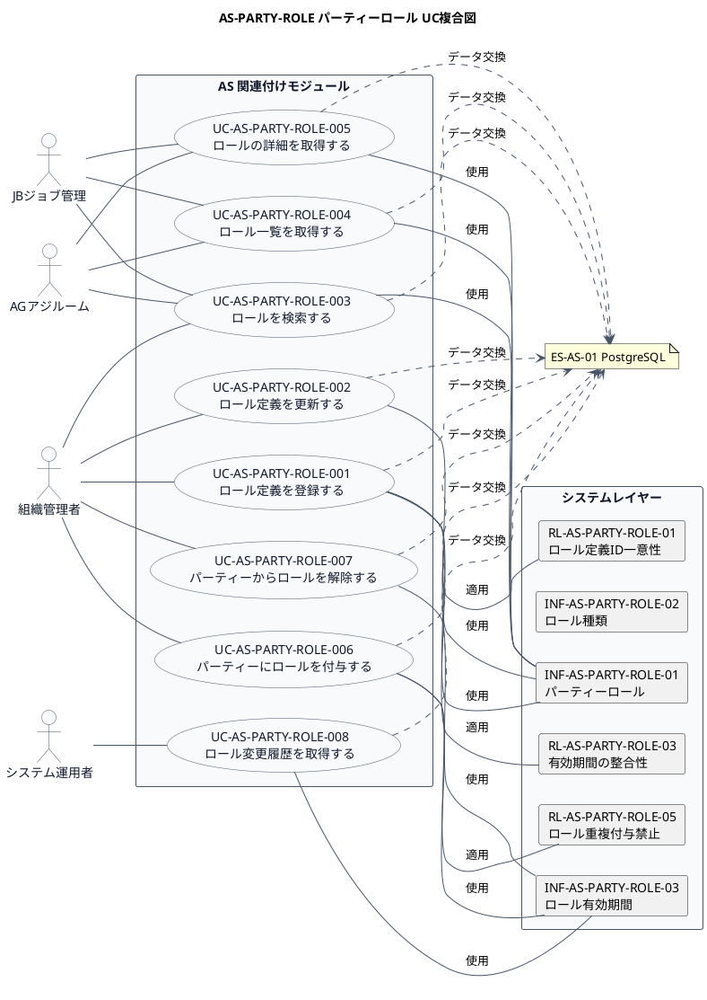

# UC複合図

AS-PARTY-ROLE パーティーロール業務領域で扱うユースケース、画面、イベント、情報、条件を関連づけた図です。

## 1. 目的

本書は、AS-PARTY-ROLE パーティーロール業務領域のシステム境界レイヤーで扱うユースケース、画面、イベント、情報、条件を関連づけたUC複合図です。

## 2. PlantUML UC複合図

## 3. ユースケース一覧

| ユースケースID | ユースケース名 | 説明 | 関連アクター |
|----------------|----------------|------|--------------|
| UC-AS-PARTY-ROLE-001 | ロール定義を登録する | 新しいロール定義を登録する | AC-AS-01 |
| UC-AS-PARTY-ROLE-002 | ロール定義を更新する | ロール定義を更新する | AC-AS-01 |
| UC-AS-PARTY-ROLE-003 | ロールを検索する | 条件に合致するロールを検索する | AC-AS-01, AC-AS-03, AC-AS-04 |
| UC-AS-PARTY-ROLE-004 | ロール一覧を取得する | ロールの一覧をページネーションで取得する | AC-AS-01, AC-AS-03, AC-AS-04 |
| UC-AS-PARTY-ROLE-005 | ロールの詳細を取得する | 指定したロールの詳細情報を取得する | AC-AS-01, AC-AS-03, AC-AS-04 |
| UC-AS-PARTY-ROLE-006 | パーティーにロールを付与する | パーティーにロールを付与する | AC-AS-01 |
| UC-AS-PARTY-ROLE-007 | パーティーからロールを解除する | パーティーからロールを解除する | AC-AS-01 |
| UC-AS-PARTY-ROLE-008 | ロール変更履歴を取得する | ロールの有効期間変更履歴を取得する | AC-AS-01, AC-AS-02 |

## 4. 情報一覧

| 情報ID | 情報名 | 説明 | 関連ユースケース |
|--------|--------|------|------------------|
| INF-AS-PARTY-ROLE-01 | パーティーロール | パーティーに付与されるロールの定義 | UC-AS-PARTY-ROLE-001〜005 |
| INF-AS-PARTY-ROLE-02 | ロール種類 | ロールの種類（人ロール、組織ロールなど） | UC-AS-PARTY-ROLE-001 |
| INF-AS-PARTY-ROLE-03 | ロール有効期間 | ロールの有効期間管理 | UC-AS-PARTY-ROLE-006〜008 |

## 5. 条件一覧

| 条件ID | 条件名 | 説明 | 関連ユースケース |
|--------|--------|------|------------------|
| RL-AS-PARTY-ROLE-01 | ロール定義ID一意性 | ロール定義IDはシステム内で一意であること | UC-AS-PARTY-ROLE-001 |
| RL-AS-PARTY-ROLE-03 | 有効期間の整合性 | 有効開始日 ≤ 有効終了日であること | UC-AS-PARTY-ROLE-001, 002 |
| RL-AS-PARTY-ROLE-05 | ロール重複付与禁止 | 同じロールを重複して付与できないこと | UC-AS-PARTY-ROLE-006 |

## 6. 参照情報

- ユースケース一覧: `03.システム境界/ユースケース一覧.md`
- 情報一覧: `04.システム/01.情報/情報一覧.md`
- 条件一覧: `04.システム/03.条件/条件一覧.tsv`
