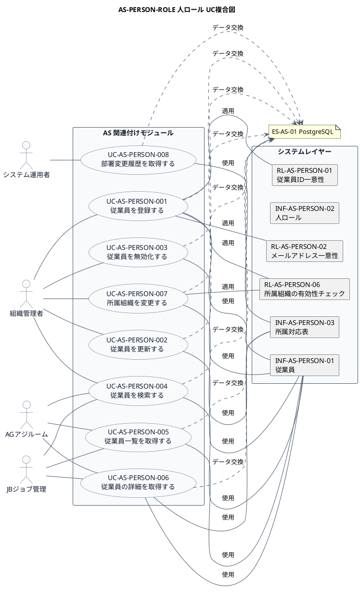

# UC複合図

AS-PERSON-ROLE 人ロール業務領域で扱うユースケース、画面、イベント、情報、条件を関連づけた図です。

## 1. 目的

本書は、AS-PERSON-ROLE 人ロール業務領域のシステム境界レイヤーで扱うユースケース、画面、イベント、情報、条件を関連づけたUC複合図です。

## 2. PlantUML UC複合図

## 3. ユースケース一覧

| ユースケースID | ユースケース名 | 説明 | 関連アクター |
|----------------|----------------|------|--------------|
| UC-AS-PERSON-001 | 従業員を登録する | 新しい従業員を登録する（PartyとPersonRoleを自動作成） | AC-AS-01 |
| UC-AS-PERSON-002 | 従業員を更新する | 従業員の基本情報を更新する | AC-AS-01 |
| UC-AS-PERSON-003 | 従業員を無効化する | 従業員を退社処理する | AC-AS-01 |
| UC-AS-PERSON-004 | 従業員を検索する | 条件に合致する従業員を検索する | AC-AS-01, AC-AS-03, AC-AS-04 |
| UC-AS-PERSON-005 | 従業員一覧を取得する | 従業員の一覧をページネーションで取得する | AC-AS-01, AC-AS-03, AC-AS-04 |
| UC-AS-PERSON-006 | 従業員の詳細を取得する | 指定した従業員の詳細情報を取得する（所属情報を含む） | AC-AS-01, AC-AS-03, AC-AS-04 |
| UC-AS-PERSON-007 | 所属組織を変更する | 従業員の所属組織・部署を変更する | AC-AS-01 |
| UC-AS-PERSON-008 | 部署変更履歴を取得する | 従業員の部署変更履歴を取得する | AC-AS-01, AC-AS-02 |

## 4. 情報一覧

| 情報ID | 情報名 | 説明 | 関連ユースケース |
|--------|--------|------|------------------|
| INF-AS-PERSON-01 | 従業員 | 個人（従業員）の基本情報 | UC-AS-PERSON-001〜006 |
| INF-AS-PERSON-02 | 人ロール | 従業員に付与される人ロール | UC-AS-PERSON-001, 007 |
| INF-AS-PERSON-03 | 所属対応表 | 従業員と組織・部署の所属関係 | UC-AS-PERSON-006〜008 |

## 5. 条件一覧

| 条件ID | 条件名 | 説明 | 関連ユースケース |
|--------|--------|------|------------------|
| RL-AS-PERSON-01 | 従業員ID一意性 | 従業員IDはシステム内で一意であること | UC-AS-PERSON-001 |
| RL-AS-PERSON-02 | メールアドレス一意性 | メールアドレスは重複できないこと | UC-AS-PERSON-001, 002 |
| RL-AS-PERSON-06 | 所属組織の有効性チェック | 所属組織は有効な組織であること | UC-AS-PERSON-001, 007 |

## 6. 参照情報

- ユースケース一覧: `03.システム境界/ユースケース一覧.md`
- 情報一覧: `04.システム/01.情報/情報一覧.md`
- 条件一覧: `04.システム/03.条件/条件一覧.tsv`
