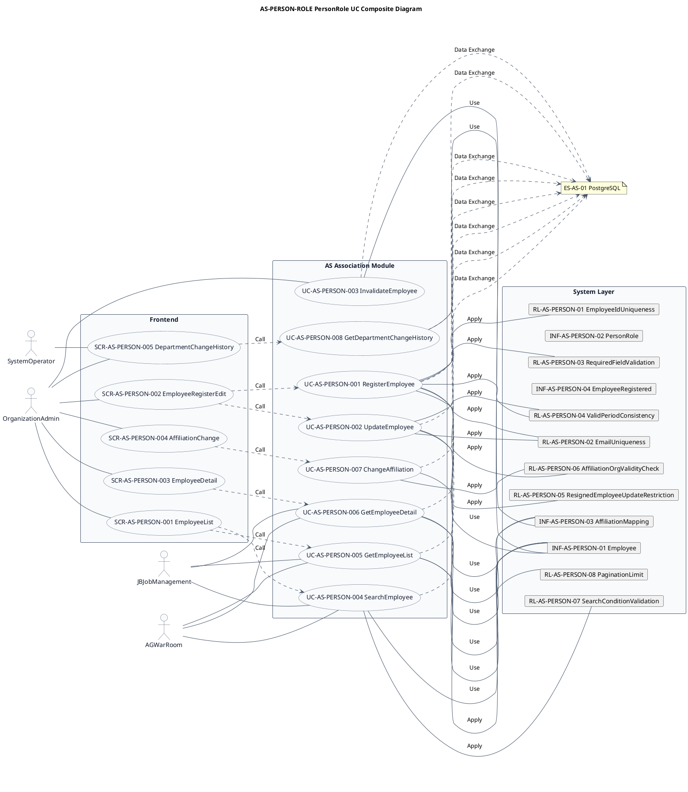
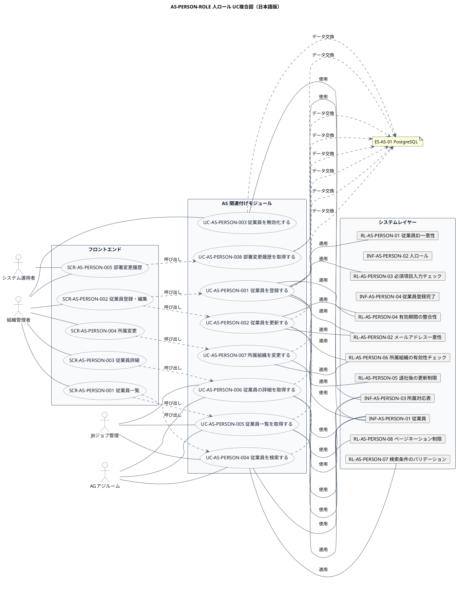

# UC複合図

AS-PERSON-ROLE 人ロール業務領域で扱うユースケース、画面、イベント、情報、条件を関連づけた図です。

## 1. 目的

本書は、AS-PERSON-ROLE 人ロール業務領域のシステム境界レイヤーで扱うユースケース、画面、イベント、情報、条件を関連づけたUC複合図です。

## 2. PlantUML UC複合図（英語版）

## 3. 日本語版 UC複合図

## 4. ユースケース一覧

| ユースケースID | ユースケース名 | 英語名 | 説明 | 関連アクター |
|----------------|----------------|--------|------|--------------|
| UC-AS-PERSON-001 | 従業員を登録する | RegisterEmployee | 新しい従業員を登録する（PartyとPersonRoleを自動作成） | AC-AS-01 |
| UC-AS-PERSON-002 | 従業員を更新する | UpdateEmployee | 従業員の基本情報を更新する | AC-AS-01 |
| UC-AS-PERSON-003 | 従業員を無効化する | InvalidateEmployee | 従業員を退社処理する | AC-AS-01 |
| UC-AS-PERSON-004 | 従業員を検索する | SearchEmployee | 条件に合致する従業員を検索する | AC-AS-01, AC-AS-03, AC-AS-04 |
| UC-AS-PERSON-005 | 従業員一覧を取得する | GetEmployeeList | 従業員の一覧をページネーションで取得する | AC-AS-01, AC-AS-03, AC-AS-04 |
| UC-AS-PERSON-006 | 従業員の詳細を取得する | GetEmployeeDetail | 指定した従業員の詳細情報を取得する（所属情報を含む） | AC-AS-01, AC-AS-03, AC-AS-04 |
| UC-AS-PERSON-007 | 所属組織を変更する | ChangeAffiliation | 従業員の所属組織・部署を変更する | AC-AS-01 |
| UC-AS-PERSON-008 | 部署変更履歴を取得する | GetDepartmentChangeHistory | 従業員の部署変更履歴を取得する | AC-AS-01, AC-AS-02 |

## 5. 画面一覧

| 画面ID | 画面名 | 英語名 | 説明 | 関連ユースケース |
|--------|--------|--------|------|------------------|
| SCR-AS-PERSON-001 | 従業員一覧 | EmployeeList | 従業員の検索・一覧表示・ページネーション | UC-AS-PERSON-004, UC-AS-PERSON-005 |
| SCR-AS-PERSON-002 | 従業員登録・編集 | EmployeeRegisterEdit | 新しい従業員の登録と既存従業員の情報編集 | UC-AS-PERSON-001, UC-AS-PERSON-002 |
| SCR-AS-PERSON-003 | 従業員詳細 | EmployeeDetail | 従業員の詳細情報と所属組織の確認 | UC-AS-PERSON-006 |
| SCR-AS-PERSON-004 | 所属変更 | AffiliationChange | 従業員の所属組織・部署の変更 | UC-AS-PERSON-007 |
| SCR-AS-PERSON-005 | 部署変更履歴 | DepartmentChangeHistory | 従業員の部署変更履歴の確認 | UC-AS-PERSON-008 |

## 6. イベント一覧

| イベントID | イベント名 | 英語名 | 説明 | 関連ユースケース |
|------------|------------|--------|------|------------------|
| EVT-AS-PERSON-001 | 従業員登録完了 | EmployeeRegistered | 新しい従業員が登録されたとき | UC-AS-PERSON-001 |
| EVT-AS-PERSON-002 | 従業員更新完了 | EmployeeUpdated | 従業員の基本情報が更新されたとき | UC-AS-PERSON-002 |
| EVT-AS-PERSON-003 | 従業員退社完了 | EmployeeResigned | 従業員が退社処理されたとき | UC-AS-PERSON-003 |
| EVT-AS-PERSON-004 | 所属組織変更完了 | AffiliationChanged | 従業員の所属組織が変更されたとき | UC-AS-PERSON-007 |

## 7. 情報一覧

| 情報ID | 情報名 | 英語名 | 説明 | 関連ユースケース |
|--------|--------|--------|------|------------------|
| INF-AS-PERSON-01 | 従業員 | Employee | 個人（従業員）の基本情報 | UC-AS-PERSON-001〜006 |
| INF-AS-PERSON-02 | 人ロール | PersonRole | 従業員に付与される人ロール | UC-AS-PERSON-001, 007 |
| INF-AS-PERSON-03 | 所属対応表 | AffiliationMapping | 従業員と組織・部署の所属関係 | UC-AS-PERSON-006〜008 |
| INF-AS-PERSON-04 | 従業員登録完了 | EmployeeRegistered | 従業員が登録されたことを示すイベント | UC-AS-PERSON-001 |

## 8. 条件一覧

| 条件ID | 条件名 | 英語名 | 説明 | 関連ユースケース |
|--------|--------|--------|------|------------------|
| RL-AS-PERSON-01 | 従業員ID一意性 | EmployeeIdUniqueness | 従業員IDはシステム内で一意であること | UC-AS-PERSON-001 |
| RL-AS-PERSON-02 | メールアドレス一意性 | EmailUniqueness | メールアドレスは重複できないこと | UC-AS-PERSON-001, 002 |
| RL-AS-PERSON-03 | 必須項目入力チェック | RequiredFieldValidation | 登録時に必須項目が入力されていること | UC-AS-PERSON-001 |
| RL-AS-PERSON-04 | 有効期間の整合性 | ValidPeriodConsistency | 有効開始日 ≤ 有効終了日であること | UC-AS-PERSON-001, 002 |
| RL-AS-PERSON-05 | 退社後の更新制限 | ResignedEmployeeUpdateRestriction | 退社処理された従業員は基本情報を変更できないこと | UC-AS-PERSON-002 |
| RL-AS-PERSON-06 | 所属組織の有効性チェック | AffiliationOrgValidityCheck | 所属組織は有効な組織であること | UC-AS-PERSON-001, 007 |
| RL-AS-PERSON-07 | 検索条件のバリデーション | SearchConditionValidation | 検索条件は有効な値であること | UC-AS-PERSON-004 |
| RL-AS-PERSON-08 | ページネーション制限 | PaginationLimit | 一覧取得のページサイズは1〜100件の範囲であること | UC-AS-PERSON-005 |

## 9. 参照情報

- ユースケース一覧: `03.システム境界/ユースケース一覧.md`
- 画面一覧: `04.システム/04.画面/画面一覧.md`
- イベント一覧: `../05 実装準備/イベント一覧.tsv`
- 情報一覧: `04.システム/01.情報/情報一覧.md`
- 条件一覧: `04.システム/03.条件/条件一覧.tsv`
