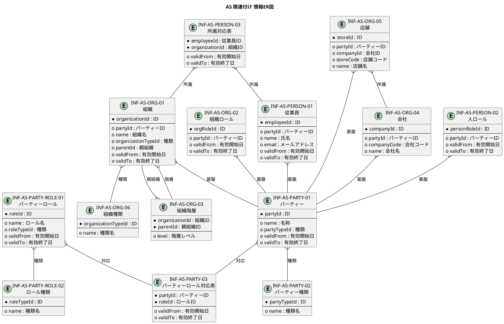

# AS 関連付け 既存システム可視化

本ドキュメントは、AS 関連付け（Association）モジュールの既存システムを RDRA 手法で可視化した成果物です。

## 1. システム概要

AS 関連付け（Association）は、組織・部署・従業員・会社・店舗などの実体とその関連付けを管理するコア基盤モジュールです。Party Role パターンを採用し、実体（Party）とロール（Role）を分離することで、柔軟な関連付け構造を実現します。

- **事業領域コード**: AS
- **事業領域名**: 関連付け
- **事業領域英名**: Association
- **区分**: 支援

## 2. 分析アプローチ

- **トップダウン分析**: 既存の要件定義書（RDRA 4 レイヤー構造）から、アクター・業務・BUC・UC・画面・イベント・情報・状態・条件を抽出
- **ボトムアップ分析**: ソースコードの `association/relationshipMgmt` パッケージ構成から、ドキュメントとの対応関係を整理

## 3. システム価値レイヤー

### 3.1 アクター一覧

| アクターID | アクター名 | 説明 |
|------------|------------|------|
| AC-AS-01 | 組織管理者 | 組織・従業員・ロールの管理を行う管理者 |
| AC-AS-02 | システム運用者 | システムの運用管理担当者 |
| AC-AS-03 | JBジョブ管理 | 会社・店舗別のジョブ実行権限フィルタリング、通知対象設定 |
| AC-AS-04 | AGアジルーム | プロジェクトメンバー管理、権限管理 |

### 3.2 外部システム一覧

| 外部システムID | 外部システム名 | 説明 |
|----------------|----------------|------|
| ES-AS-01 | PostgreSQL | AS モジュールの永続化データベース |

## 4. 外部環境レイヤー

### 4.1 業務一覧

| 業務ID | 業務名 | 説明 |
|--------|--------|------|
| AS-PARTY | パーティー | 組織・人・会社・店舗などの実体を抽象化して一元管理 |
| AS-PARTY-ROLE | パーティーロール | パーティーに付与されるロールの定義を一元管理 |
| AS-PERSON-ROLE | 人ロール | 個人（従業員）に特化したロール管理 |
| AS-ORG-ROLE | 組織ロール | 組織・部署・会社・店舗に特化したロール管理 |

### 4.2 BUC（ビジネスユースケース）一覧

#### AS-PARTY パーティー

| BUC ID | BUC 名 | 概要 | 主なアクター |
|--------|--------|------|--------------|
| BUC-AS-PARTY-01 | パーティーの管理 | 実体の登録・更新・削除を管理する | AC-AS-01 |
| BUC-AS-PARTY-02 | パーティーの参照 | パーティー情報の検索・一覧取得を管理する | AC-AS-01, AC-AS-03, AC-AS-04 |
| BUC-AS-PARTY-03 | パーティーとロールの関連付け | パーティーにロールを付与・解除する | AC-AS-01 |

#### AS-PARTY-ROLE パーティーロール

| BUC ID | BUC 名 | 概要 | 主なアクター |
|--------|--------|------|--------------|
| BUC-AS-PARTY-ROLE-01 | ロール定義の管理 | ロールの種類や属性を管理する | AC-AS-01 |
| BUC-AS-PARTY-ROLE-02 | ロールの参照 | ロール情報の検索・一覧取得を管理する | AC-AS-01, AC-AS-03, AC-AS-04 |
| BUC-AS-PARTY-ROLE-03 | パーティーへのロール付与 | パーティーにロールを付与・解除する | AC-AS-01 |
| BUC-AS-PARTY-ROLE-04 | ロール変更履歴の追跡 | ロールの有効期間変更履歴を追跡する | AC-AS-01, AC-AS-02 |

#### AS-PERSON-ROLE 人ロール

| BUC ID | BUC 名 | 概要 | 主なアクター |
|--------|--------|------|--------------|
| BUC-AS-PERSON-01 | 従業員の管理 | 従業員の登録・更新・削除を管理する | AC-AS-01 |
| BUC-AS-PERSON-02 | 従業員の参照 | 従業員情報の検索・一覧取得を管理する | AC-AS-01, AC-AS-03, AC-AS-04 |
| BUC-AS-PERSON-03 | 従業員の所属管理 | 従業員の所属組織・部署の関連付けを管理する | AC-AS-01 |
| BUC-AS-PERSON-04 | 部署変更履歴の追跡 | 従業員の部署変更履歴を追跡する | AC-AS-01, AC-AS-02 |

#### AS-ORG-ROLE 組織ロール

| BUC ID | BUC 名 | 概要 | 主なアクター |
|--------|--------|------|--------------|
| BUC-AS-ORG-01 | 組織の管理 | 組織・部署・会社・店舗の登録・更新・削除を管理する | AC-AS-01 |
| BUC-AS-ORG-02 | 組織の参照 | 組織情報の検索・一覧取得を管理する | AC-AS-01, AC-AS-03, AC-AS-04 |
| BUC-AS-ORG-03 | 組織階層の管理 | 組織の階層構造を構築・変更する | AC-AS-01 |
| BUC-AS-ORG-04 | 権限範囲の定義 | 組織単位での権限範囲を定義する | AC-AS-01 |
| BUC-AS-ORG-05 | 組織変更履歴の追跡 | 組織の変更履歴を追跡する | AC-AS-01, AC-AS-02 |

## 5. システム境界レイヤー

### 5.1 ユースケース統合一覧

#### AS-PARTY パーティー（8 UC）

| UC ID | UC 名 | 関連 BUC | 関連情報 | 関連画面 |
|-------|-------|----------|----------|----------|
| UC-AS-PARTY-001 | パーティーを登録する | BUC-AS-PARTY-01 | INF-AS-PARTY-01 | SCR-AS-PARTY-002 |
| UC-AS-PARTY-002 | パーティーを更新する | BUC-AS-PARTY-01 | INF-AS-PARTY-01 | SCR-AS-PARTY-002 |
| UC-AS-PARTY-003 | パーティーを無効化する | BUC-AS-PARTY-01 | INF-AS-PARTY-01 | |
| UC-AS-PARTY-004 | パーティーを検索する | BUC-AS-PARTY-02 | INF-AS-PARTY-01 | SCR-AS-PARTY-001 |
| UC-AS-PARTY-005 | パーティー一覧を取得する | BUC-AS-PARTY-02 | INF-AS-PARTY-01 | SCR-AS-PARTY-001 |
| UC-AS-PARTY-006 | パーティーの詳細を取得する | BUC-AS-PARTY-02 | INF-AS-PARTY-01 | SCR-AS-PARTY-003 |
| UC-AS-PARTY-007 | ロールを付与する | BUC-AS-PARTY-03 | INF-AS-PARTY-03 | |
| UC-AS-PARTY-008 | ロールを解除する | BUC-AS-PARTY-03 | INF-AS-PARTY-03 | |

#### AS-PARTY-ROLE パーティーロール（8 UC）

| UC ID | UC 名 | 関連 BUC | 関連情報 | 関連画面 |
|-------|-------|----------|----------|----------|
| UC-AS-PARTY-ROLE-001 | ロール定義を登録する | BUC-AS-PARTY-ROLE-01 | INF-AS-PARTY-ROLE-01 | SCR-AS-PARTY-ROLE-002 |
| UC-AS-PARTY-ROLE-002 | ロール定義を更新する | BUC-AS-PARTY-ROLE-01 | INF-AS-PARTY-ROLE-01 | SCR-AS-PARTY-ROLE-002 |
| UC-AS-PARTY-ROLE-003 | ロールを検索する | BUC-AS-PARTY-ROLE-02 | INF-AS-PARTY-ROLE-01 | SCR-AS-PARTY-ROLE-001 |
| UC-AS-PARTY-ROLE-004 | ロール一覧を取得する | BUC-AS-PARTY-ROLE-02 | INF-AS-PARTY-ROLE-01 | SCR-AS-PARTY-ROLE-001 |
| UC-AS-PARTY-ROLE-005 | ロールの詳細を取得する | BUC-AS-PARTY-ROLE-02 | INF-AS-PARTY-ROLE-01 | |
| UC-AS-PARTY-ROLE-006 | パーティーにロールを付与する | BUC-AS-PARTY-ROLE-03 | INF-AS-PARTY-ROLE-03 | SCR-AS-PARTY-ROLE-003 |
| UC-AS-PARTY-ROLE-007 | パーティーからロールを解除する | BUC-AS-PARTY-ROLE-03 | INF-AS-PARTY-ROLE-03 | SCR-AS-PARTY-ROLE-003 |
| UC-AS-PARTY-ROLE-008 | ロール変更履歴を取得する | BUC-AS-PARTY-ROLE-04 | INF-AS-PARTY-ROLE-03 | SCR-AS-PARTY-ROLE-004 |

#### AS-PERSON-ROLE 人ロール（10 UC）

| UC ID | UC 名 | 関連 BUC | 関連情報 | 関連画面 |
|-------|-------|----------|----------|----------|
| UC-AS-PERSON-001 | 従業員を登録する | BUC-AS-PERSON-01 | INF-AS-PERSON-01, INF-AS-PERSON-02 | SCR-AS-PERSON-002 |
| UC-AS-PERSON-002 | 従業員を更新する | BUC-AS-PERSON-01 | INF-AS-PERSON-01 | SCR-AS-PERSON-002 |
| UC-AS-PERSON-003 | 従業員を無効化する | BUC-AS-PERSON-01 | INF-AS-PERSON-01 | |
| UC-AS-PERSON-004 | 従業員を検索する | BUC-AS-PERSON-02 | INF-AS-PERSON-01 | SCR-AS-PERSON-001 |
| UC-AS-PERSON-005 | 従業員一覧を取得する | BUC-AS-PERSON-02 | INF-AS-PERSON-01 | SCR-AS-PERSON-001 |
| UC-AS-PERSON-006 | 従業員の詳細を取得する | BUC-AS-PERSON-02 | INF-AS-PERSON-01, INF-AS-PERSON-03 | SCR-AS-PERSON-003 |
| UC-AS-PERSON-007 | 所属組織を変更する | BUC-AS-PERSON-03 | INF-AS-PERSON-03 | SCR-AS-PERSON-004 |
| UC-AS-PERSON-008 | 部署変更履歴を取得する | BUC-AS-PERSON-04 | INF-AS-PERSON-03 | SCR-AS-PERSON-005 |
| UC-AS-PERSON-009 | 従業員の所属組織一覧を取得する | BUC-AS-PERSON-02 | INF-AS-PERSON-03 | |
| UC-AS-PERSON-010 | 組織の所属従業員一覧を取得する | BUC-AS-PERSON-02 | INF-AS-PERSON-03 | |

#### AS-ORG-ROLE 組織ロール（14 UC）

| UC ID | UC 名 | 関連 BUC | 関連情報 | 関連画面 |
|-------|-------|----------|----------|----------|
| UC-AS-ORG-001 | 組織を登録する | BUC-AS-ORG-01 | INF-AS-ORG-01 | SCR-AS-ORG-002 |
| UC-AS-ORG-002 | 組織を更新する | BUC-AS-ORG-01 | INF-AS-ORG-01 | SCR-AS-ORG-002 |
| UC-AS-ORG-003 | 組織を無効化する | BUC-AS-ORG-01 | INF-AS-ORG-01 | |
| UC-AS-ORG-004 | 会社を登録する | BUC-AS-ORG-01 | INF-AS-ORG-04 | SCR-AS-ORG-005 |
| UC-AS-ORG-005 | 店舗を登録する | BUC-AS-ORG-01 | INF-AS-ORG-05 | SCR-AS-ORG-007 |
| UC-AS-ORG-006 | 組織を検索する | BUC-AS-ORG-02 | INF-AS-ORG-01 | SCR-AS-ORG-001 |
| UC-AS-ORG-007 | 組織一覧を取得する | BUC-AS-ORG-02 | INF-AS-ORG-01 | SCR-AS-ORG-001 |
| UC-AS-ORG-008 | 組織の詳細を取得する | BUC-AS-ORG-02 | INF-AS-ORG-01 | SCR-AS-ORG-003 |
| UC-AS-ORG-009 | 会社一覧を取得する | BUC-AS-ORG-02 | INF-AS-ORG-04 | SCR-AS-ORG-004 |
| UC-AS-ORG-010 | 店舗一覧を取得する | BUC-AS-ORG-02 | INF-AS-ORG-05 | SCR-AS-ORG-006 |
| UC-AS-ORG-011 | 組織階層を変更する | BUC-AS-ORG-03 | INF-AS-ORG-03 | SCR-AS-ORG-008 |
| UC-AS-ORG-012 | 権限範囲を定義する | BUC-AS-ORG-04 | INF-AS-ORG-02 | |
| UC-AS-ORG-013 | 組織変更履歴を取得する | BUC-AS-ORG-05 | | SCR-AS-ORG-009 |
| UC-AS-ORG-014 | 組織の所属従業員一覧を取得する | BUC-AS-ORG-02 | | |

### 5.2 画面統合一覧

| 画面ID | 画面名 | サブモジュール | 主な利用者 | 関連 UC |
|--------|--------|----------------|------------|---------|
| SCR-AS-PARTY-001 | パーティー一覧 | AS-PARTY | 組織管理者 | UC-AS-PARTY-004, 005 |
| SCR-AS-PARTY-002 | パーティー登録・編集 | AS-PARTY | 組織管理者 | UC-AS-PARTY-001, 002 |
| SCR-AS-PARTY-003 | パーティー詳細 | AS-PARTY | 組織管理者, JB, AG | UC-AS-PARTY-006 |
| SCR-AS-PARTY-ROLE-001 | ロール定義一覧 | AS-PARTY-ROLE | 組織管理者 | UC-AS-PARTY-ROLE-003, 004 |
| SCR-AS-PARTY-ROLE-002 | ロール定義登録・編集 | AS-PARTY-ROLE | 組織管理者 | UC-AS-PARTY-ROLE-001, 002 |
| SCR-AS-PARTY-ROLE-003 | ロール割り当て | AS-PARTY-ROLE | 組織管理者 | UC-AS-PARTY-ROLE-006, 007 |
| SCR-AS-PARTY-ROLE-004 | ロール変更履歴 | AS-PARTY-ROLE | 組織管理者, 運用者 | UC-AS-PARTY-ROLE-008 |
| SCR-AS-PERSON-001 | 従業員一覧 | AS-PERSON-ROLE | 組織管理者 | UC-AS-PERSON-004, 005 |
| SCR-AS-PERSON-002 | 従業員登録・編集 | AS-PERSON-ROLE | 組織管理者 | UC-AS-PERSON-001, 002 |
| SCR-AS-PERSON-003 | 従業員詳細 | AS-PERSON-ROLE | 組織管理者, JB, AG | UC-AS-PERSON-006 |
| SCR-AS-PERSON-004 | 所属変更 | AS-PERSON-ROLE | 組織管理者 | UC-AS-PERSON-007 |
| SCR-AS-PERSON-005 | 部署変更履歴 | AS-PERSON-ROLE | 組織管理者, 運用者 | UC-AS-PERSON-008 |
| SCR-AS-ORG-001 | 組織一覧 | AS-ORG-ROLE | 組織管理者 | UC-AS-ORG-006, 007 |
| SCR-AS-ORG-002 | 組織登録・編集 | AS-ORG-ROLE | 組織管理者 | UC-AS-ORG-001, 002 |
| SCR-AS-ORG-003 | 組織詳細 | AS-ORG-ROLE | 組織管理者, JB, AG | UC-AS-ORG-008 |
| SCR-AS-ORG-004 | 会社一覧 | AS-ORG-ROLE | 組織管理者 | UC-AS-ORG-009 |
| SCR-AS-ORG-005 | 会社登録・編集 | AS-ORG-ROLE | 組織管理者 | UC-AS-ORG-004 |
| SCR-AS-ORG-006 | 店舗一覧 | AS-ORG-ROLE | 組織管理者 | UC-AS-ORG-010 |
| SCR-AS-ORG-007 | 店舗登録・編集 | AS-ORG-ROLE | 組織管理者 | UC-AS-ORG-005 |
| SCR-AS-ORG-008 | 組織階層変更 | AS-ORG-ROLE | 組織管理者 | UC-AS-ORG-011 |
| SCR-AS-ORG-009 | 組織変更履歴 | AS-ORG-ROLE | 組織管理者, 運用者 | UC-AS-ORG-013 |

### 5.3 イベント統合一覧

| イベントID | イベント名 | サブモジュール | 関連 UC |
|------------|------------|----------------|---------|
| EVT-AS-PARTY-001 | パーティー登録完了 | AS-PARTY | UC-AS-PARTY-001 |
| EVT-AS-PARTY-002 | パーティー更新完了 | AS-PARTY | UC-AS-PARTY-002 |
| EVT-AS-PARTY-003 | パーティー無効化完了 | AS-PARTY | UC-AS-PARTY-003 |
| EVT-AS-PARTY-004 | ロール付与完了 | AS-PARTY | UC-AS-PARTY-007 |
| EVT-AS-PARTY-005 | ロール解除完了 | AS-PARTY | UC-AS-PARTY-008 |
| EVT-AS-PARTY-ROLE-001 | ロール定義登録完了 | AS-PARTY-ROLE | UC-AS-PARTY-ROLE-001 |
| EVT-AS-PARTY-ROLE-002 | ロール定義更新完了 | AS-PARTY-ROLE | UC-AS-PARTY-ROLE-002 |
| EVT-AS-PARTY-ROLE-003 | パーティーロール付与完了 | AS-PARTY-ROLE | UC-AS-PARTY-ROLE-006 |
| EVT-AS-PARTY-ROLE-004 | パーティーロール解除完了 | AS-PARTY-ROLE | UC-AS-PARTY-ROLE-007 |
| EVT-AS-PERSON-001 | 従業員登録完了 | AS-PERSON-ROLE | UC-AS-PERSON-001 |
| EVT-AS-PERSON-002 | 従業員更新完了 | AS-PERSON-ROLE | UC-AS-PERSON-002 |
| EVT-AS-PERSON-003 | 従業員退社完了 | AS-PERSON-ROLE | UC-AS-PERSON-003 |
| EVT-AS-PERSON-004 | 所属組織変更完了 | AS-PERSON-ROLE | UC-AS-PERSON-007 |
| EVT-AS-ORG-001 | 組織登録完了 | AS-ORG-ROLE | UC-AS-ORG-001 |
| EVT-AS-ORG-002 | 組織更新完了 | AS-ORG-ROLE | UC-AS-ORG-002 |
| EVT-AS-ORG-003 | 組織廃止完了 | AS-ORG-ROLE | UC-AS-ORG-003 |
| EVT-AS-ORG-004 | 会社登録完了 | AS-ORG-ROLE | UC-AS-ORG-004 |
| EVT-AS-ORG-005 | 店舗登録完了 | AS-ORG-ROLE | UC-AS-ORG-005 |
| EVT-AS-ORG-006 | 組織階層変更完了 | AS-ORG-ROLE | UC-AS-ORG-011 |
| EVT-AS-ORG-007 | 権限範囲定義完了 | AS-ORG-ROLE | UC-AS-ORG-012 |

## 6. システムレイヤー

### 6.1 情報統合一覧

#### AS-PARTY パーティー

| 情報ID | 情報名 | 種類 | 説明 | 履歴管理 | 証跡 | 実現方法 |
|--------|--------|------|------|----------|------|----------|
| INF-AS-PARTY-01 | パーティー | リソース | 組織・人・会社・店舗などの実体を抽象化した基本情報 | Y | Y | DB |
| INF-AS-PARTY-02 | パーティー種類 | 対照表 | パーティーの種類（個人、法人、組織など） | N | N | DB and enum |
| INF-AS-PARTY-03 | パーティーロール対応表 | 対応表 | パーティーとロールの対応関係 | Y | N | DB |
| INF-AS-PARTY-04 | パーティー登録完了 | イベント | パーティーが登録されたことを示すイベント | N | N | |

#### AS-PARTY-ROLE パーティーロール

| 情報ID | 情報名 | 種類 | 説明 | 履歴管理 | 証跡 | 実現方法 |
|--------|--------|------|------|----------|------|----------|
| INF-AS-PARTY-ROLE-01 | パーティーロール | リソース | パーティーに付与されるロールの定義 | Y | Y | DB |
| INF-AS-PARTY-ROLE-02 | ロール種類 | 対照表 | ロールの種類（人ロール、組織ロールなど） | N | N | DB and enum |
| INF-AS-PARTY-ROLE-03 | ロール有効期間 | 対応表 | ロールの有効期間管理 | Y | N | DB |
| INF-AS-PARTY-ROLE-04 | ロール付与完了 | イベント | ロールが付与されたことを示すイベント | N | N | |

#### AS-PERSON-ROLE 人ロール

| 情報ID | 情報名 | 種類 | 説明 | 実現方法 |
|--------|--------|------|------|----------|
| INF-AS-PERSON-01 | 従業員 | リソース | 個人（従業員）の基本情報 | DB |
| INF-AS-PERSON-02 | 人ロール | リソース | 従業員に付与される人ロール | DB |
| INF-AS-PERSON-03 | 所属対応表 | 対応表 | 従業員と組織・部署の所属関係 | DB |
| INF-AS-PERSON-04 | 従業員登録完了 | イベント | 従業員が登録されたことを示すイベント | |

#### AS-ORG-ROLE 組織ロール

| 情報ID | 情報名 | 種類 | 説明 | 履歴管理 | 証跡 | 実現方法 |
|--------|--------|------|------|----------|------|----------|
| INF-AS-ORG-01 | 組織 | リソース | 組織・部署の基本情報 | Y | Y | DB |
| INF-AS-ORG-02 | 組織ロール | リソース | 組織に付与される組織ロール | Y | Y | DB |
| INF-AS-ORG-03 | 組織階層 | 対応表 | 組織の階層構造（親・子関係） | Y | N | DB |
| INF-AS-ORG-04 | 会社 | リソース | 会社の基本情報 | Y | Y | DB |
| INF-AS-ORG-05 | 店舗 | リソース | 店舗の基本情報 | Y | Y | DB |
| INF-AS-ORG-06 | 組織種類 | 対照表 | 組織の種類（会社、部署、店舗など） | N | N | DB and enum |
| INF-AS-ORG-07 | 組織登録完了 | イベント | 組織が登録されたことを示すイベント | N | N | |

### 6.2 情報 ER 図



### 6.3 状態遷移

各サブモジュールの状態遷移は共通パターン（有効 / 無効）に従います。

#### AS-PARTY パーティー

| 状態 | 説明 |
|------|------|
| 有効 (Active) | パーティーが有効な状態 |
| 無効 (Inactive) | パーティーが無効化された状態 |

| 遷移 | トリガー | 関連 UC |
|------|----------|---------|
| [*] → 有効 | パーティー登録 | UC-AS-PARTY-001 |
| 有効 → 無効 | パーティー無効化 | UC-AS-PARTY-003 |

#### AS-PARTY-ROLE パーティーロール

| 状態 | 説明 |
|------|------|
| 有効 (Active) | ロールが有効な状態 |
| 無効 (Inactive) | ロールが無効化された状態 |

| 遷移 | トリガー | 関連 UC |
|------|----------|---------|
| [*] → 有効 | ロール定義登録 | UC-AS-PARTY-ROLE-001 |
| 有効 → 無効 | ロール解除 | UC-AS-PARTY-ROLE-007 |

#### AS-PERSON-ROLE 人ロール

| 状態 | 説明 |
|------|------|
| 有効 (Active) | 従業員が有効な状態（在籍中） |
| 無効 (Inactive) | 従業員が無効化された状態（退社） |

| 遷移 | トリガー | 関連 UC |
|------|----------|---------|
| [*] → 有効 | 従業員登録 | UC-AS-PERSON-001 |
| 有効 → 無効 | 退社処理 | UC-AS-PERSON-003 |

#### AS-ORG-ROLE 組織ロール

| 状態 | 説明 |
|------|------|
| 有効 (Active) | 組織が有効な状態 |
| 無効 (Inactive) | 組織が無効化された状態（廃止） |

| 遷移 | トリガー | 関連 UC |
|------|----------|---------|
| [*] → 有効 | 組織登録 | UC-AS-ORG-001 |
| 有効 → 無効 | 組織廃止 | UC-AS-ORG-003 |

### 6.4 バリエーション

#### パーティー種類

| バリエーション名 | 説明 |
|------------------|------|
| 個人 | 個人を表すパーティー |
| 法人 | 法人を表すパーティー |
| 組織 | 組織・部署を表すパーティー |

#### 組織種類

| バリエーション名 | 説明 |
|------------------|------|
| 会社 | 会社を表す組織 |
| 部署 | 部署を表す組織 |
| 店舗 | 店舗を表す組織 |

#### ロール種類

| バリエーション名 | 説明 |
|------------------|------|
| 人ロール | 個人に付与されるロール |
| 組織ロール | 組織に付与されるロール |

## 7. ソースコードマッピング

### 7.1 パッケージ構成

```
undecided.association.relationshipMgmt/
├── party/                    → AS-PARTY パーティー
│   ├── command/              → 登録・更新・無効化コマンド
│   ├── query/                → 検索・一覧・詳細クエリ
│   ├── internal/             → 内部実装
│   └── (spi は上位パッケージ共用)
├── partyRole/                → AS-PARTY-ROLE パーティーロール
│   ├── internal/
│   │   ├── role/             → ロール定義管理
│   │   └── customer/         → カスタマー関連
│   └── spi/
│       ├── role/             → ロール SPI
│       └── customer/         → カスタマー SPI
├── personRole/               → AS-PERSON-ROLE 人ロール
│   ├── internal/
│   │   ├── employee/         → 従業員管理
│   │   └── command/          → コマンド実装
│   └── spi/
│       └── employee/         → 従業員 SPI
├── orgRole/                  → AS-ORG-ROLE 組織ロール
│   ├── internal/
│   │   ├── organization/     → 組織管理
│   │   └── department/       → 部署管理
│   └── spi/
│       ├── Organization.java → 組織エンティティ
│       ├── Company.java      → 会社エンティティ
│       ├── Store.java        → 店舗エンティティ
│       ├── Department.java   → 部署エンティティ
│       └── OrganizationRole.java → 組織ロール
└── spi/                      → 共用 SPI
    ├── party/                → パーティー共用 SPI
    ├── orgRole/              → 組織ロール共用 SPI
    └── partyRole/            → パーティーロール共用 SPI
```

### 7.2 UC とソースコードのマッピング

| サブモジュール | UC カテゴリ | 対応パッケージ | 主なクラス |
|----------------|-------------|----------------|------------|
| AS-PARTY | 登録・更新 | party/command | CreatePersonCommandService, CreateOrgCommandService, CreateOrgUnitCommandService |
| AS-PARTY | 検索・一覧 | party/query | PartyQueryService, OrganizationQueryService, OrgUnitQueryService |
| AS-PARTY-ROLE | ロール定義 | partyRole/internal/role | RoleAssignmentsForEmpApi, RoleAssignmentsForOrgApi |
| AS-PARTY-ROLE | ロール SPI | partyRole/spi/role | RoleAssignmentForEmp, RoleAssignmentForOrg |
| AS-PERSON-ROLE | 従業員管理 | personRole/internal/employee | (従業員関連コマンド・クエリ) |
| AS-PERSON-ROLE | 従業員 SPI | personRole/spi/employee | (従業員 SPI) |
| AS-ORG-ROLE | 組織管理 | orgRole/internal/organization | OrganizationApi, OrganizationQueryImpl, OrganizationRepository |
| AS-ORG-ROLE | 部署管理 | orgRole/internal/department | DepartmentCommand, DepartmentCommandImpl, DepartmentQuery, DepartmentQueryImpl, DepartmentRepository |
| AS-ORG-ROLE | 組織 SPI | orgRole/spi | Organization, Company, Store, Department, OrganizationRole, OrganizationHierarchy, OrganizationType |

## 8. 統計情報

| 項目 | 数 |
|------|-----|
| サブモジュール | 4 |
| アクター | 4 |
| 外部システム | 1 |
| 業務 | 4 |
| BUC | 16 |
| UC | 40 |
| 画面 | 21 |
| イベント | 20 |
| 情報 | 19 |
| 状態 | 8 (4 モジュール × 2 状態) |
| バリエーション | 3 種類 |

## 9. 参照ドキュメント

- `docs/22 要件定義書/AS 関連付け/overview.md`
- `docs/22 要件定義書/AS 関連付け/03 機能要件/AS-PARTY パーティー/`
- `docs/22 要件定義書/AS 関連付け/03 機能要件/AS-PARTY-ROLE パーティーロール/`
- `docs/22 要件定義書/AS 関連付け/03 機能要件/AS-PERSON-ROLE 人ロール/`
- `docs/22 要件定義書/AS 関連付け/03 機能要件/AS-ORG-ROLE 組織ロール/`
- `backend/src/main/java/undecided/association/relationshipMgmt/`
