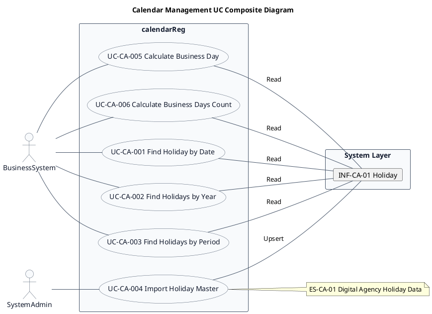
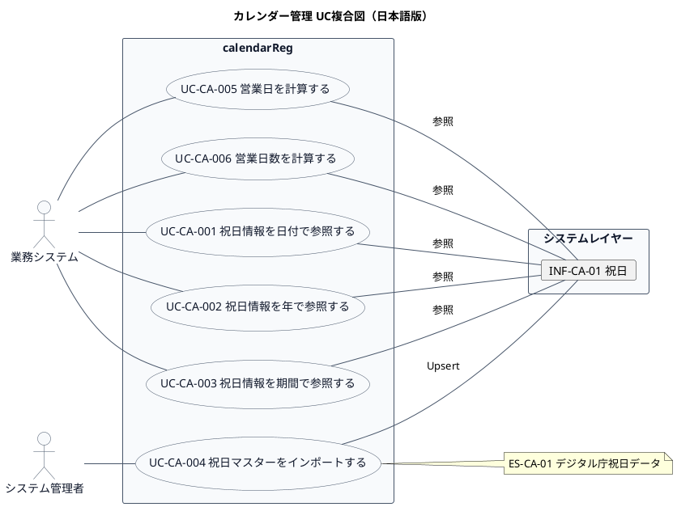

# UC複合図

カレンダー管理（CA-01）業務領域で扱うユースケース、画面、イベント、情報、条件を関連づけた図です。

## 1. 目的

本書は、CA-01 カレンダー管理業務領域のシステム境界レイヤーで扱うユースケース、画面、イベント、情報、条件を関連づけたUC複合図です。

## 2. PlantUML UC複合図（英語版）

## 3. 日本語版 UC複合図

## 4. ユースケース一覧

| ユースケースID | ユースケース名 | 英語名      | 説明 | 関連アクター |
|----------------|----------------|-------------|------|--------------|
| UC-CA-001      | 祝日情報を日付で参照する | Find Holiday by Date | 指定された日付の祝日情報を取得する | システム管理者, 業務システム |
| UC-CA-002      | 祝日情報を年で参照する   | Find Holidays by Year | 指定された年の全祝日情報を取得する | 業務システム |
| UC-CA-003      | 祝日情報を期間で参照する | Find Holidays by Period | 指定された期間内の全祝日情報を取得する | 業務システム |
| UC-CA-004      | 祝日マスターをインポートする | Import Holiday Master | デジタル庁/内閣府の祝日CSVをバッチインポートする | システム管理者 |
| UC-CA-005      | 営業日を計算する             | Calculate Business Day | 基準日と営業日数から営業日（日付）を求める | 業務システム |
| UC-CA-006      | 営業日数を計算する           | Calculate Business Days Count | 2つの日付の間の営業日数を求める | 業務システム |

## 5. 画面一覧

カレンダー管理はAPI中心のモジュールであり、GUI画面は定義されていません。

## 6. イベント一覧

| イベントID | イベント名 | 英語名    | 説明 | 関連ユースケース |
|------------|------------|-----------|------|------------------|
| EVT-CA-01  | 祝日CSVインポート | Holiday CSV Import | デジタル庁/内閣府の祝日CSVデータをバッチ読み込み | UC-CA-004 |

## 7. 情報一覧

| 情報ID    | 情報名 | 英語名          | 説明 | 関連ユースケース |
|-----------|--------|-----------------|------|------------------|
| INF-CA-01 | 祝日   | Holiday         | 祝日・休日の日付・名称・備考を管理 | UC-CA-001, UC-CA-002, UC-CA-003, UC-CA-004, UC-CA-005, UC-CA-006 |

## 8. 条件一覧

| 条件ID   | 条件名   | 英語名   | 説明 | 関連ユースケース |
|----------|----------|----------|------|------------------|
| RL-CA-01 | 祝日ID生成ルール | Holiday ID Generation Rule | 日付から祝日IDを生成（yyyyMMdd形式） | UC-CA-004 |
| RL-CA-02 | CSVヘッダーマッピング | CSV Header Mapping | 日本語・英語の複数ヘッダー形式をマッピング | UC-CA-004 |
| RL-CA-03 | 日付形式パースルール | Date Format Parse Rule | 複数日付形式（yyyy/MM/dd, yyyy-MM-dd等）をパース | UC-CA-004 |
| RL-CA-04 | 営業日計算ルール | Business Day Calculation Rule | 基準日から営業日数を加算・減算し、祝日・休業日を除外して営業日を算出 | UC-CA-005, UC-CA-006 |

## 9. 参照情報

- ユースケース一覧: `03.システム境界/01.ユースケース/ユースケース一覧.md`
- 情報一覧: `04.システム/01.情報/情報一覧.md`
- イベント一覧: `04.システム/03.イベント/イベント一覧.md`
