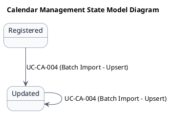
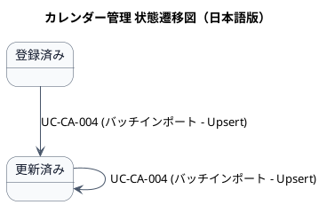

# ステートマシン図

カレンダー管理（CA-01）業務領域で扱う情報の状態遷移を示す状態モデル図です。

## 1. 目的

本書は、CA-01 カレンダー管理業務領域のシステムレイヤーで扱う情報の状態遷移を示す状態モデル図（ステートマシン図）です。

## 2. PlantUML 状態遷移図（英語版）

## 3. 日本語版 状態遷移図

## 4. 状態一覧

| 状態名 (ID)       | 英語名    | 説明 |
|-------------------|-----------|------|
| 登録済み (ST-CA-01) | Registered | 祝日データが初めて登録された状態 |
| 更新済み (ST-CA-02) | Updated | 既存の祝日データが更新された状態 |

## 5. 遷移一覧

| 遷移ID | 元状態       | 遷移先状態 | トリガー  | 関連ユースケース | 説明 |
|--------|--------------|------------|-----------|------------------|------|
| TR-CA-01 | 登録済み | 更新済み | バッチインポート | UC-CA-004 | 既存祝日データの名称・備考が更新される |
| TR-CA-02 | 更新済み | 更新済み | バッチインポート | UC-CA-004 | 既に更新済みの祝日データが再度更新される |

## 6. 参照情報

- 関連ユースケース: `03.システム境界/01.ユースケース/ユースケース一覧.md`
