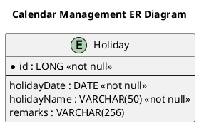
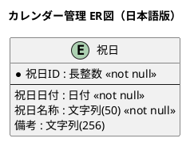

# ER図

カレンダー管理（CA-01）業務領域で扱う情報（エンティティ）間の関係を示すER図です。

## 1. 目的

本書は、CA-01 カレンダー管理業務領域のシステムレイヤーで扱う情報（エンティティ）間の関係を示すER図（エンティティ関係図）です。

## 2. PlantUML ER図（英語版）

## 3. 日本語版 ER図

## 4. 情報（エンティティ）一覧

| 情報ID    | 情報名 | 英語名          | 説明 | 情報種類 |
|-----------|--------|-----------------|------|----------|
| INF-CA-01 | 祝日   | Holiday         | 祝日・休日の日付・名称・備考を管理 | リソース |

## 5. 関係一覧

カレンダー管理では単一エンティティのみであり、エンティティ間の関係はありません。

## 6. 関係の種類

関係の種類は以下の記号で表現します：

| 記号 | 意味 | 説明 |
|------|------|------|
| `||--o{` | 1対多 (1:N) | 左側の1つが右側の0個以上に関連 |
| `||--||` | 1対1 (1:1) | 左側の1つが右側の1つに関連 |
| `}o--o{` | 多対多 (N:M) | 左側の0個以上が右側の0個以上に関連 |
| `||--o|` | 1対1以上 (1:1+) | 左側の1つが右側の1個以上に関連 |

## 7. 参照情報

- 情報一覧: `04.システム/01.情報/情報一覧.md`
- UC複合図: `03.システム境界/UC複合図.md`
