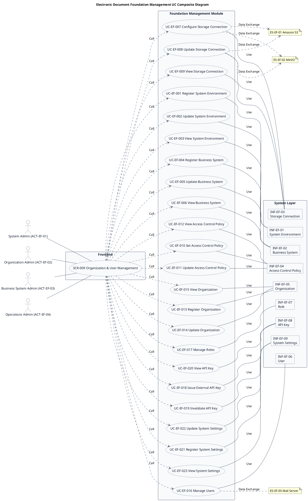
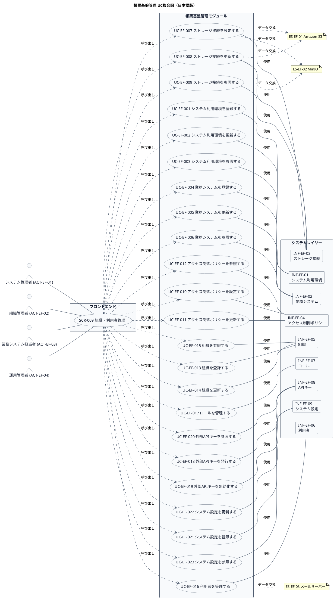

# UC複合図

帳票基盤管理業務領域で扱うユースケース、画面、イベント、情報などを関連づけたUC複合図です。

## 1. 目的

本書は、EF-01 帳票基盤管理業務領域のシステム境界レイヤーで扱うユースケース、画面、イベント、情報、条件を関連づけたUC複合図です。

## 2. PlantUML UC複合図（英語版）

## 3. 日本語版 UC複合図

## 4. ユースケース一覧

| ユースケースID | ユースケース名                   | 英語名                          | 説明                                                       | 関連アクター                       |
|----------------|----------------------------------|---------------------------------|------------------------------------------------------------|------------------------------------|
| UC-EF-001      | システム利用環境を登録する       | Register System Environment     | システム環境、共通設定、環境別接続情報を登録する             | ACT-EF-01                          |
| UC-EF-002      | システム利用環境を更新する       | Update System Environment       | 既存のシステム環境設定を修正する                           | ACT-EF-01                          |
| UC-EF-003      | システム利用環境を参照する       | View System Environment         | 登録されたシステム環境設定を確認する                       | ACT-EF-01                          |
| UC-EF-004      | 業務システムを登録する           | Register Business System        | 連携する業務システムを登録する                             | ACT-EF-01, ACT-EF-03               |
| UC-EF-005      | 業務システムを更新する           | Update Business System          | 既存の業務システム情報を修正する                           | ACT-EF-01, ACT-EF-03               |
| UC-EF-006      | 業務システムを参照する           | View Business System            | 登録された業務システム一覧・詳細を確認する                 | ACT-EF-01, ACT-EF-03               |
| UC-EF-007      | ストレージ接続を設定する         | Configure Storage Connection    | S3・MinIOの接続情報を設定する                              | ACT-EF-01                          |
| UC-EF-008      | ストレージ接続を更新する         | Update Storage Connection       | 既存のストレージ接続情報を修正する                         | ACT-EF-01                          |
| UC-EF-009      | ストレージ接続を参照する         | View Storage Connection         | 登録されたストレージ接続情報を確認する                     | ACT-EF-01                          |
| UC-EF-010      | アクセス制御ポリシーを設定する   | Set Access Control Policy       | 組織・利用者・業務システム・帳票単位の権限ポリシーを設定する | ACT-EF-01, ACT-EF-04               |
| UC-EF-011      | アクセス制御ポリシーを更新する   | Update Access Control Policy    | 既存の権限ポリシーを修正する                               | ACT-EF-01, ACT-EF-04               |
| UC-EF-012      | アクセス制御ポリシーを参照する   | View Access Control Policy      | 登録された権限ポリシーを確認する                           | ACT-EF-01, ACT-EF-04               |
| UC-EF-013      | 組織を登録する                 | Register Organization           | 組織、部門を階層構造で登録する                             | ACT-EF-02                          |
| UC-EF-014      | 組織を更新する                 | Update Organization             | 既存の組織情報を修正する                                   | ACT-EF-02                          |
| UC-EF-015      | 組織を参照する                 | View Organization               | 登録された組織一覧・詳細を確認する                         | ACT-EF-02                          |
| UC-EF-016      | 利用者を管理する               | Manage Users                    | 利用者の登録・更新・参照する                               | ACT-EF-02                          |
| UC-EF-017      | ロールを管理する               | Manage Roles                    | ロールの定義と利用者への割り当てを管理する                 | ACT-EF-02                          |
| UC-EF-018      | 外部APIキーを発行する          | Issue External API Key          | 外部API利用のためのキーを発行する                          | ACT-EF-01                          |
| UC-EF-019      | 外部APIキーを無効化する        | Invalidate API Key              | 発行したAPIキーを無効化する                                | ACT-EF-01                          |
| UC-EF-020      | 外部APIキーを参照する          | View API Key                    | 登録されたAPIキー一覧・詳細を確認する                      | ACT-EF-01                          |
| UC-EF-021      | システム設定を登録する         | Register System Settings        | 共通設定、環境設定、各種マスタを登録する                   | ACT-EF-01                          |
| UC-EF-022      | システム設定を更新する         | Update System Settings          | 既存のシステム設定を修正する                               | ACT-EF-01                          |
| UC-EF-023      | システム設定を参照する         | View System Settings            | 登録されたシステム設定を確認する                           | ACT-EF-01                          |

## 5. 画面一覧

| 画面ID  | 画面名                      | 英語名                     | 主な利用者                       | 関連ユースケース |
|---------|-----------------------------|----------------------------|----------------------------------|------------------|
| SCR-009 | 組織・利用者管理            | Organization & User Mgmt   | システム管理者、組織管理者、業務システム担当者、運用管理者 | UC-EF-001〜023 |

## 6. イベント一覧

| イベントID | イベント名                           | 英語名                              | 説明                                                         | 関連ユースケース |
|------------|--------------------------------------|-------------------------------------|--------------------------------------------------------------|------------------|
| EVT-EF-001 | システム利用環境が登録された         | System Environment Registered       | システム環境、共通設定、環境別接続情報が登録された             | UC-EF-001        |
| EVT-EF-002 | システム利用環境が更新された         | System Environment Updated          | 既存のシステム環境設定が修正された                           | UC-EF-002        |
| EVT-EF-003 | 業務システムが登録された             | Business System Registered          | 連携する業務システムが登録された                             | UC-EF-004        |
| EVT-EF-004 | 業務システムが更新された             | Business System Updated             | 既存の業務システム情報が修正された                           | UC-EF-005        |
| EVT-EF-005 | ストレージ接続が設定された           | Storage Connection Configured       | S3・MinIOの接続情報が設定された                              | UC-EF-007        |
| EVT-EF-006 | ストレージ接続が更新された           | Storage Connection Updated          | 既存のストレージ接続情報が修正された                         | UC-EF-008        |
| EVT-EF-007 | アクセス制御ポリシーが設定された     | Access Control Policy Set           | 組織・利用者・業務システム・帳票単位の権限ポリシーが設定された | UC-EF-010        |
| EVT-EF-008 | アクセス制御ポリシーが更新された     | Access Control Policy Updated       | 既存の権限ポリシーが修正された                               | UC-EF-011        |
| EVT-EF-009 | 組織が登録された                   | Organization Registered             | 組織、部門が階層構造で登録された                             | UC-EF-013        |
| EVT-EF-010 | 組織が更新された                   | Organization Updated                | 既存の組織情報が修正された                                   | UC-EF-014        |
| EVT-EF-011 | 利用者が登録された                 | User Registered                     | 利用者が登録された                                           | UC-EF-016        |
| EVT-EF-012 | 利用者が更新された                 | User Updated                        | 利用者が更新された                                           | UC-EF-016        |
| EVT-EF-013 | ロールが定義された                 | Role Defined                        | ロールが定義された                                           | UC-EF-017        |
| EVT-EF-014 | 外部APIキーが発行された            | External API Key Issued             | 外部API利用のためのキーが発行された                          | UC-EF-018        |
| EVT-EF-015 | 外部APIキーが無効化された          | API Key Invalidated                 | 発行したAPIキーが無効化された                                | UC-EF-019        |
| EVT-EF-016 | システム設定が登録された           | System Settings Registered          | 共通設定、環境設定、各種マスタが登録された                   | UC-EF-021        |
| EVT-EF-017 | システム設定が更新された           | System Settings Updated             | 既存のシステム設定が修正された                               | UC-EF-022        |

## 7. 情報一覧

| 情報ID    | 情報名             | 英語名               | 情報種類 | 説明                                           | 関連ユースケース |
|-----------|-------------------|----------------------|----------|------------------------------------------------|------------------|
| INF-EF-01 | システム利用環境   | System Environment   | リソース | システム環境、共通設定、環境別接続情報           | UC-EF-001〜003   |
| INF-EF-02 | 業務システム       | Business System      | リソース | 連携する業務システムの情報                       | UC-EF-004〜006   |
| INF-EF-03 | ストレージ接続     | Storage Connection   | リソース | S3・MinIOの接続情報                             | UC-EF-007〜009   |
| INF-EF-04 | アクセス制御ポリシー | Access Control Policy | リソース | 組織・利用者・業務システム・帳票単位の権限ポリシー | UC-EF-010〜012   |
| INF-EF-05 | 組織             | Organization         | リソース | 組織、部門の階層構造                           | UC-EF-013〜015   |
| INF-EF-06 | 利用者           | User                 | リソース | 利用者の情報                                   | UC-EF-016        |
| INF-EF-07 | ロール           | Role                 | リソース | ロールの定義と利用者への割り当て               | UC-EF-017        |
| INF-EF-08 | APIキー          | API Key              | リソース | 外部API利用のためのキー                        | UC-EF-018〜020   |
| INF-EF-09 | システム設定     | System Settings      | リソース | 共通設定、環境設定、各種マスタ                 | UC-EF-021〜023   |

## 8. 参照情報

- ユースケース一覧: `01.ユースケース/ユースケース一覧.md`
- 画面一覧: `04.システム/04.画面/画面一覧.md`
- イベント一覧: `04.システム/03.イベント/イベント一覧.md`
- 情報一覧: `04.システム/01.情報/情報一覧.md`
- 外部システム一覧: `02.外部環境/01.外部システム定義/外部システム一覧.md`
