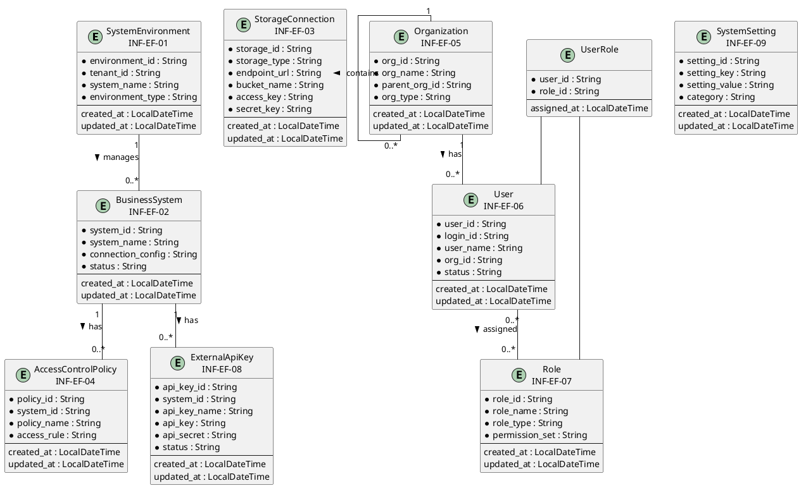
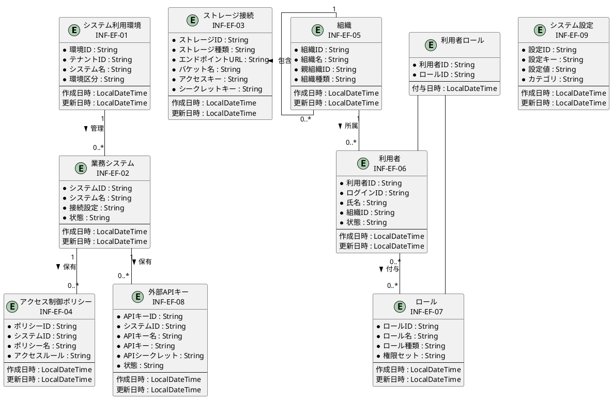

# 情報ER図

## 概要

本ファイルは、EF-01 帳票基盤管理の情報エンティティ間の関係をER図で定義します。

## ER図（英語版）

## ER図（日本語版）

## 情報エンティティ一覧

| 情報ID | 情報名 | 主要属性 | 関連エンティティ |
|--------|--------|----------|-----------------|
| INF-EF-01 | システム利用環境 | environment_id, tenant_id, system_name, environment_type | 業務システム |
| INF-EF-02 | 業務システム | system_id, system_name, connection_config, status | アクセス制御ポリシー, 外部APIキー |
| INF-EF-03 | ストレージ接続 | storage_id, storage_type, endpoint_url, bucket_name | - |
| INF-EF-04 | アクセス制御ポリシー | policy_id, system_id, policy_name, access_rule | 業務システム |
| INF-EF-05 | 組織 | org_id, org_name, parent_org_id, org_type | 組織(自己参照), 利用者 |
| INF-EF-06 | 利用者 | user_id, login_id, user_name, org_id, status | 組織, ロール |
| INF-EF-07 | ロール | role_id, role_name, role_type, permission_set | 利用者 |
| INF-EF-08 | 外部APIキー | api_key_id, system_id, api_key_name, api_key, status | 業務システム |
| INF-EF-09 | システム設定 | setting_id, setting_key, setting_value, category | - |

## 関係一覧

| 源エンティティ | 関係 | 対象エンティティ | 多重度 | 説明 |
|---------------|------|-----------------|--------|------|
| システム利用環境 | 管理 | 業務システム | 1 : 0..* | 1つの環境に複数の業務システムが存在 |
| 業務システム | 保有 | アクセス制御ポリシー | 1 : 0..* | 1つの業務システムに複数のアクセス制御ポリシーが存在 |
| 業務システム | 保有 | 外部APIキー | 1 : 0..* | 1つの業務システムに複数の外部APIキーが存在 |
| 組織 | 包含 | 組織 | 1 : 0..* | 階層構造（自己参照） |
| 組織 | 所属 | 利用者 | 1 : 0..* | 1つの組織に複数の利用者が所属 |
| 利用者 | 付与 | ロール | 0..* : 0..* | 複数の利用者に複数のロールを付与 |
