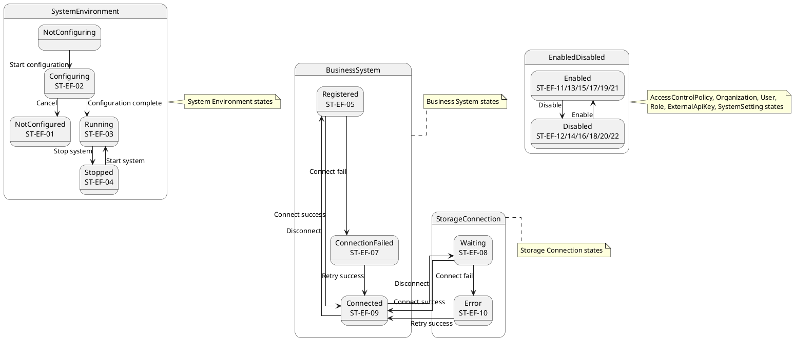
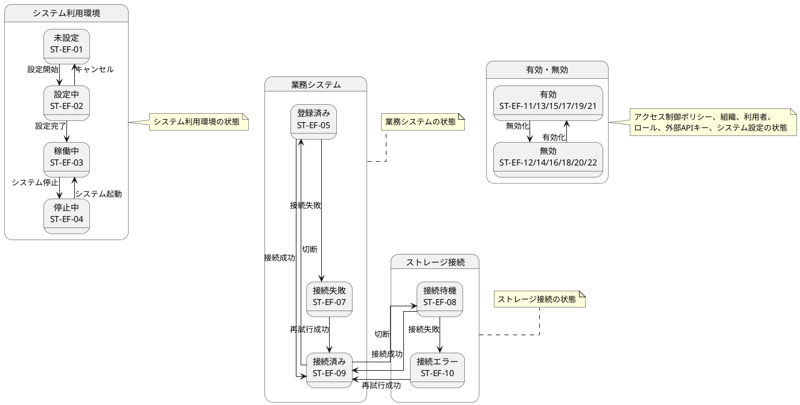

# ステートマシン図

## 概要

本ファイルは、EF-01 帳票基盤管理の情報エンティティの状態遷移をステートマシン図で定義します。

## ステートマシン図（英語版）

## ステートマシン図（日本語版）

## 状態一覧

| 状態ID | 状態名 | 対象情報 | 説明 |
|--------|--------|----------|------|
| ST-EF-01 | 未設定 | システム利用環境 | 設定されていない状態 |
| ST-EF-02 | 設定中 | システム利用環境 | 設定進行中 |
| ST-EF-03 | 稼働中 | システム利用環境 | 正常稼働中 |
| ST-EF-04 | 停止中 | システム利用環境 | 一時的停止 |
| ST-EF-05 | 登録済み | 業務システム | 登録完了 |
| ST-EF-06 | 接続済み | 業務システム | 接続完了 |
| ST-EF-07 | 接続失敗 | 業務システム | 接続エラー |
| ST-EF-08 | 接続待機 | ストレージ接続 | 接続待機中 |
| ST-EF-09 | 接続済み | ストレージ接続 | 接続完了 |
| ST-EF-10 | 接続エラー | ストレージ接続 | 接続エラー |
| ST-EF-11 | 有効 | アクセス制御ポリシー | ポリシー有効 |
| ST-EF-12 | 無効 | アクセス制御ポリシー | ポリシー無効 |
| ST-EF-13 | 有効 | 組織 | 組織有効 |
| ST-EF-14 | 無効 | 組織 | 組織無効 |
| ST-EF-15 | 有効 | 利用者 | 利用者有効 |
| ST-EF-16 | 無効 | 利用者 | 利用者無効 |
| ST-EF-17 | 有効 | ロール | ロール有効 |
| ST-EF-18 | 無効 | ロール | ロール無効 |
| ST-EF-19 | 有効 | 外部APIキー | APIキー有効 |
| ST-EF-20 | 無効 | 外部APIキー | APIキー無効 |
| ST-EF-21 | 有効 | システム設定 | 設定有効 |
| ST-EF-22 | 無効 | システム設定 | 設定無効 |

## 遷移一覧

| 遷移ID | 源状態 | 遷移条件 | 対象状態 | 説明 |
|--------|--------|----------|----------|------|
| TR-EF-01 | 未設定 | 設定開始 | 設定中 | システム利用環境の設定を開始 |
| TR-EF-02 | 設定中 | 設定完了 | 稼働中 | 設定が正常に完了 |
| TR-EF-03 | 設定中 | キャンセル | 未設定 | 設定をキャンセル |
| TR-EF-04 | 稼働中 | システム停止 | 停止中 | システムを停止 |
| TR-EF-05 | 停止中 | システム起動 | 稼働中 | システムを起動 |
| TR-EF-06 | 登録済み | 接続成功 | 接続済み | 業務システムに接続成功 |
| TR-EF-07 | 登録済み | 接続失敗 | 接続失敗 | 業務システムに接続失敗 |
| TR-EF-08 | 接続失敗 | 再試行成功 | 接続済み | 再接続に成功 |
| TR-EF-09 | 接続済み | 切断 | 登録済み | 業務システムを切断 |
| TR-EF-10 | 接続待機 | 接続成功 | 接続済み | ストレージに接続成功 |
| TR-EF-11 | 接続待機 | 接続失敗 | 接続エラー | ストレージに接続失敗 |
| TR-EF-12 | 接続エラー | 再試行成功 | 接続済み | 再接続に成功 |
| TR-EF-13 | 接続済み | 切断 | 接続待機 | ストレージを切断 |
| TR-EF-14 | 有効 | 無効化 | 無効 | 対象を無効化 |
| TR-EF-15 | 無効 | 有効化 | 有効 | 対象を有効化 |
