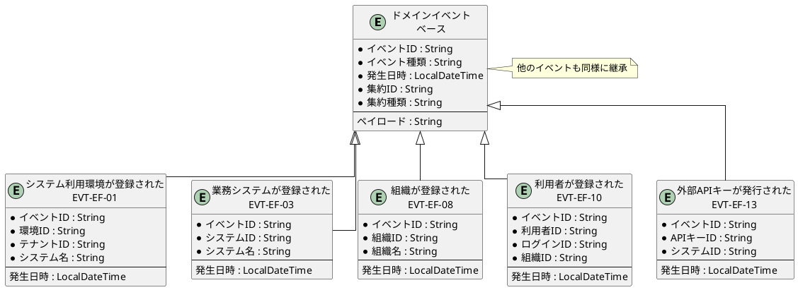

# イベントER図

## 概要

本ファイルは、EF-01 帳票基盤管理のイベントエンティティ間の関係をER図で定義します。

## ER図（英語版）

```plantuml
@startuml
skinparam linetype ortho

entity "DomainEvent\nBase" as DomainEvent {
  * event_id : String
  * event_type : String
  * occurred_at : LocalDateTime
  * aggregate_id : String
  * aggregate_type : String
  --
  payload : String
}

entity "SystemEnvironmentRegistered\nEVT-EF-01" as SERegistered {
  * event_id : String
  * environment_id : String
  * tenant_id : String
  * system_name : String
  --
  occurred_at : LocalDateTime
}

entity "SystemEnvironmentUpdated\nEVT-EF-02" as SEUpdated {
  * event_id : String
  * environment_id : String
  * changed_fields : String
  --
  occurred_at : LocalDateTime
}

entity "BusinessSystemRegistered\nEVT-EF-03" as BSRegistered {
  * event_id : String
  * system_id : String
  * system_name : String
  --
  occurred_at : LocalDateTime
}

entity "BusinessSystemUpdated\nEVT-EF-04" as BSUpdated {
  * event_id : String
  * system_id : String
  * changed_fields : String
  --
  occurred_at : LocalDateTime
}

entity "StorageConnectionConfigured\nEVT-EF-05" as SCConfigured {
  * event_id : String
  * storage_id : String
  * storage_type : String
  --
  occurred_at : LocalDateTime
}

entity "AccessControlPolicyChanged\nEVT-EF-07" as ACPChanged {
  * event_id : String
  * policy_id : String
  * system_id : String
  --
  occurred_at : LocalDateTime
}

entity "OrganizationRegistered\nEVT-EF-08" as OrgRegistered {
  * event_id : String
  * org_id : String
  * org_name : String
  --
  occurred_at : LocalDateTime
}

entity "UserRegistered\nEVT-EF-10" as UserRegistered {
  * event_id : String
  * user_id : String
  * login_id : String
  * org_id : String
  --
  occurred_at : LocalDateTime
}

entity "RoleChanged\nEVT-EF-12" as RoleChanged {
  * event_id : String
  * role_id : String
  * role_name : String
  --
  occurred_at : LocalDateTime
}

entity "ExternalApiKeyIssued\nEVT-EF-13" as APIKeyIssued {
  * event_id : String
  * api_key_id : String
  * system_id : String
  --
  occurred_at : LocalDateTime
}

entity "SystemSettingChanged\nEVT-EF-15" as SSChanged {
  * event_id : String
  * setting_id : String
  * setting_key : String
  --
  occurred_at : LocalDateTime
}

DomainEvent <|-- SERegistered
DomainEvent <|-- SEUpdated
DomainEvent <|-- BSRegistered
DomainEvent <|-- BSUpdated
DomainEvent <|-- SCConfigured
DomainEvent <|-- ACPChanged
DomainEvent <|-- OrgRegistered
DomainEvent <|-- UserRegistered
DomainEvent <|-- RoleChanged
DomainEvent <|-- APIKeyIssued
DomainEvent <|-- SSChanged

@enduml
```

## ER図（日本語版）

## イベントエンティティ一覧

| イベントID | イベント名 | 集約 | 主要属性 |
|------------|------------|------|----------|
| EVT-EF-01 | システム利用環境が登録された | SystemEnvironment | environment_id, tenant_id, system_name |
| EVT-EF-02 | システム利用環境が更新された | SystemEnvironment | environment_id, changed_fields |
| EVT-EF-03 | 業務システムが登録された | BusinessSystem | system_id, system_name |
| EVT-EF-04 | 業務システムが更新された | BusinessSystem | system_id, changed_fields |
| EVT-EF-05 | ストレージ接続が設定された | StorageConnection | storage_id, storage_type |
| EVT-EF-06 | ストレージ接続が更新された | StorageConnection | storage_id, changed_fields |
| EVT-EF-07 | アクセス制御ポリシーが変更された | AccessControlPolicy | policy_id, system_id |
| EVT-EF-08 | 組織が登録された | Organization | org_id, org_name |
| EVT-EF-09 | 組織が更新された | Organization | org_id, changed_fields |
| EVT-EF-10 | 利用者が登録された | User | user_id, login_id, org_id |
| EVT-EF-11 | 利用者が更新された | User | user_id, changed_fields |
| EVT-EF-12 | ロールが変更された | Role | role_id, role_name |
| EVT-EF-13 | 外部APIキーが発行された | ExternalApiKey | api_key_id, system_id |
| EVT-EF-14 | 外部APIキーが無効化された | ExternalApiKey | api_key_id, system_id |
| EVT-EF-15 | システム設定が変更された | SystemSetting | setting_id, setting_key |

## 関係一覧

| 源エンティティ | 関係 | 対象エンティティ | 説明 |
|---------------|------|-----------------|------|
| DomainEvent | 継承 | システム利用環境が登録された | ベースイベントから継承 |
| DomainEvent | 継承 | 業務システムが登録された | ベースイベントから継承 |
| DomainEvent | 継承 | 組織が登録された | ベースイベントから継承 |
| DomainEvent | 継承 | 利用者が登録された | ベースイベントから継承 |
| DomainEvent | 継承 | 外部APIキーが発行された | ベースイベントから継承 |
