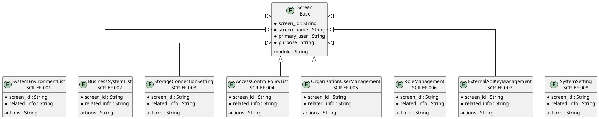
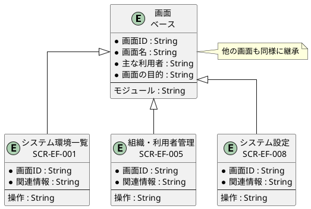

# 画面ER図

## 概要

本ファイルは、EF-01 帳票基盤管理の画面エンティティ間の関係をER図で定義します。

## ER図（英語版）

## ER図（日本語版）

## 画面エンティティ一覧

| 画面ID | 画面名 | 関連情報 | 主な操作 |
|--------|--------|----------|----------|
| SCR-EF-001 | システム環境一覧 | システム利用環境 | 一覧・検索・編集 |
| SCR-EF-002 | 業務システム一覧 | 業務システム | 一覧・検索・登録・編集 |
| SCR-EF-003 | ストレージ接続設定 | ストレージ接続 | 一覧・設定・テスト |
| SCR-EF-004 | アクセス制御ポリシー一覧 | アクセス制御ポリシー | 一覧・検索・登録・編集 |
| SCR-EF-005 | 組織・利用者管理 | 組織, 利用者 | 一覧・検索・登録・編集 |
| SCR-EF-006 | ロール管理 | ロール | 一覧・検索・登録・編集 |
| SCR-EF-007 | 外部APIキー管理 | 外部APIキー | 一覧・検索・発行・無効化 |
| SCR-EF-008 | システム設定 | システム設定 | 一覧・編集 |

## 関係一覧

| 源エンティティ | 関係 | 対象エンティティ | 説明 |
|---------------|------|-----------------|------|
| Screen | 継承 | システム環境一覧 | ベース画面から継承 |
| Screen | 継承 | 組織・利用者管理 | ベース画面から継承 |
| Screen | 継承 | システム設定 | ベース画面から継承 |
