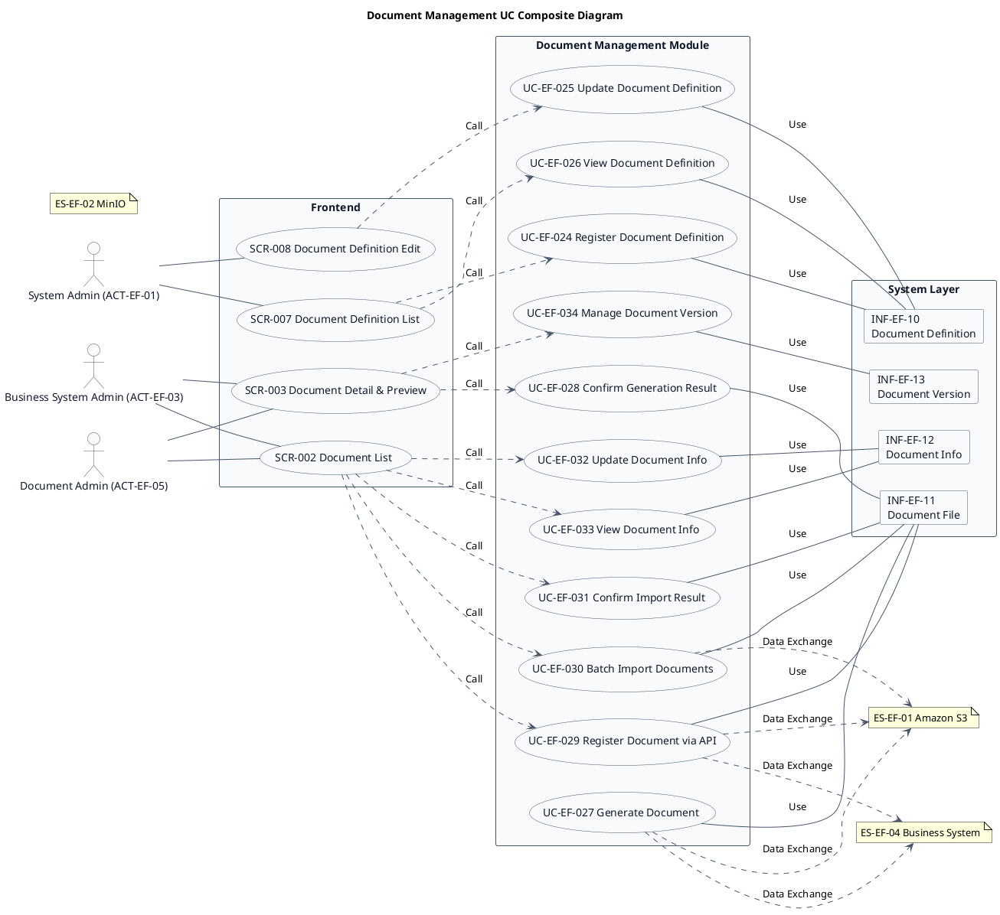
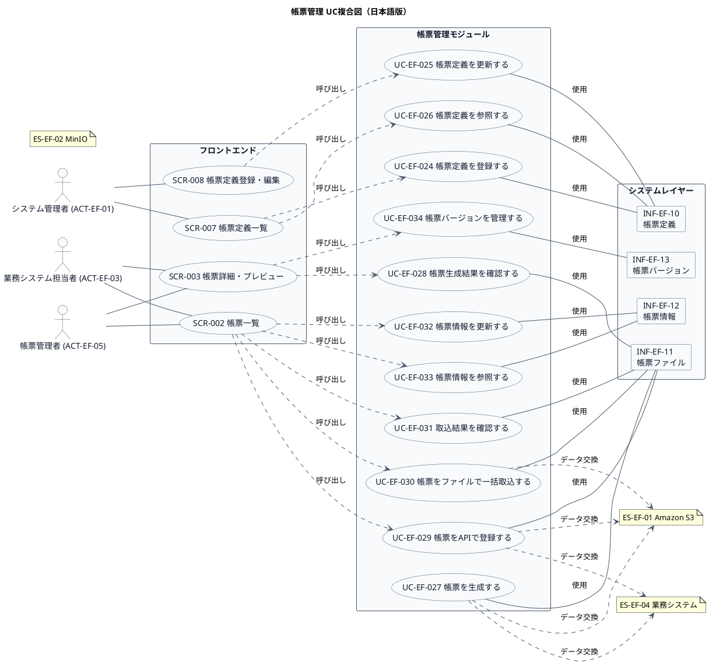

# UC複合図

帳票管理業務領域で扱うユースケース、画面、イベント、情報などを関連づけたUC複合図です。

## 1. 目的

本書は、EF-02 帳票管理業務領域のシステム境界レイヤーで扱うユースケース、画面、イベント、情報、条件を関連づけたUC複合図です。

## 2. PlantUML UC複合図（英語版）

## 3. 日本語版 UC複合図

## 4. ユースケース一覧

| ユースケースID | ユースケース名                   | 英語名                          | 説明                                                       | 関連アクター                       |
|----------------|----------------------------------|---------------------------------|------------------------------------------------------------|------------------------------------|
| UC-EF-024      | 帳票定義を登録する               | Register Document Definition    | 帳票種類、レイアウト、テンプレートを登録する                 | ACT-EF-01                          |
| UC-EF-025      | 帳票定義を更新する               | Update Document Definition      | 既存の帳票定義を修正する                                   | ACT-EF-01                          |
| UC-EF-026      | 帳票定義を参照する               | View Document Definition        | 登録された帳票定義一覧・詳細を確認する                     | ACT-EF-01, ACT-EF-03               |
| UC-EF-027      | 帳票を生成する                   | Generate Document               | テンプレートとデータから帳票ファイルを生成する             | ACT-EF-03                          |
| UC-EF-028      | 帳票生成結果を確認する           | Confirm Generation Result       | 生成された帳票ファイルを確認する                           | ACT-EF-03                          |
| UC-EF-029      | 帳票をAPIで登録する              | Register Document via API       | API経由で帳票を登録する                                    | ACT-EF-03                          |
| UC-EF-030      | 帳票をファイルで一括取込する     | Batch Import Documents          | ファイルアップロードにより帳票を一括取込する               | ACT-EF-03                          |
| UC-EF-031      | 取込結果を確認する               | Confirm Import Result           | 一括取込の結果を確認する                                   | ACT-EF-03                          |
| UC-EF-032      | 帳票情報を更新する               | Update Document Info            | 帳票のメタデータ、状態を更新する                           | ACT-EF-05                          |
| UC-EF-033      | 帳票情報を参照する               | View Document Info              | 帳票の一覧・詳細を確認する                                 | ACT-EF-05                          |
| UC-EF-034      | 帳票バージョンを管理する         | Manage Document Version         | 帳票のバージョン履歴を確認・管理する                       | ACT-EF-05                          |

## 5. 画面一覧

| 画面ID  | 画面名                      | 英語名                     | 主な利用者                       | 関連ユースケース |
|---------|-----------------------------|----------------------------|----------------------------------|------------------|
| SCR-002 | 帳票一覧                    | Document List              | 業務システム担当者、帳票管理者   | UC-EF-029〜033   |
| SCR-003 | 帳票詳細・プレビュー        | Document Detail & Preview  | 業務システム担当者、帳票管理者   | UC-EF-028, 034   |
| SCR-007 | 帳票定義一覧                | Document Definition List   | システム管理者                   | UC-EF-024, 026   |
| SCR-008 | 帳票定義登録・編集          | Document Definition Edit   | システム管理者                   | UC-EF-025        |

## 6. イベント一覧

| イベントID | イベント名                           | 英語名                              | 説明                                                         | 関連ユースケース |
|------------|--------------------------------------|-------------------------------------|--------------------------------------------------------------|------------------|
| EVT-EF-018 | 帳票定義が登録された                 | Document Definition Registered      | 帳票種類、レイアウト、テンプレートが登録された                 | UC-EF-024        |
| EVT-EF-019 | 帳票定義が更新された                 | Document Definition Updated         | 既存の帳票定義が修正された                                   | UC-EF-025        |
| EVT-EF-020 | 帳票が生成された                     | Document Generated                  | テンプレートとデータから帳票ファイルが生成された             | UC-EF-027        |
| EVT-EF-021 | 帳票がAPIで登録された               | Document Registered via API         | API経由で帳票が登録された                                    | UC-EF-029        |
| EVT-EF-022 | 帳票が一括取込された                 | Documents Batch Imported            | ファイルアップロードにより帳票が一括取込された               | UC-EF-030        |
| EVT-EF-023 | 帳票情報が更新された                 | Document Info Updated               | 帳票のメタデータ、状態が更新された                           | UC-EF-032        |
| EVT-EF-024 | 帳票バージョンが管理された           | Document Version Managed            | 帳票のバージョン履歴が管理された                             | UC-EF-034        |

## 7. 情報一覧

| 情報ID    | 情報名             | 英語名               | 情報種類 | 説明                                           | 関連ユースケース |
|-----------|-------------------|----------------------|----------|------------------------------------------------|------------------|
| INF-EF-10 | 帳票定義         | Document Definition  | リソース | 帳票種類、レイアウト、テンプレート             | UC-EF-024〜026   |
| INF-EF-11 | 帳票ファイル     | Document File        | リソース | 生成・登録・取込された帳票ファイル             | UC-EF-027〜031   |
| INF-EF-12 | 帳票情報         | Document Info        | リソース | 帳票のメタデータ、状態                         | UC-EF-032〜033   |
| INF-EF-13 | 帳票バージョン   | Document Version     | リソース | 帳票のバージョン履歴                           | UC-EF-034        |

## 8. 参照情報

- ユースケース一覧: `01.ユースケース/ユースケース一覧.md`
- 画面一覧: `04.システム/04.画面/画面一覧.md`
- イベント一覧: `04.システム/03.イベント/イベント一覧.md`
- 情報一覧: `04.システム/01.情報/情報一覧.md`
- 外部システム一覧: `02.外部環境/01.外部システム定義/外部システム一覧.md`
