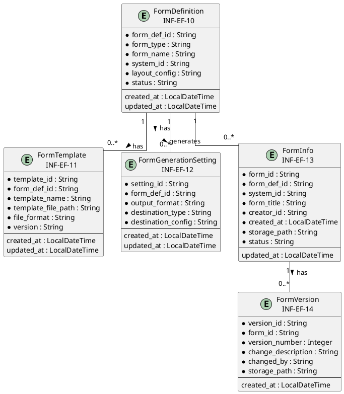
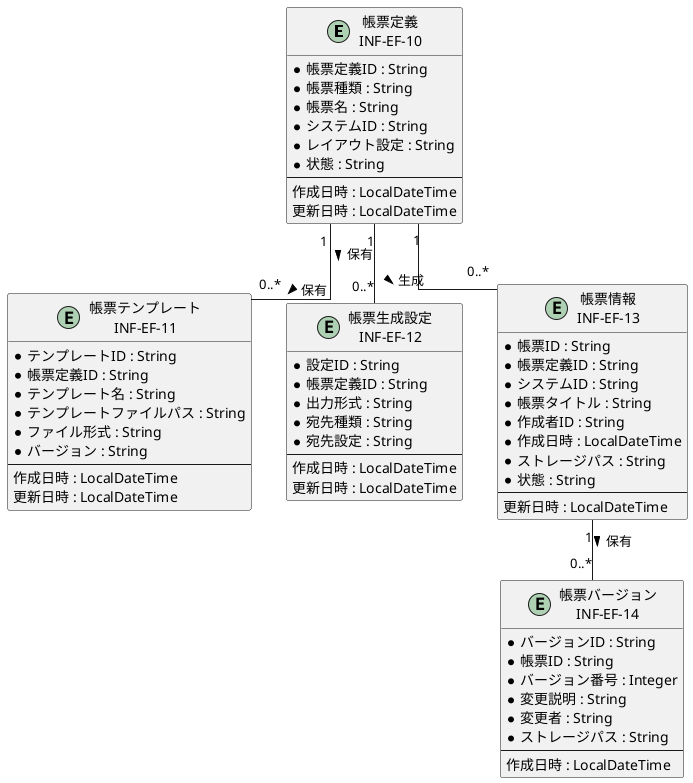

# 情報ER図

## 概要

本ファイルは、EF-02 帳票管理の情報エンティティ間の関係をER図で定義します。

## ER図（英語版）

## ER図（日本語版）

## 情報エンティティ一覧

| 情報ID | 情報名 | 主要属性 | 関連エンティティ |
|--------|--------|----------|-----------------|
| INF-EF-10 | 帳票定義 | form_def_id, form_type, form_name, system_id | 帳票テンプレート, 帳票生成設定, 帳票情報 |
| INF-EF-11 | 帳票テンプレート | template_id, form_def_id, template_name, file_format | 帳票定義 |
| INF-EF-12 | 帳票生成設定 | setting_id, form_def_id, output_format, destination_type | 帳票定義 |
| INF-EF-13 | 帳票情報 | form_id, form_def_id, system_id, form_title, storage_path | 帳票定義, 帳票バージョン |
| INF-EF-14 | 帳票バージョン | version_id, form_id, version_number, change_description | 帳票情報 |

## 関係一覧

| 源エンティティ | 関係 | 対象エンティティ | 多重度 | 説明 |
|---------------|------|-----------------|--------|------|
| 帳票定義 | 保有 | 帳票テンプレート | 1 : 0..* | 1つの帳票定義に複数のテンプレートが存在 |
| 帳票定義 | 保有 | 帳票生成設定 | 1 : 0..* | 1つの帳票定義に複数の生成設定が存在 |
| 帳票定義 | 生成 | 帳票情報 | 1 : 0..* | 1つの帳票定義から複数の帳票が生成 |
| 帳票情報 | 保有 | 帳票バージョン | 1 : 0..* | 1つの帳票に複数のバージョンが存在 |
