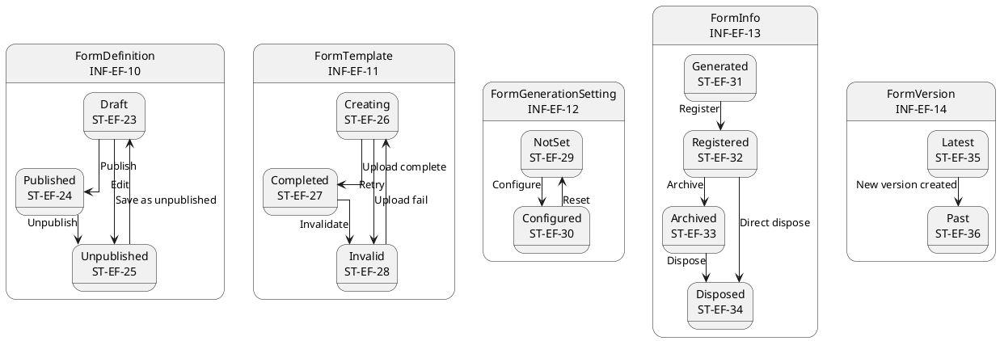
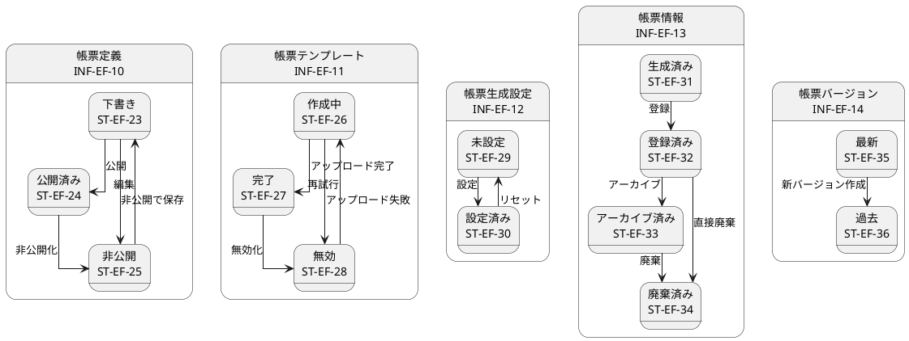

# ステートマシン図

## 概要

本ファイルは、EF-02 帳票管理の情報エンティティの状態遷移をステートマシン図で定義します。

## ステートマシン図（英語版）

## ステートマシン図（日本語版）

## 状態一覧

| 状態ID | 状態名 | 対象情報 | 説明 |
|--------|--------|----------|------|
| ST-EF-23 | 下書き | 帳票定義 | 下書き状態 |
| ST-EF-24 | 公開済み | 帳票定義 | 公開済み |
| ST-EF-25 | 非公開 | 帳票定義 | 非公開状態 |
| ST-EF-26 | 作成中 | 帳票テンプレート | 作成中 |
| ST-EF-27 | 完了 | 帳票テンプレート | 作成完了 |
| ST-EF-28 | 無効 | 帳票テンプレート | 無効状態 |
| ST-EF-29 | 未設定 | 帳票生成設定 | 未設定 |
| ST-EF-30 | 設定済み | 帳票生成設定 | 設定完了 |
| ST-EF-31 | 生成済み | 帳票情報 | 生成完了 |
| ST-EF-32 | 登録済み | 帳票情報 | 登録完了 |
| ST-EF-33 | アーカイブ済み | 帳票情報 | アーカイブ完了 |
| ST-EF-34 | 廃棄済み | 帳票情報 | 廃棄完了 |
| ST-EF-35 | 最新 | 帳票バージョン | 最新バージョン |
| ST-EF-36 | 過去 | 帳票バージョン | 過去バージョン |

## 遷移一覧

| 遷移ID | 源状態 | 遷移条件 | 対象状態 | 説明 |
|--------|--------|----------|----------|------|
| TR-EF-16 | 下書き | 公開 | 公開済み | 帳票定義を公開 |
| TR-EF-17 | 公開済み | 非公開化 | 非公開 | 帳票定義を非公開化 |
| TR-EF-18 | 非公開 | 編集 | 下書き | 非公開定義を編集 |
| TR-EF-19 | 下書き | 非公開で保存 | 非公開 | 下書きを非公開で保存 |
| TR-EF-20 | 作成中 | アップロード完了 | 完了 | テンプレートアップロード完了 |
| TR-EF-21 | 作成中 | アップロード失敗 | 無効 | テンプレートアップロード失敗 |
| TR-EF-22 | 完了 | 無効化 | 無効 | テンプレートを無効化 |
| TR-EF-23 | 無効 | 再試行 | 作成中 | テンプレートを再作成 |
| TR-EF-24 | 未設定 | 設定 | 設定済み | 生成設定を完了 |
| TR-EF-25 | 設定済み | リセット | 未設定 | 生成設定をリセット |
| TR-EF-26 | 生成済み | 登録 | 登録済み | 帳票を登録 |
| TR-EF-27 | 登録済み | アーカイブ | アーカイブ済み | 帳票をアーカイブ |
| TR-EF-28 | アーカイブ済み | 廃棄 | 廃棄済み | アーカイブ帳票を廃棄 |
| TR-EF-29 | 登録済み | 直接廃棄 | 廃棄済み | 帳票を直接廃棄 |
| TR-EF-30 | 最新 | 新バージョン作成 | 過去 | 新バージョンで過去化 |
