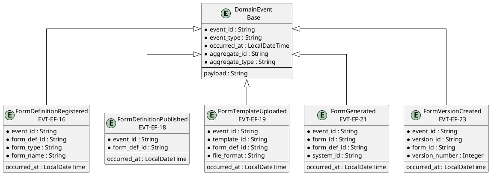
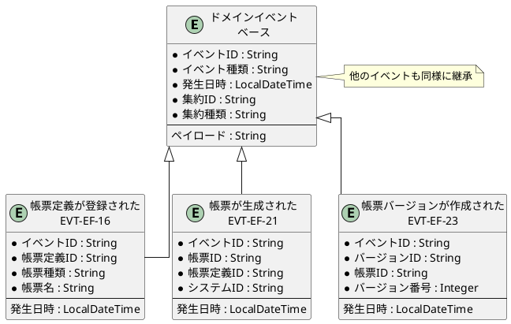

# イベントER図

## 概要

本ファイルは、EF-02 帳票管理のイベントエンティティ間の関係をER図で定義します。

## ER図（英語版）

## ER図（日本語版）

## イベントエンティティ一覧

| イベントID | イベント名 | 集約 | 主要属性 |
|------------|------------|------|----------|
| EVT-EF-16 | 帳票定義が登録された | FormDefinition | form_def_id, form_type, form_name |
| EVT-EF-17 | 帳票定義が更新された | FormDefinition | form_def_id, changed_fields |
| EVT-EF-18 | 帳票定義が公開された | FormDefinition | form_def_id |
| EVT-EF-19 | 帳票テンプレートがアップロードされた | FormTemplate | template_id, form_def_id, file_format |
| EVT-EF-20 | 帳票生成設定が変更された | FormGenerationSetting | setting_id, form_def_id |
| EVT-EF-21 | 帳票が生成された | FormInfo | form_id, form_def_id, system_id |
| EVT-EF-22 | 帳票が登録された | FormInfo | form_id, form_def_id |
| EVT-EF-23 | 帳票バージョンが作成された | FormVersion | version_id, form_id, version_number |

## 関係一覧

| 源エンティティ | 関係 | 対象エンティティ | 説明 |
|---------------|------|-----------------|------|
| DomainEvent | 継承 | 帳票定義が登録された | ベースイベントから継承 |
| DomainEvent | 継承 | 帳票が生成された | ベースイベントから継承 |
| DomainEvent | 継承 | 帳票バージョンが作成された | ベースイベントから継承 |
