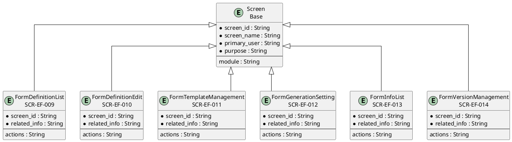
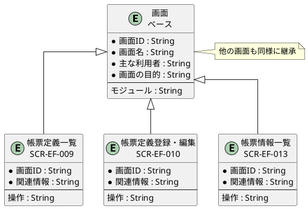

# 画面ER図

## 概要

本ファイルは、EF-02 帳票管理の画面エンティティ間の関係をER図で定義します。

## ER図（英語版）

## ER図（日本語版）

## 画面エンティティ一覧

| 画面ID | 画面名 | 関連情報 | 主な操作 |
|--------|--------|----------|----------|
| SCR-EF-009 | 帳票定義一覧 | 帳票定義 | 一覧・検索・登録・編集 |
| SCR-EF-010 | 帳票定義登録・編集 | 帳票定義 | 登録・編集・公開 |
| SCR-EF-011 | 帳票テンプレート管理 | 帳票テンプレート | 一覧・アップロード・無効化 |
| SCR-EF-012 | 帳票生成設定 | 帳票生成設定 | 設定・編集 |
| SCR-EF-013 | 帳票情報一覧 | 帳票情報 | 一覧・検索・プレビュー |
| SCR-EF-014 | 帳票バージョン管理 | 帳票バージョン | 一覧・差分確認 |

## 関係一覧

| 源エンティティ | 関係 | 対象エンティティ | 説明 |
|---------------|------|-----------------|------|
| Screen | 継承 | 帳票定義一覧 | ベース画面から継承 |
| Screen | 継承 | 帳票定義登録・編集 | ベース画面から継承 |
| Screen | 継承 | 帳票情報一覧 | ベース画面から継承 |
