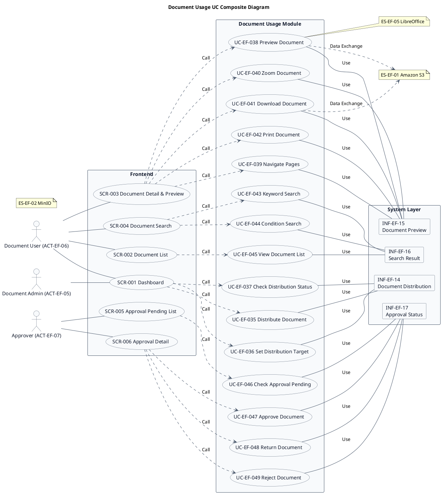
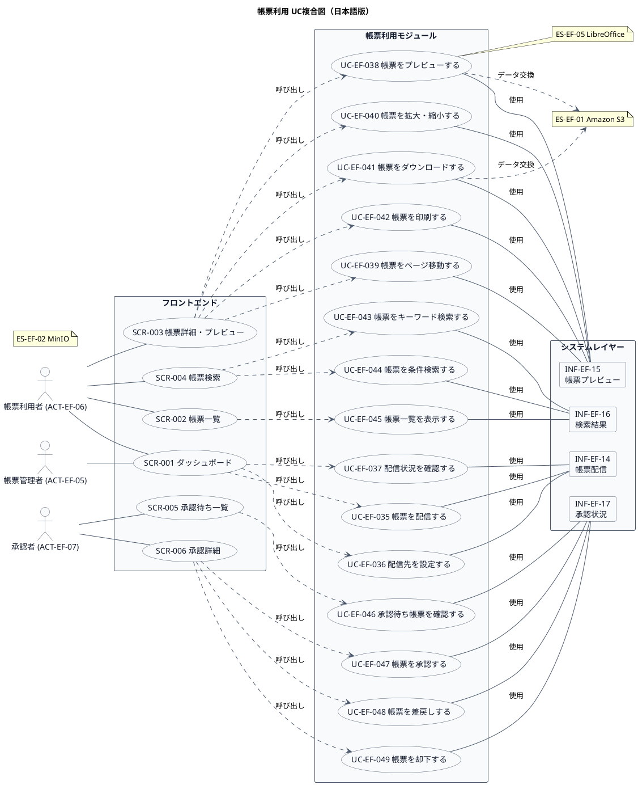

# UC複合図

帳票利用業務領域で扱うユースケース、画面、イベント、情報などを関連づけたUC複合図です。

## 1. 目的

本書は、EF-03 帳票利用業務領域のシステム境界レイヤーで扱うユースケース、画面、イベント、情報、条件を関連づけたUC複合図です。

## 2. PlantUML UC複合図（英語版）

## 3. 日本語版 UC複合図

## 4. ユースケース一覧

| ユースケースID | ユースケース名                   | 英語名                          | 説明                                                       | 関連アクター                       |
|----------------|----------------------------------|---------------------------------|------------------------------------------------------------|------------------------------------|
| UC-EF-035      | 帳票を配信する                   | Distribute Document             | 利用者・組織・取引先へ帳票を配信する                       | ACT-EF-05                          |
| UC-EF-036      | 配信先を設定する                 | Set Distribution Target         | 帳票の配信先（利用者・組織）を設定する                     | ACT-EF-05                          |
| UC-EF-037      | 配信状況を確認する               | Check Distribution Status       | 帳票の配信状況を確認する                                   | ACT-EF-05                          |
| UC-EF-038      | 帳票をプレビューする             | Preview Document                | PDF・Office文書をブラウザでプレビュー表示する              | ACT-EF-06                          |
| UC-EF-039      | 帳票をページ移動する             | Navigate Pages                  | プレビューでページを移動する                               | ACT-EF-06                          |
| UC-EF-040      | 帳票を拡大・縮小する             | Zoom Document                   | プレビューで表示倍率を変更する                             | ACT-EF-06                          |
| UC-EF-041      | 帳票をダウンロードする           | Download Document               | 帳票ファイルをダウンロードする                             | ACT-EF-06                          |
| UC-EF-042      | 帳票を印刷する                   | Print Document                  | 帳票を印刷する                                             | ACT-EF-06                          |
| UC-EF-043      | 帳票をキーワード検索する         | Keyword Search                  | キーワードで帳票を検索する                                 | ACT-EF-06                          |
| UC-EF-044      | 帳票を条件検索する               | Condition Search                | 業務システム、帳票種類、発行日などの条件で検索する         | ACT-EF-06                          |
| UC-EF-045      | 帳票一覧を表示する               | View Document List              | 閲覧可能な帳票を一覧表示する                               | ACT-EF-06                          |
| UC-EF-046      | 承認待ち帳票を確認する           | Check Approval Pending          | 承認待ちの帳票一覧を確認する                               | ACT-EF-07                          |
| UC-EF-047      | 帳票を承認する                   | Approve Document                | 帳票の内容を確認して承認する                               | ACT-EF-07                          |
| UC-EF-048      | 帳票を差戻しする                 | Return Document                 | 帳票を申請者に差戻しする                                   | ACT-EF-07                          |
| UC-EF-049      | 帳票を却下する                   | Reject Document                 | 帳票を却下する                                             | ACT-EF-07                          |

## 5. 画面一覧

| 画面ID  | 画面名                      | 英語名                     | 主な利用者                       | 関連ユースケース |
|---------|-----------------------------|----------------------------|----------------------------------|------------------|
| SCR-001 | ダッシュボード              | Dashboard                  | 帳票管理者、帳票利用者           | UC-EF-035〜037   |
| SCR-002 | 帳票一覧                    | Document List              | 帳票利用者                       | UC-EF-045        |
| SCR-003 | 帳票詳細・プレビュー        | Document Detail & Preview  | 帳票利用者                       | UC-EF-038〜042   |
| SCR-004 | 帳票検索                    | Document Search            | 帳票利用者                       | UC-EF-043〜044   |
| SCR-005 | 承認待ち一覧                | Approval Pending List      | 承認者                           | UC-EF-046        |
| SCR-006 | 承認詳細                    | Approval Detail            | 承認者                           | UC-EF-047〜049   |

## 6. イベント一覧

| イベントID | イベント名                           | 英語名                              | 説明                                                         | 関連ユースケース |
|------------|--------------------------------------|-------------------------------------|--------------------------------------------------------------|------------------|
| EVT-EF-025 | 帳票が配信された                     | Document Distributed                | 利用者・組織・取引先へ帳票が配信された                       | UC-EF-035        |
| EVT-EF-026 | 配信先が設定された                   | Distribution Target Set             | 帳票の配信先が設定された                                     | UC-EF-036        |
| EVT-EF-027 | 帳票がプレビューされた               | Document Previewed                  | 帳票がブラウザでプレビュー表示された                         | UC-EF-038        |
| EVT-EF-028 | 帳票がダウンロードされた             | Document Downloaded                 | 帳票ファイルがダウンロードされた                             | UC-EF-041        |
| EVT-EF-029 | 帳票が印刷された                     | Document Printed                    | 帳票が印刷された                                             | UC-EF-042        |
| EVT-EF-030 | 帳票が検索された                     | Document Searched                   | 帳票が検索された                                             | UC-EF-043, 044   |
| EVT-EF-031 | 帳票が承認された                     | Document Approved                   | 帳票が承認された                                             | UC-EF-047        |
| EVT-EF-032 | 帳票が差戻しされた                   | Document Returned                   | 帳票が申請者に差戻しされた                                   | UC-EF-048        |
| EVT-EF-033 | 帳票が却下された                     | Document Rejected                   | 帳票が却下された                                             | UC-EF-049        |

## 7. 情報一覧

| 情報ID    | 情報名             | 英語名               | 情報種類 | 説明                                           | 関連ユースケース |
|-----------|-------------------|----------------------|----------|------------------------------------------------|------------------|
| INF-EF-14 | 帳票配信         | Document Distribution | リソース | 帳票の配信先、配信状況                         | UC-EF-035〜037   |
| INF-EF-15 | 帳票プレビュー   | Document Preview     | リソース | 帳票のプレビュー表示情報                       | UC-EF-038〜042   |
| INF-EF-16 | 検索結果         | Search Result        | リソース | 帳票検索の結果                                 | UC-EF-043〜045   |
| INF-EF-17 | 承認状況         | Approval Status      | リソース | 帳票の承認・差戻し・却下状況                   | UC-EF-046〜049   |

## 8. 参照情報

- ユースケース一覧: `01.ユースケース/ユースケース一覧.md`
- 画面一覧: `04.システム/04.画面/画面一覧.md`
- イベント一覧: `04.システム/03.イベント/イベント一覧.md`
- 情報一覧: `04.システム/01.情報/情報一覧.md`
- 外部システム一覧: `02.外部環境/01.外部システム定義/外部システム一覧.md`
