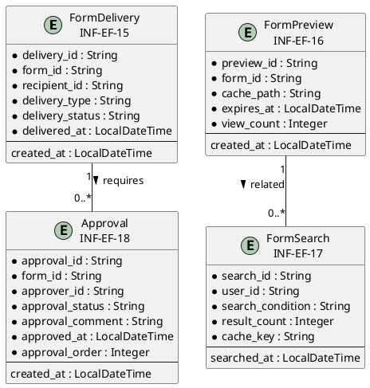
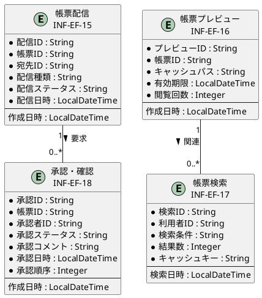

# 情報ER図

## 概要

本ファイルは、EF-03 帳票利用の情報エンティティ間の関係をER図で定義します。

## ER図（英語版）

## ER図（日本語版）

## 情報エンティティ一覧

| 情報ID | 情報名 | 主要属性 | 関連エンティティ |
|--------|--------|----------|-----------------|
| INF-EF-15 | 帳票配信 | delivery_id, form_id, recipient_id, delivery_status | 承認・確認 |
| INF-EF-16 | 帳票プレビュー | preview_id, form_id, cache_path, expires_at | 帳票検索 |
| INF-EF-17 | 帳票検索 | search_id, user_id, search_condition, result_count | 帳票プレビュー |
| INF-EF-18 | 承認・確認 | approval_id, form_id, approver_id, approval_status | 帳票配信 |

## 関係一覧

| 源エンティティ | 関係 | 対象エンティティ | 多重度 | 説明 |
|---------------|------|-----------------|--------|------|
| 帳票配信 | 要求 | 承認・確認 | 1 : 0..* | 配信前に承認が必要な場合がある |
| 帳票プレビュー | 関連 | 帳票検索 | 1 : 0..* | 検索結果からプレビューを表示 |
