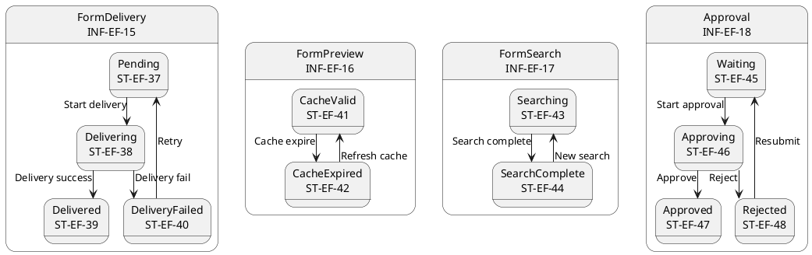
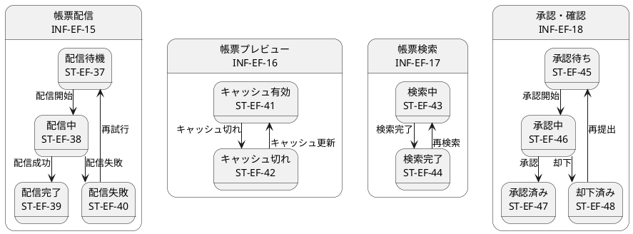

# ステートマシン図

## 概要

本ファイルは、EF-03 帳票利用の情報エンティティの状態遷移をステートマシン図で定義します。

## ステートマシン図（英語版）

## ステートマシン図（日本語版）

## 状態一覧

| 状態ID | 状態名 | 対象情報 | 説明 |
|--------|--------|----------|------|
| ST-EF-37 | 配信待機 | 帳票配信 | 配信待機中 |
| ST-EF-38 | 配信中 | 帳票配信 | 配信進行中 |
| ST-EF-39 | 配信完了 | 帳票配信 | 配信完了 |
| ST-EF-40 | 配信失敗 | 帳票配信 | 配信失敗 |
| ST-EF-41 | キャッシュ有効 | 帳票プレビュー | キャッシュ有効 |
| ST-EF-42 | キャッシュ切れ | 帳票プレビュー | キャッシュ切れ |
| ST-EF-43 | 検索中 | 帳票検索 | 検索進行中 |
| ST-EF-44 | 検索完了 | 帳票検索 | 検索完了 |
| ST-EF-45 | 承認待ち | 承認・確認 | 承認待機中 |
| ST-EF-46 | 承認中 | 承認・確認 | 承認進行中 |
| ST-EF-47 | 承認済み | 承認・確認 | 承認完了 |
| ST-EF-48 | 却下済み | 承認・確認 | 却下完了 |

## 遷移一覧

| 遷移ID | 源状態 | 遷移条件 | 対象状態 | 説明 |
|--------|--------|----------|----------|------|
| TR-EF-31 | 配信待機 | 配信開始 | 配信中 | 配信を開始 |
| TR-EF-32 | 配信中 | 配信成功 | 配信完了 | 配信が成功 |
| TR-EF-33 | 配信中 | 配信失敗 | 配信失敗 | 配信に失敗 |
| TR-EF-34 | 配信失敗 | 再試行 | 配信待機 | 配信を再試行 |
| TR-EF-35 | キャッシュ有効 | キャッシュ切れ | キャッシュ切れ | キャッシュが切れる |
| TR-EF-36 | キャッシュ切れ | キャッシュ更新 | キャッシュ有効 | キャッシュを更新 |
| TR-EF-37 | 検索中 | 検索完了 | 検索完了 | 検索が完了 |
| TR-EF-38 | 検索完了 | 再検索 | 検索中 | 再度検索 |
| TR-EF-39 | 承認待ち | 承認開始 | 承認中 | 承認を開始 |
| TR-EF-40 | 承認中 | 承認 | 承認済み | 承認が完了 |
| TR-EF-41 | 承認中 | 却下 | 却下済み | 承認が却下 |
| TR-EF-42 | 却下済み | 再提出 | 承認待ち | 却下後に再提出 |
