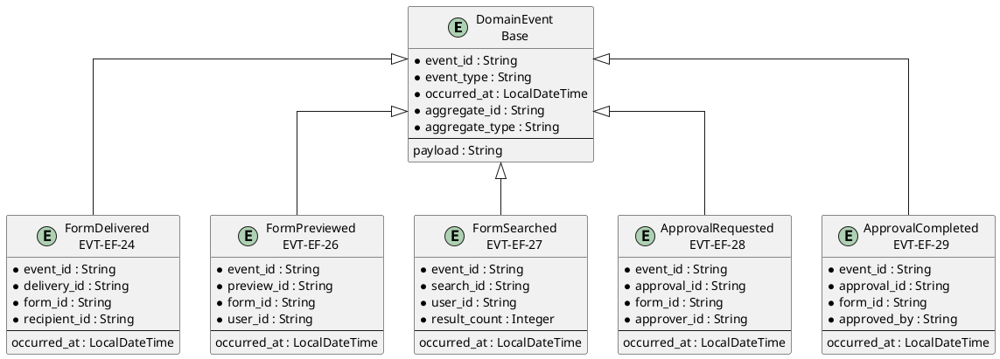
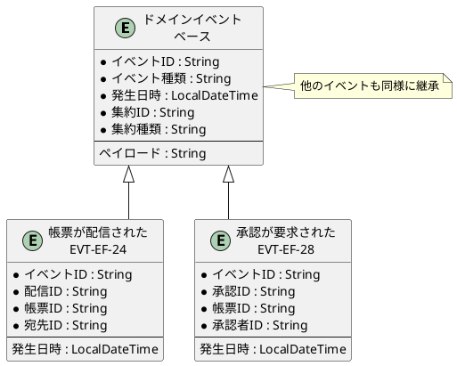

# イベントER図

## 概要

本ファイルは、EF-03 帳票利用のイベントエンティティ間の関係をER図で定義します。

## ER図（英語版）

## ER図（日本語版）

## イベントエンティティ一覧

| イベントID | イベント名 | 集約 | 主要属性 |
|------------|------------|------|----------|
| EVT-EF-24 | 帳票が配信された | FormDelivery | delivery_id, form_id, recipient_id |
| EVT-EF-25 | 帳票配信が失敗した | FormDelivery | delivery_id, form_id, error_message |
| EVT-EF-26 | 帳票がプレビューされた | FormPreview | preview_id, form_id, user_id |
| EVT-EF-27 | 帳票が検索された | FormSearch | search_id, user_id, result_count |
| EVT-EF-28 | 承認が要求された | Approval | approval_id, form_id, approver_id |
| EVT-EF-29 | 承認が完了した | Approval | approval_id, form_id, approved_by |
| EVT-EF-30 | 承認が却下された | Approval | approval_id, form_id, rejected_by |

## 関係一覧

| 源エンティティ | 関係 | 対象エンティティ | 説明 |
|---------------|------|-----------------|------|
| DomainEvent | 継承 | 帳票が配信された | ベースイベントから継承 |
| DomainEvent | 継承 | 承認が要求された | ベースイベントから継承 |
