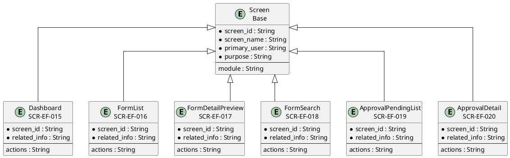
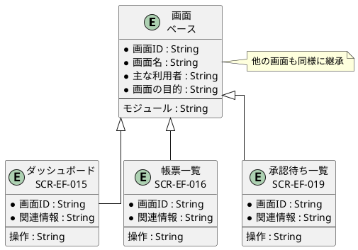

# 画面ER図

## 概要

本ファイルは、EF-03 帳票利用の画面エンティティ間の関係をER図で定義します。

## ER図（英語版）

## ER図（日本語版）

## 画面エンティティ一覧

| 画面ID | 画面名 | 関連情報 | 主な操作 |
|--------|--------|----------|----------|
| SCR-EF-015 | ダッシュボード | 帳票配信, 帳票分析 | 概要確認・統計表示 |
| SCR-EF-016 | 帳票一覧 | 帳票情報 | 一覧・検索・プレビュー |
| SCR-EF-017 | 帳票詳細・プレビュー | 帳票情報, 帳票プレビュー | 詳細表示・プレビュー |
| SCR-EF-018 | 帳票検索 | 帳票検索 | 検索条件入力・結果表示 |
| SCR-EF-019 | 承認待ち一覧 | 承認・確認 | 一覧・承認・却下 |
| SCR-EF-020 | 承認詳細 | 承認・確認, 帳票情報 | 詳細表示・承認・却下 |

## 関係一覧

| 源エンティティ | 関係 | 対象エンティティ | 説明 |
|---------------|------|-----------------|------|
| Screen | 継承 | ダッシュボード | ベース画面から継承 |
| Screen | 継承 | 帳票一覧 | ベース画面から継承 |
| Screen | 継承 | 承認待ち一覧 | ベース画面から継承 |
