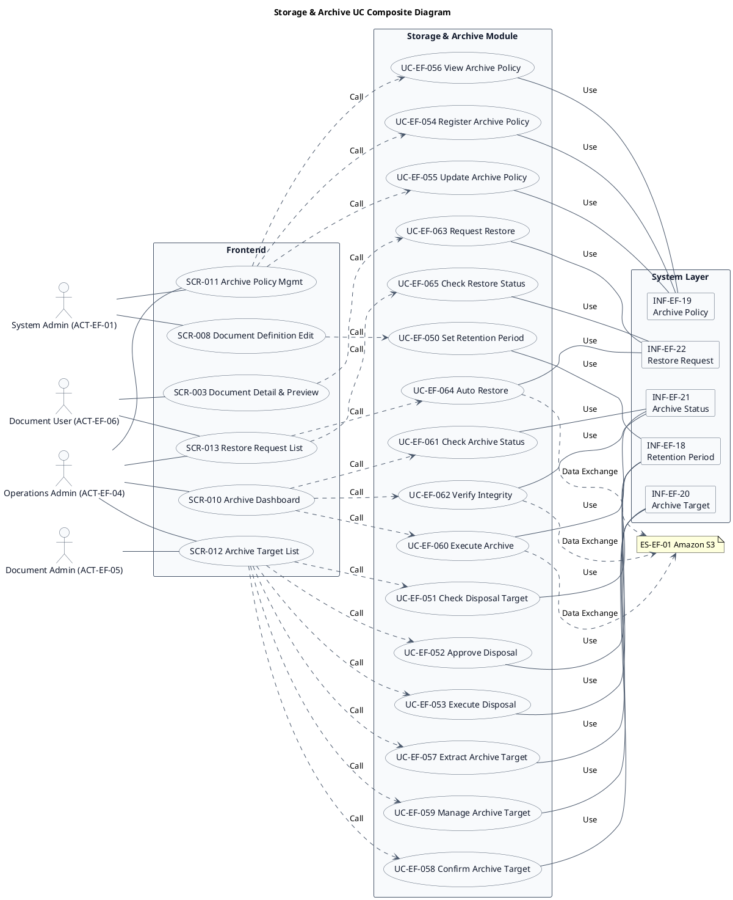
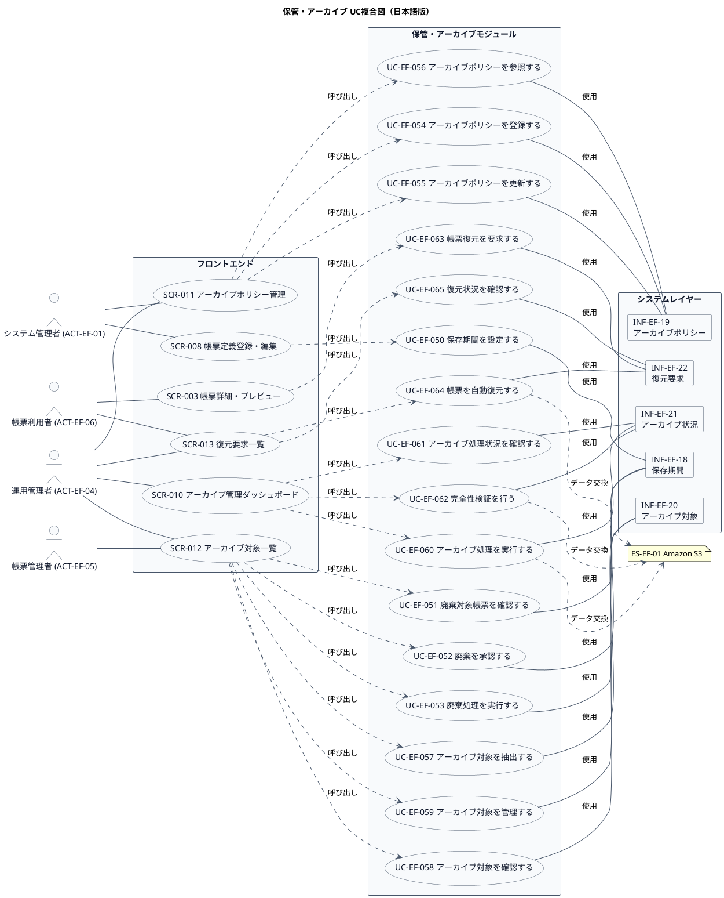

# UC複合図

保管・アーカイブ業務領域で扱うユースケース、画面、イベント、情報などを関連づけたUC複合図です。

## 1. 目的

本書は、EF-04 保管・アーカイブ業務領域のシステム境界レイヤーで扱うユースケース、画面、イベント、情報、条件を関連づけたUC複合図です。

## 2. PlantUML UC複合図（英語版）

## 3. 日本語版 UC複合図

## 4. ユースケース一覧

| ユースケースID | ユースケース名                   | 英語名                          | 説明                                                       | 関連アクター                       |
|----------------|----------------------------------|---------------------------------|------------------------------------------------------------|------------------------------------|
| UC-EF-050      | 保存期間を設定する               | Set Retention Period            | 帳票種類ごとの保存期間、起算日を設定する                   | ACT-EF-01                          |
| UC-EF-051      | 廃棄対象帳票を確認する           | Check Disposal Target           | 保存期限到来の帳票を抽出・確認する                         | ACT-EF-05                          |
| UC-EF-052      | 廃棄を承認する                   | Approve Disposal                | 廃棄対象帳票を承認する                                     | ACT-EF-05                          |
| UC-EF-053      | 廃棄処理を実行する               | Execute Disposal                | 承認された帳票を完全に削除する                             | ACT-EF-04                          |
| UC-EF-054      | アーカイブポリシーを登録する     | Register Archive Policy         | 帳票種類ごとのアーカイブ条件を定義する                     | ACT-EF-01                          |
| UC-EF-055      | アーカイブポリシーを更新する     | Update Archive Policy           | 既存のアーカイブポリシーを修正する                         | ACT-EF-01                          |
| UC-EF-056      | アーカイブポリシーを参照する     | View Archive Policy             | 登録されたアーカイブポリシーを確認する                     | ACT-EF-01, ACT-EF-04               |
| UC-EF-057      | アーカイブ対象を抽出する         | Extract Archive Target          | アーカイブ条件に合致する帳票を抽出する                     | ACT-EF-04                          |
| UC-EF-058      | アーカイブ対象を確認する         | Confirm Archive Target          | 抽出されたアーカイブ対象帳票を確認する                     | ACT-EF-04                          |
| UC-EF-059      | アーカイブ対象を管理する         | Manage Archive Target           | アーカイブ対象の除外・追加を管理する                       | ACT-EF-04                          |
| UC-EF-060      | アーカイブ処理を実行する         | Execute Archive                 | S3ストレージクラスを変更してアーカイブ移行する             | ACT-EF-04                          |
| UC-EF-061      | アーカイブ処理状況を確認する     | Check Archive Status            | アーカイブ処理の進捗・結果を確認する                       | ACT-EF-04                          |
| UC-EF-062      | 完全性検証を行う                 | Verify Integrity                | アーカイブ後のデータ完全性をチェックサムで検証する         | ACT-EF-04                          |
| UC-EF-063      | 帳票復元を要求する               | Request Restore                 | アーカイブ済み帳票の復元を要求する                         | ACT-EF-06                          |
| UC-EF-064      | 帳票を自動復元する               | Auto Restore                    | 復元要求に応じ、アーカイブ済み帳票を自動復元する           | ACT-EF-04                          |
| UC-EF-065      | 復元状況を確認する               | Check Restore Status            | 復元処理の進捗・結果を確認する                             | ACT-EF-04, ACT-EF-06               |

## 5. 画面一覧

| 画面ID  | 画面名                      | 英語名                     | 主な利用者                       | 関連ユースケース |
|---------|-----------------------------|----------------------------|----------------------------------|------------------|
| SCR-003 | 帳票詳細・プレビュー        | Document Detail & Preview  | 帳票利用者                       | UC-EF-063        |
| SCR-008 | 帳票定義登録・編集          | Document Definition Edit   | システム管理者                   | UC-EF-050        |
| SCR-010 | アーカイブ管理ダッシュボード | Archive Dashboard          | 運用管理者                       | UC-EF-060〜062   |
| SCR-011 | アーカイブポリシー管理      | Archive Policy Mgmt        | システム管理者、運用管理者       | UC-EF-054〜056   |
| SCR-012 | アーカイブ対象一覧          | Archive Target List        | 運用管理者、帳票管理者           | UC-EF-051〜053, 057〜059 |
| SCR-013 | 復元要求一覧                | Restore Request List       | 運用管理者、帳票利用者           | UC-EF-064〜065   |

## 6. イベント一覧

| イベントID | イベント名                           | 英語名                              | 説明                                                         | 関連ユースケース |
|------------|--------------------------------------|-------------------------------------|--------------------------------------------------------------|------------------|
| EVT-EF-034 | 保存期間が設定された                 | Retention Period Set                | 帳票種類ごとの保存期間、起算日が設定された                   | UC-EF-050        |
| EVT-EF-035 | 廃棄が承認された                     | Disposal Approved                   | 廃棄対象帳票が承認された                                     | UC-EF-052        |
| EVT-EF-036 | 廃棄処理が実行された                 | Disposal Executed                   | 承認された帳票が完全に削除された                             | UC-EF-053        |
| EVT-EF-037 | アーカイブポリシーが登録された       | Archive Policy Registered           | 帳票種類ごとのアーカイブ条件が定義された                     | UC-EF-054        |
| EVT-EF-038 | アーカイブポリシーが更新された       | Archive Policy Updated              | 既存のアーカイブポリシーが修正された                         | UC-EF-055        |
| EVT-EF-039 | アーカイブ処理が実行された           | Archive Executed                    | S3ストレージクラスが変更されてアーカイブ移行された           | UC-EF-060        |
| EVT-EF-040 | 完全性検証が行われた                 | Integrity Verified                  | アーカイブ後のデータ完全性がチェックサムで検証された         | UC-EF-062        |
| EVT-EF-041 | 帳票復元が要求された                 | Restore Requested                   | アーカイブ済み帳票の復元が要求された                         | UC-EF-063        |
| EVT-EF-042 | 帳票が自動復元された                 | Document Auto Restored              | アーカイブ済み帳票が自動復元された                           | UC-EF-064        |

## 7. 情報一覧

| 情報ID    | 情報名             | 英語名               | 情報種類 | 説明                                           | 関連ユースケース |
|-----------|-------------------|----------------------|----------|------------------------------------------------|------------------|
| INF-EF-18 | 保存期間         | Retention Period     | リソース | 帳票種類ごとの保存期間、起算日                 | UC-EF-050〜053   |
| INF-EF-19 | アーカイブポリシー | Archive Policy       | リソース | 帳票種類ごとのアーカイブ条件                   | UC-EF-054〜056   |
| INF-EF-20 | アーカイブ対象   | Archive Target       | リソース | アーカイブ対象帳票のリスト                     | UC-EF-057〜059   |
| INF-EF-21 | アーカイブ状況   | Archive Status       | リソース | アーカイブ処理の進捗・結果                     | UC-EF-060〜062   |
| INF-EF-22 | 復元要求         | Restore Request      | リソース | アーカイブ済み帳票の復元要求                   | UC-EF-063〜065   |

## 8. 参照情報

- ユースケース一覧: `01.ユースケース/ユースケース一覧.md`
- 画面一覧: `04.システム/04.画面/画面一覧.md`
- イベント一覧: `04.システム/03.イベント/イベント一覧.md`
- 情報一覧: `04.システム/01.情報/情報一覧.md`
- 外部システム一覧: `02.外部環境/01.外部システム定義/外部システム一覧.md`
