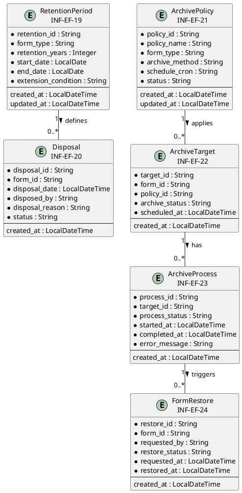
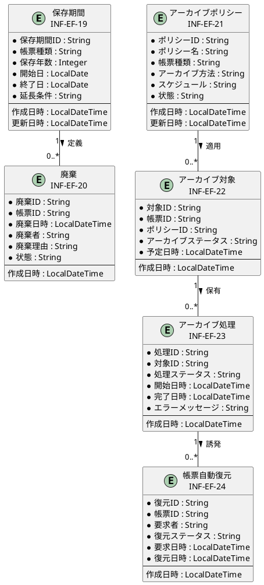

# 情報ER図

## 概要

本ファイルは、EF-04 保管・アーカイブの情報エンティティ間の関係をER図で定義します。

## ER図（英語版）

## ER図（日本語版）

## 情報エンティティ一覧

| 情報ID | 情報名 | 主要属性 | 関連エンティティ |
|--------|--------|----------|-----------------|
| INF-EF-19 | 保存期間 | retention_id, form_type, retention_years, end_date | 廃棄 |
| INF-EF-20 | 廃棄 | disposal_id, form_id, disposal_date, disposed_by | 保存期間 |
| INF-EF-21 | アーカイブポリシー | policy_id, policy_name, archive_method, schedule_cron | アーカイブ対象 |
| INF-EF-22 | アーカイブ対象 | target_id, form_id, policy_id, archive_status | アーカイブポリシー, アーカイブ処理 |
| INF-EF-23 | アーカイブ処理 | process_id, target_id, process_status, started_at | アーカイブ対象, 帳票自動復元 |
| INF-EF-24 | 帳票自動復元 | restore_id, form_id, requested_by, restore_status | アーカイブ処理 |

## 関係一覧

| 源エンティティ | 関係 | 対象エンティティ | 多重度 | 説明 |
|---------------|------|-----------------|--------|------|
| 保存期間 | 定義 | 廃棄 | 1 : 0..* | 保存期間満了で廃棄対象となる |
| アーカイブポリシー | 適用 | アーカイブ対象 | 1 : 0..* | ポリシーに基づいてアーカイブ対象を決定 |
| アーカイブ対象 | 保有 | アーカイブ処理 | 1 : 0..* | 対象ごとにアーカイブ処理を実行 |
| アーカイブ処理 | 誘発 | 帳票自動復元 | 1 : 0..* | アーカイブ後の復元要求を処理 |
