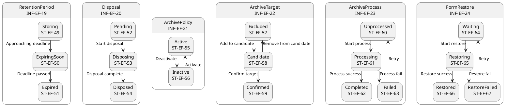
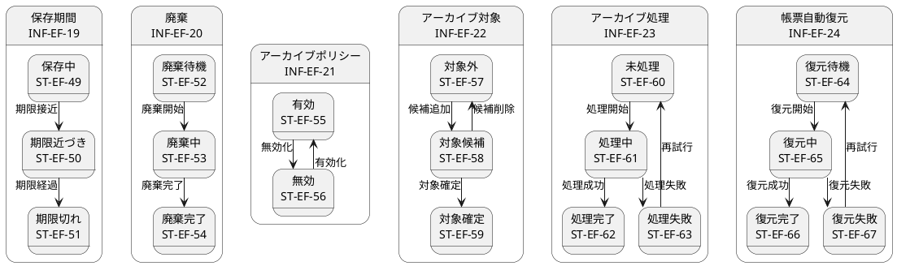

# ステートマシン図

## 概要

本ファイルは、EF-04 保管・アーカイブの情報エンティティの状態遷移をステートマシン図で定義します。

## ステートマシン図（英語版）

## ステートマシン図（日本語版）

## 状態一覧

| 状態ID | 状態名 | 対象情報 | 説明 |
|--------|--------|----------|------|
| ST-EF-49 | 保存中 | 保存期間 | 保存期間内 |
| ST-EF-50 | 期限近づき | 保存期間 | 期限接近 |
| ST-EF-51 | 期限切れ | 保存期間 | 期限経過 |
| ST-EF-52 | 廃棄待機 | 廃棄 | 廃棄待機中 |
| ST-EF-53 | 廃棄中 | 廃棄 | 廃棄進行中 |
| ST-EF-54 | 廃棄完了 | 廃棄 | 廃棄完了 |
| ST-EF-55 | 有効 | アーカイブポリシー | ポリシー有効 |
| ST-EF-56 | 無効 | アーカイブポリシー | ポリシー無効 |
| ST-EF-57 | 対象外 | アーカイブ対象 | 対象外 |
| ST-EF-58 | 対象候補 | アーカイブ対象 | 対象候補 |
| ST-EF-59 | 対象確定 | アーカイブ対象 | 対象確定 |
| ST-EF-60 | 未処理 | アーカイブ処理 | 未処理 |
| ST-EF-61 | 処理中 | アーカイブ処理 | 処理進行中 |
| ST-EF-62 | 処理完了 | アーカイブ処理 | 処理完了 |
| ST-EF-63 | 処理失敗 | アーカイブ処理 | 処理失敗 |
| ST-EF-64 | 復元待機 | 帳票自動復元 | 復元待機中 |
| ST-EF-65 | 復元中 | 帳票自動復元 | 復元進行中 |
| ST-EF-66 | 復元完了 | 帳票自動復元 | 復元完了 |
| ST-EF-67 | 復元失敗 | 帳票自動復元 | 復元失敗 |

## 遷移一覧

| 遷移ID | 源状態 | 遷移条件 | 対象状態 | 説明 |
|--------|--------|----------|----------|------|
| TR-EF-43 | 保存中 | 期限接近 | 期限近づき | 保存期限が近づく |
| TR-EF-44 | 期限近づき | 期限経過 | 期限切れ | 保存期限が経過 |
| TR-EF-45 | 廃棄待機 | 廃棄開始 | 廃棄中 | 廃棄処理を開始 |
| TR-EF-46 | 廃棄中 | 廃棄完了 | 廃棄完了 | 廃棄処理が完了 |
| TR-EF-47 | 有効 | 無効化 | 無効 | ポリシーを無効化 |
| TR-EF-48 | 無効 | 有効化 | 有効 | ポリシーを有効化 |
| TR-EF-49 | 対象外 | 候補追加 | 対象候補 | アーカイブ候補に追加 |
| TR-EF-50 | 対象候補 | 対象確定 | 対象確定 | アーカイブ対象を確定 |
| TR-EF-51 | 対象候補 | 候補削除 | 対象外 | アーカイブ候補から削除 |
| TR-EF-52 | 未処理 | 処理開始 | 処理中 | アーカイブ処理を開始 |
| TR-EF-53 | 処理中 | 処理成功 | 処理完了 | アーカイブ処理が成功 |
| TR-EF-54 | 処理中 | 処理失敗 | 処理失敗 | アーカイブ処理に失敗 |
| TR-EF-55 | 処理失敗 | 再試行 | 未処理 | アーカイブ処理を再試行 |
| TR-EF-56 | 復元待機 | 復元開始 | 復元中 | 復元処理を開始 |
| TR-EF-57 | 復元中 | 復元成功 | 復元完了 | 復元処理が成功 |
| TR-EF-58 | 復元中 | 復元失敗 | 復元失敗 | 復元処理に失敗 |
| TR-EF-59 | 復元失敗 | 再試行 | 復元待機 | 復元処理を再試行 |
