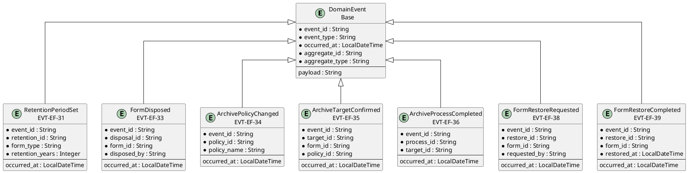
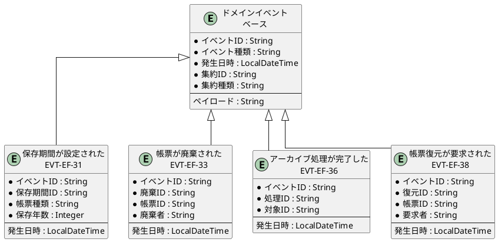

# イベントER図

## 概要

本ファイルは、EF-04 保管・アーカイブのイベントエンティティ間の関係をER図で定義します。

## ER図（英語版）

## ER図（日本語版）

## イベントエンティティ一覧

| イベントID | イベント名 | 集約 | 主要属性 |
|------------|------------|------|----------|
| EVT-EF-31 | 保存期間が設定された | RetentionPeriod | retention_id, form_type, retention_years |
| EVT-EF-32 | 保存期限が近づいた | RetentionPeriod | retention_id, form_id, expiry_date |
| EVT-EF-33 | 帳票が廃棄された | Disposal | disposal_id, form_id, disposed_by |
| EVT-EF-34 | アーカイブポリシーが変更された | ArchivePolicy | policy_id, policy_name |
| EVT-EF-35 | アーカイブ対象が確定した | ArchiveTarget | target_id, form_id, policy_id |
| EVT-EF-36 | アーカイブ処理が完了した | ArchiveProcess | process_id, target_id |
| EVT-EF-37 | アーカイブ処理が失敗した | ArchiveProcess | process_id, target_id, error_message |
| EVT-EF-38 | 帳票復元が要求された | FormRestore | restore_id, form_id, requested_by |
| EVT-EF-39 | 帳票復元が完了した | FormRestore | restore_id, form_id, restored_at |

## 関係一覧

| 源エンティティ | 関係 | 対象エンティティ | 説明 |
|---------------|------|-----------------|------|
| DomainEvent | 継承 | 保存期間が設定された | ベースイベントから継承 |
| DomainEvent | 継承 | 帳票が廃棄された | ベースイベントから継承 |
| DomainEvent | 継承 | アーカイブ処理が完了した | ベースイベントから継承 |
| DomainEvent | 継承 | 帳票復元が要求された | ベースイベントから継承 |
