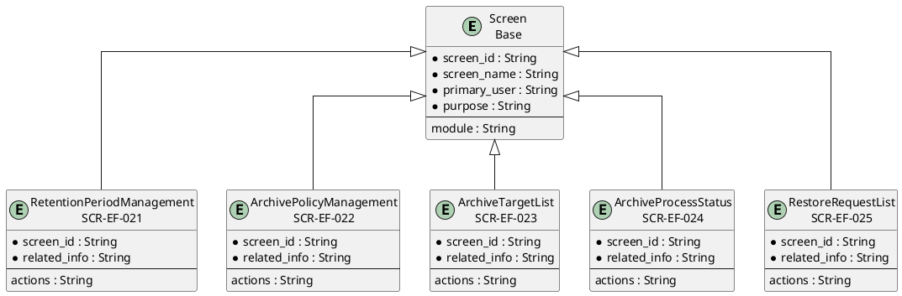
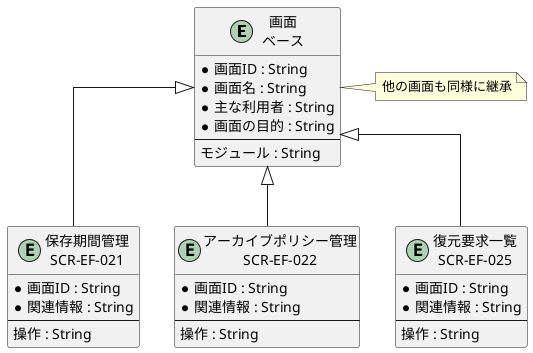

# 画面ER図

## 概要

本ファイルは、EF-04 保管・アーカイブの画面エンティティ間の関係をER図で定義します。

## ER図（英語版）

## ER図（日本語版）

## 画面エンティティ一覧

| 画面ID | 画面名 | 関連情報 | 主な操作 |
|--------|--------|----------|----------|
| SCR-EF-021 | 保存期間管理 | 保存期間 | 一覧・設定・編集 |
| SCR-EF-022 | アーカイブポリシー管理 | アーカイブポリシー | 一覧・設定・編集 |
| SCR-EF-023 | アーカイブ対象一覧 | アーカイブ対象 | 一覧・検索 |
| SCR-EF-024 | アーカイブ処理状況 | アーカイブ処理 | 状況確認・再試行 |
| SCR-EF-025 | 復元要求一覧 | 帳票自動復元 | 一覧・検索・復元要求 |

## 関係一覧

| 源エンティティ | 関係 | 対象エンティティ | 説明 |
|---------------|------|-----------------|------|
| Screen | 継承 | 保存期間管理 | ベース画面から継承 |
| Screen | 継承 | アーカイブポリシー管理 | ベース画面から継承 |
| Screen | 継承 | 復元要求一覧 | ベース画面から継承 |
