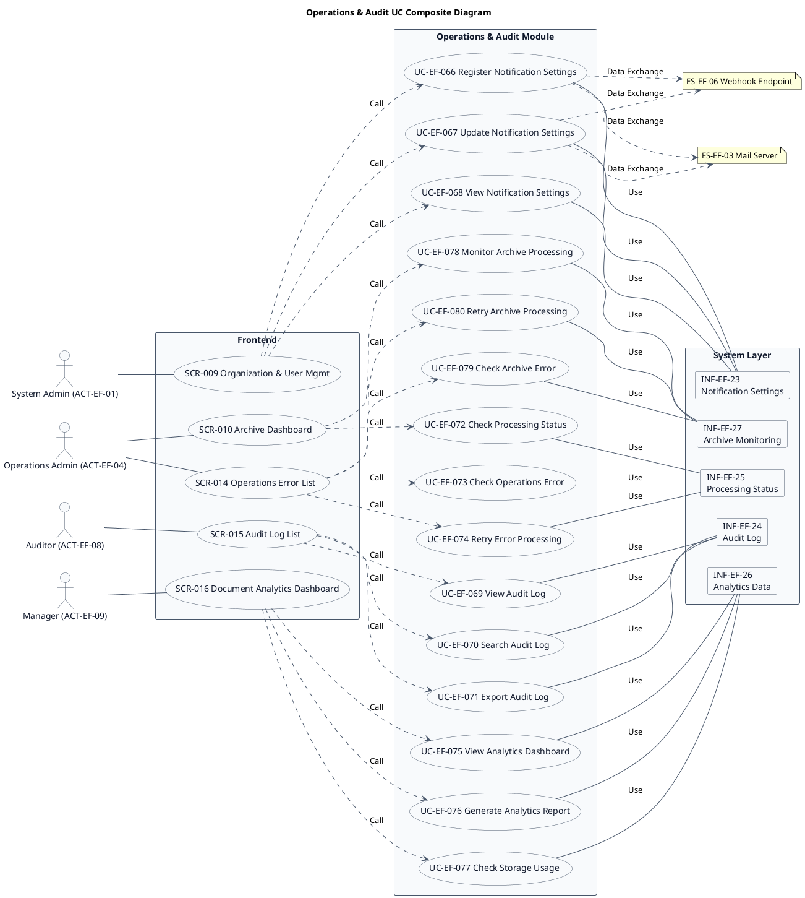
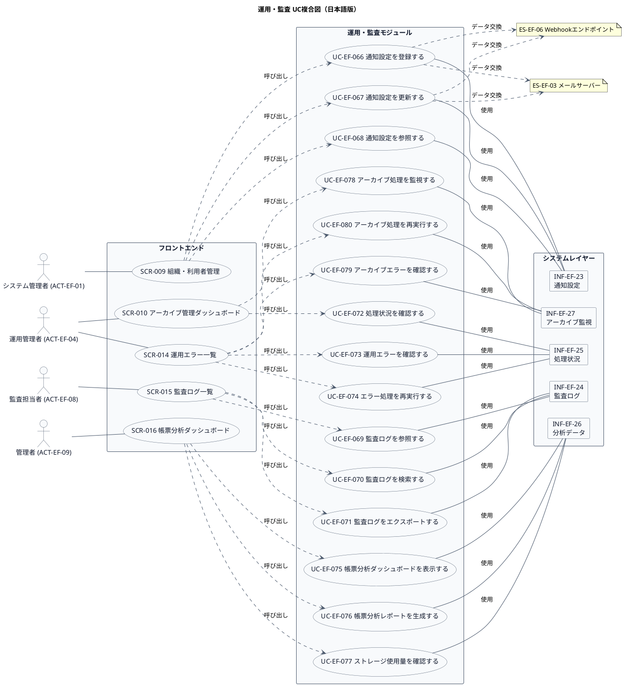

# UC複合図

運用・監査業務領域で扱うユースケース、画面、イベント、情報などを関連づけたUC複合図です。

## 1. 目的

本書は、EF-05 運用・監査業務領域のシステム境界レイヤーで扱うユースケース、画面、イベント、情報、条件を関連づけたUC複合図です。

## 2. PlantUML UC複合図（英語版）

## 3. 日本語版 UC複合図

## 4. ユースケース一覧

| ユースケースID | ユースケース名                   | 英語名                          | 説明                                                       | 関連アクター                       |
|----------------|----------------------------------|---------------------------------|------------------------------------------------------------|------------------------------------|
| UC-EF-066      | 通知設定を登録する               | Register Notification Settings  | メール、システム内通知、Webhook通知の設定を登録する         | ACT-EF-01                          |
| UC-EF-067      | 通知設定を更新する               | Update Notification Settings    | 既存の通知設定を修正する                                   | ACT-EF-01                          |
| UC-EF-068      | 通知設定を参照する               | View Notification Settings      | 登録された通知設定を確認する                               | ACT-EF-01                          |
| UC-EF-069      | 監査ログを参照する               | View Audit Log                  | 操作履歴、閲覧履歴、ダウンロード履歴を確認する             | ACT-EF-08                          |
| UC-EF-070      | 監査ログを検索する               | Search Audit Log                | 利用者、操作種別、日時などの条件で監査ログを検索する       | ACT-EF-08                          |
| UC-EF-071      | 監査ログをエクスポートする       | Export Audit Log                | 監査ログをエクスポートする                                 | ACT-EF-08                          |
| UC-EF-072      | 処理状況を確認する               | Check Processing Status         | バッチ処理、アーカイブ処理などの進捗を確認する             | ACT-EF-04                          |
| UC-EF-073      | 運用エラーを確認する             | Check Operations Error          | 発生したエラーの内容・回数を確認する                       | ACT-EF-04                          |
| UC-EF-074      | エラー処理を再実行する           | Retry Error Processing          | 失敗した処理を再実行する                                   | ACT-EF-04                          |
| UC-EF-075      | 帳票分析ダッシュボードを表示する | View Analytics Dashboard        | 帳票件数、配信状況、利用状況の統計を表示する               | ACT-EF-09                          |
| UC-EF-076      | 帳票分析レポートを生成する       | Generate Analytics Report       | 集計期間を指定して分析レポートを生成する                   | ACT-EF-09                          |
| UC-EF-077      | ストレージ使用量を確認する       | Check Storage Usage             | 通常・アーカイブ・プレビューのストレージ使用量を確認する   | ACT-EF-09                          |
| UC-EF-078      | アーカイブ処理を監視する         | Monitor Archive Processing      | アーカイブ・復元処理の進捗・状態を監視する                 | ACT-EF-04                          |
| UC-EF-079      | アーカイブエラーを確認する       | Check Archive Error             | アーカイブ・復元処理で発生したエラーを確認する             | ACT-EF-04                          |
| UC-EF-080      | アーカイブ処理を再実行する       | Retry Archive Processing        | 失敗したアーカイブ・復元処理を再実行する                   | ACT-EF-04                          |

## 5. 画面一覧

| 画面ID  | 画面名                      | 英語名                     | 主な利用者                       | 関連ユースケース |
|---------|-----------------------------|----------------------------|----------------------------------|------------------|
| SCR-009 | 組織・利用者管理            | Organization & User Mgmt   | システム管理者                   | UC-EF-066〜068   |
| SCR-010 | アーカイブ管理ダッシュボード | Archive Dashboard          | 運用管理者                       | UC-EF-072, 078   |
| SCR-014 | 運用エラー一覧              | Operations Error List      | 運用管理者                       | UC-EF-073〜074, 079〜080 |
| SCR-015 | 監査ログ一覧                | Audit Log List             | 監査担当者                       | UC-EF-069〜071   |
| SCR-016 | 帳票分析ダッシュボード      | Document Analytics Dashboard | 管理者                         | UC-EF-075〜077   |

## 6. イベント一覧

| イベントID | イベント名                           | 英語名                              | 説明                                                         | 関連ユースケース |
|------------|--------------------------------------|-------------------------------------|--------------------------------------------------------------|------------------|
| EVT-EF-043 | 通知設定が登録された                 | Notification Settings Registered    | メール、システム内通知、Webhook通知の設定が登録された         | UC-EF-066        |
| EVT-EF-044 | 通知設定が更新された                 | Notification Settings Updated       | 既存の通知設定が修正された                                   | UC-EF-067        |
| EVT-EF-045 | 監査ログが参照された                 | Audit Log Viewed                    | 操作履歴、閲覧履歴、ダウンロード履歴が確認された             | UC-EF-069        |
| EVT-EF-046 | 監査ログがエクスポートされた         | Audit Log Exported                  | 監査ログがエクスポートされた                                 | UC-EF-071        |
| EVT-EF-047 | エラー処理が再実行された             | Error Processing Retried            | 失敗した処理が再実行された                                   | UC-EF-074        |
| EVT-EF-048 | 帳票分析レポートが生成された         | Analytics Report Generated          | 集計期間を指定して分析レポートが生成された                   | UC-EF-076        |
| EVT-EF-049 | アーカイブ処理が再実行された         | Archive Processing Retried          | 失敗したアーカイブ・復元処理が再実行された                   | UC-EF-080        |

## 7. 情報一覧

| 情報ID    | 情報名             | 英語名               | 情報種類 | 説明                                           | 関連ユースケース |
|-----------|-------------------|----------------------|----------|------------------------------------------------|------------------|
| INF-EF-23 | 通知設定         | Notification Settings | リソース | メール、システム内通知、Webhook通知の設定       | UC-EF-066〜068   |
| INF-EF-24 | 監査ログ         | Audit Log            | リソース | 操作履歴、閲覧履歴、ダウンロード履歴           | UC-EF-069〜071   |
| INF-EF-25 | 処理状況         | Processing Status    | リソース | バッチ処理、アーカイブ処理などの進捗           | UC-EF-072〜074   |
| INF-EF-26 | 分析データ       | Analytics Data       | リソース | 帳票件数、配信状況、利用状況の統計             | UC-EF-075〜077   |
| INF-EF-27 | アーカイブ監視   | Archive Monitoring   | リソース | アーカイブ・復元処理の進捗・状態               | UC-EF-078〜080   |

## 8. 参照情報

- ユースケース一覧: `01.ユースケース/ユースケース一覧.md`
- 画面一覧: `04.システム/04.画面/画面一覧.md`
- イベント一覧: `04.システム/03.イベント/イベント一覧.md`
- 情報一覧: `04.システム/01.情報/情報一覧.md`
- 外部システム一覧: `02.外部環境/01.外部システム定義/外部システム一覧.md`
