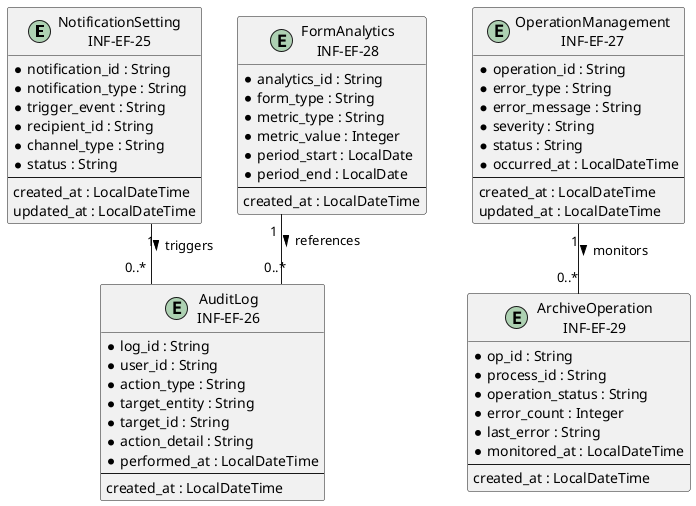
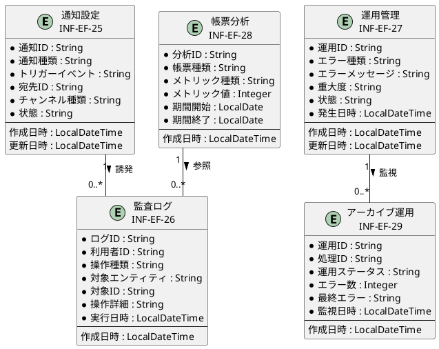

# 情報ER図

## 概要

本ファイルは、EF-05 運用・監査の情報エンティティ間の関係をER図で定義します。

## ER図（英語版）

## ER図（日本語版）

## 情報エンティティ一覧

| 情報ID | 情報名 | 主要属性 | 関連エンティティ |
|--------|--------|----------|-----------------|
| INF-EF-25 | 通知設定 | notification_id, notification_type, trigger_event, recipient_id | 監査ログ |
| INF-EF-26 | 監査ログ | log_id, user_id, action_type, target_entity, performed_at | 通知設定, 帳票分析 |
| INF-EF-27 | 運用管理 | operation_id, error_type, error_message, severity | アーカイブ運用 |
| INF-EF-28 | 帳票分析 | analytics_id, form_type, metric_type, metric_value | 監査ログ |
| INF-EF-29 | アーカイブ運用 | op_id, process_id, operation_status, error_count | 運用管理 |

## 関係一覧

| 源エンティティ | 関係 | 対象エンティティ | 多重度 | 説明 |
|---------------|------|-----------------|--------|------|
| 通知設定 | 誘発 | 監査ログ | 1 : 0..* | 通知トリガーで監査ログが記録 |
| 運用管理 | 監視 | アーカイブ運用 | 1 : 0..* | 運用管理がアーカイブ運用を監視 |
| 帳票分析 | 参照 | 監査ログ | 1 : 0..* | 分析に監査ログデータを参照 |
