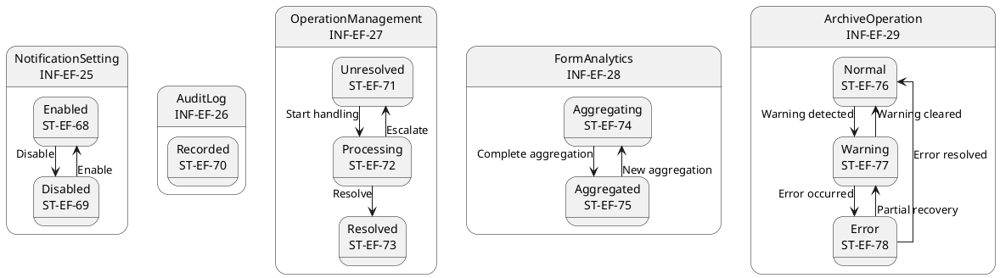
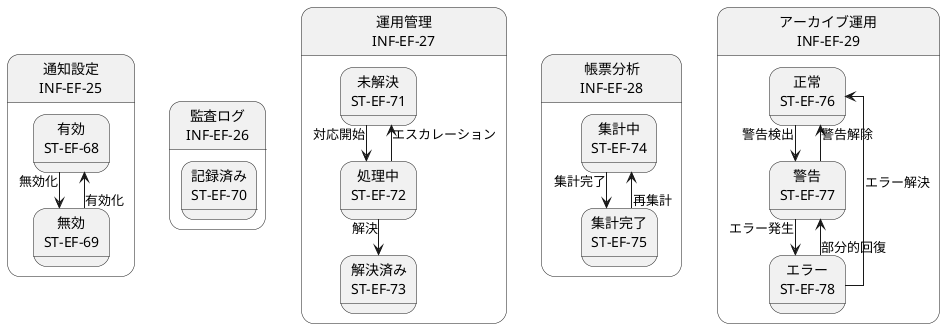

# ステートマシン図

## 概要

本ファイルは、EF-05 運用・監査の情報エンティティの状態遷移をステートマシン図で定義します。

## ステートマシン図（英語版）

## ステートマシン図（日本語版）

## 状態一覧

| 状態ID | 状態名 | 対象情報 | 説明 |
|--------|--------|----------|------|
| ST-EF-68 | 有効 | 通知設定 | 通知設定有効 |
| ST-EF-69 | 無効 | 通知設定 | 通知設定無効 |
| ST-EF-70 | 記録済み | 監査ログ | 監査ログ記録済み |
| ST-EF-71 | 未解決 | 運用管理 | 運用エラー未解決 |
| ST-EF-72 | 処理中 | 運用管理 | 運用エラー処理中 |
| ST-EF-73 | 解決済み | 運用管理 | 運用エラー解決済み |
| ST-EF-74 | 集計中 | 帳票分析 | 分析集計中 |
| ST-EF-75 | 集計完了 | 帳票分析 | 分析集計完了 |
| ST-EF-76 | 正常 | アーカイブ運用 | 運用正常 |
| ST-EF-77 | 警告 | アーカイブ運用 | 運用警告 |
| ST-EF-78 | エラー | アーカイブ運用 | 運用エラー |

## 遷移一覧

| 遷移ID | 源状態 | 遷移条件 | 対象状態 | 説明 |
|--------|--------|----------|----------|------|
| TR-EF-60 | 有効 | 無効化 | 無効 | 通知設定を無効化 |
| TR-EF-61 | 無効 | 有効化 | 有効 | 通知設定を有効化 |
| TR-EF-62 | 未解決 | 対応開始 | 処理中 | 運用エラーの対応を開始 |
| TR-EF-63 | 処理中 | 解決 | 解決済み | 運用エラーを解決 |
| TR-EF-64 | 処理中 | エスカレーション | 未解決 | 運用エラーをエスカレーション |
| TR-EF-65 | 集計中 | 集計完了 | 集計完了 | 分析データ集計が完了 |
| TR-EF-66 | 集計完了 | 再集計 | 集計中 | 分析データを再集計 |
| TR-EF-67 | 正常 | 警告検出 | 警告 | アーカイブ運用に警告 |
| TR-EF-68 | 警告 | エラー発生 | エラー | 警告がエラーに発展 |
| TR-EF-69 | 警告 | 警告解除 | 正常 | 警告が解消 |
| TR-EF-70 | エラー | エラー解決 | 正常 | エラーが完全解決 |
| TR-EF-71 | エラー | 部分的回復 | 警告 | エラーが部分的に回復 |
