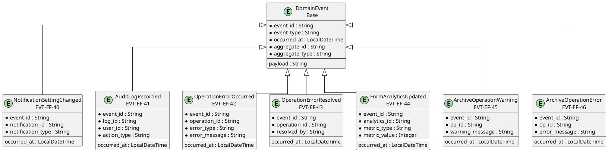
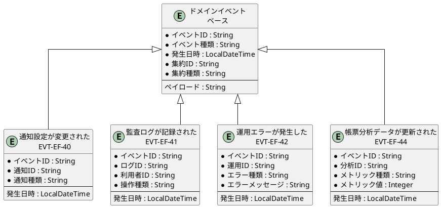

# イベントER図

## 概要

本ファイルは、EF-05 運用・監査のイベントエンティティ間の関係をER図で定義します。

## ER図（英語版）

## ER図（日本語版）

## イベントエンティティ一覧

| イベントID | イベント名 | 集約 | 主要属性 |
|------------|------------|------|----------|
| EVT-EF-40 | 通知設定が変更された | NotificationSetting | notification_id, notification_type |
| EVT-EF-41 | 監査ログが記録された | AuditLog | log_id, user_id, action_type |
| EVT-EF-42 | 運用エラーが発生した | OperationManagement | operation_id, error_type, error_message |
| EVT-EF-43 | 運用エラーが解決された | OperationManagement | operation_id, resolved_by |
| EVT-EF-44 | 帳票分析データが更新された | FormAnalytics | analytics_id, metric_type, metric_value |
| EVT-EF-45 | アーカイブ運用に警告が発生した | ArchiveOperation | op_id, warning_message |
| EVT-EF-46 | アーカイブ運用にエラーが発生した | ArchiveOperation | op_id, error_message |

## 関係一覧

| 源エンティティ | 関係 | 対象エンティティ | 説明 |
|---------------|------|-----------------|------|
| DomainEvent | 継承 | 通知設定が変更された | ベースイベントから継承 |
| DomainEvent | 継承 | 監査ログが記録された | ベースイベントから継承 |
| DomainEvent | 継承 | 運用エラーが発生した | ベースイベントから継承 |
| DomainEvent | 継承 | 帳票分析データが更新された | ベースイベントから継承 |
