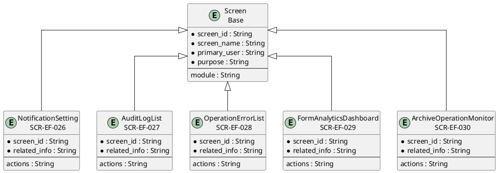
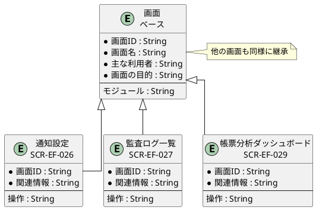

# 画面ER図

## 概要

本ファイルは、EF-05 運用・監査の画面エンティティ間の関係をER図で定義します。

## ER図（英語版）

## ER図（日本語版）

## 画面エンティティ一覧

| 画面ID | 画面名 | 関連情報 | 主な操作 |
|--------|--------|----------|----------|
| SCR-EF-026 | 通知設定 | 通知設定 | 一覧・設定・編集 |
| SCR-EF-027 | 監査ログ一覧 | 監査ログ | 一覧・検索・詳細表示 |
| SCR-EF-028 | 運用エラー一覧 | 運用管理 | 一覧・検索・対応 |
| SCR-EF-029 | 帳票分析ダッシュボード | 帳票分析 | 統計表示・グラフ表示 |
| SCR-EF-030 | アーカイブ運用監視 | アーカイブ運用 | 状況確認・アラート表示 |

## 関係一覧

| 源エンティティ | 関係 | 対象エンティティ | 説明 |
|---------------|------|-----------------|------|
| Screen | 継承 | 通知設定 | ベース画面から継承 |
| Screen | 継承 | 監査ログ一覧 | ベース画面から継承 |
| Screen | 継承 | 帳票分析ダッシュボード | ベース画面から継承 |
