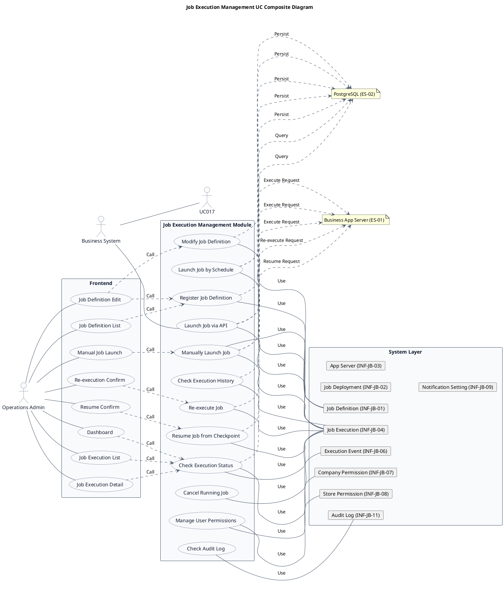
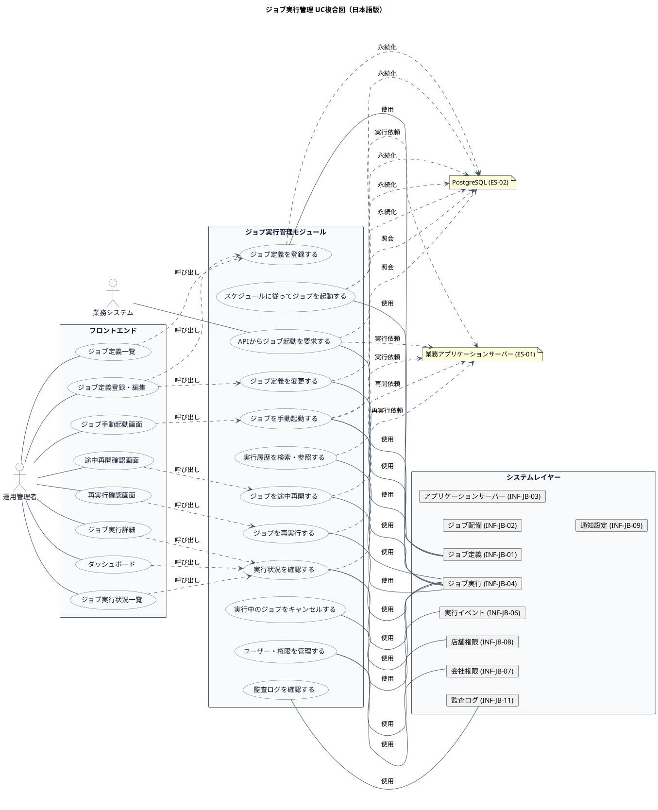

# UC複合図

ジョブ実行管理業務領域で扱うユースケース、画面、イベント、情報、条件を関連づけた図です。

## 1. 目的

本書は、JB-JB-01 ジョブ実行管理業務領域のシステム境界レイヤーで扱うユースケース、画面、イベント、情報、条件を関連づけたUC複合図です。

## 2. PlantUML UC複合図（英語版）

## 3. 日本語版 UC複合図

## 4. ユースケース一覧

| ユースケースID | ユースケース名                     | 英語名                          | 説明                                                         | 関連アクター |
|----------------|------------------------------------|---------------------------------|--------------------------------------------------------------|--------------|
| UC-JB-001      | ジョブ定義を登録する               | Register Job Definition         | ジョブコード、パラメータ仕様、実行制約などを新規登録する     | AC-01        |
| UC-JB-002      | ジョブ定義を変更する               | Modify Job Definition           | 既存のジョブ定義のパラメータ・実行条件を修正する             | AC-01        |
| UC-JB-003      | ジョブ定義を無効化する             | Disable Job Definition          | ジョブ定義を無効化して新規実行を不可にする                   | AC-01        |
| UC-JB-004      | ジョブ定義を参照する               | View Job Definition             | 登録済みジョブの定義内容・バージョン・配備状況を確認する     | AC-01        |
| UC-JB-005      | サーバー配備情報を登録する         | Register Server Deployment      | 業務アプリケーションサーバーとジョブの配備情報を登録する     | AC-01        |
| UC-JB-006      | サーバー配備情報を更新する         | Update Server Deployment        | サーバー情報やジョブ配備状況・バージョンを修正する           | AC-01        |
| UC-JB-007      | ユーザー・権限を管理する           | Manage User Permissions         | ユーザーのロール、会社・店舗の参照権限を設定する             | AC-01        |
| UC-JB-008      | ジョブを手動起動する               | Manually Launch Job             | 対象ジョブ、パラメータ、会社・店舗を指定して起動する         | AC-01        |
| UC-JB-009      | APIからジョブ起動を要求する        | Launch Job via API              | 個別業務システムからAPI経由でジョブ起動を要求する            | AC-02        |
| UC-JB-010      | スケジュールに従ってジョブを起動する | Launch Job by Schedule          | 設定された実行日時・条件に従ってジョブを起動する             | AC-01        |
| UC-JB-011      | スケジュールを登録する             | Register Schedule               | 実行日時、繰り返し条件、対象ジョブ、有効期間を設定する       | AC-01        |
| UC-JB-012      | スケジュールを変更する             | Modify Schedule                 | 既存のスケジュール設定を修正する                             | AC-01        |
| UC-JB-013      | 実行状況を確認する                 | Check Execution Status          | 実行中・待機中・異常終了などの状態をリアルタイムで確認する   | AC-01        |
| UC-JB-014      | 実行詳細を確認する                 | View Execution Detail           | 実行状態、実行先、パラメータ、処理件数、エラー情報を確認する | AC-01        |
| UC-JB-015      | 実行ログ・エラー情報を確認する     | View Execution Log              | ログ、エラー内容、発生箇所、関連イベントを確認する           | AC-01        |
| UC-JB-016      | 実行履歴を検索・参照する           | Search Execution History        | 期間・ジョブ・会社・店舗・状態などで履歴を検索・参照する     | AC-01        |
| UC-JB-017      | APIから実行状態を照会する          | Query Execution Status via API  | 個別業務システムからAPI経由で実行状態・結果を照会する        | AC-02        |
| UC-JB-018      | 実行中のジョブをキャンセルする     | Cancel Running Job              | 実行中のジョブにキャンセルを要求する                         | AC-01        |
| UC-JB-019      | ジョブを再実行する                 | Re-execute Job                  | 異常終了したジョブを最初から再実行する                       | AC-01        |
| UC-JB-020      | ジョブを途中再開する               | Resume Job from Checkpoint      | チェックポイントからジョブを再開する                         | AC-01        |
| UC-JB-021      | 復旧操作履歴を確認する             | View Recovery History           | 再実行・再開・キャンセルの操作者・理由・日時を確認する       | AC-01        |
| UC-JB-022      | 通知設定を管理する                 | Manage Notification Settings    | 通知条件、通知先、通知対象ジョブを設定する                   | AC-01        |
| UC-JB-023      | 通知を確認する                     | View Notifications              | 成功・異常終了などの通知を確認する                           | AC-01        |
| UC-JB-024      | 監査ログを確認する                 | View Audit Log                  | 起動、設定変更、権限変更、復旧操作などの操作履歴を確認する   | AC-01        |
| UC-JB-025      | 会社別実行状況・履歴を参照する     | View Company Execution Status   | 自社に属するジョブの実行状況・履歴を参照する                 | AC-01        |
| UC-JB-026      | 店舗別実行状況・履歴を参照する     | View Store Execution Status     | 権限を付与された店舗の実行状況・履歴を参照する               | AC-01        |
| UC-JB-027      | 会社・店舗を管理する               | Manage Company and Store        | 会社と店舗の登録、所属関係の管理を行う                       | AC-01        |

## 5. 画面一覧

| 画面ID    | 画面名                       | 英語名                          | 説明                                                   | 関連ユースケース |
|-----------|------------------------------|---------------------------------|--------------------------------------------------------|------------------|
| SCR-JB-001 | ダッシュボード               | Dashboard                       | 実行中・成功・失敗件数、異常発生状況を表示             | UC-JB-013        |
| SCR-JB-002 | ジョブ実行状況一覧           | Job Execution List              | 実行中・待機中・異常終了などを検索・一覧表示           | UC-JB-013        |
| SCR-JB-003 | ジョブ実行詳細               | Job Execution Detail            | 実行状態、実行先、パラメータ、エラー情報を表示         | UC-JB-013, UC-JB-014 |
| SCR-JB-004 | 実行ログ・エラー詳細         | Execution Log Detail            | ログ、エラー内容、発生箇所、関連イベントを確認         | UC-JB-015        |
| SCR-JB-005 | ジョブ実行履歴一覧           | Job Execution History List      | 期間・ジョブ・会社・店舗・状態などで履歴を検索         | UC-JB-016        |
| SCR-JB-006 | ジョブ実行履歴詳細           | Job Execution History Detail    | 実行結果、実行時間、処理件数、再実行履歴を参照         | UC-JB-016        |
| SCR-JB-007 | ジョブ定義一覧               | Job Definition List             | 登録済みジョブの検索、状態、バージョンを確認           | UC-JB-004        |
| SCR-JB-008 | ジョブ定義詳細               | Job Definition Detail           | ジョブ仕様、パラメータ、同時実行数、通知設定を確認     | UC-JB-004        |
| SCR-JB-009 | ジョブ定義登録・編集         | Job Definition Edit             | ジョブコード、パラメータ仕様、実行制約などを登録・変更 | UC-JB-001, UC-JB-002 |
| SCR-JB-010 | スケジュール一覧             | Schedule List                   | スケジュールの検索、有効・無効状態を確認               | UC-JB-010        |
| SCR-JB-011 | スケジュール登録・編集       | Schedule Edit                   | 実行日時、繰り返し条件、対象ジョブ、有効期間を設定     | UC-JB-011, UC-JB-012 |
| SCR-JB-012 | ジョブ手動起動画面           | Manual Job Launch               | 対象ジョブ、実行パラメータを指定して起動               | UC-JB-008        |
| SCR-JB-013 | 再実行確認画面               | Re-execution Confirm            | 元の実行内容、再実行条件、影響、実行理由を確認         | UC-JB-019        |
| SCR-JB-014 | 途中再開確認画面             | Resume Confirm                  | 再開可否、チェックポイント、再開位置を確認             | UC-JB-020        |
| SCR-JB-015 | キャンセル確認画面           | Cancel Confirm                  | 対象実行とキャンセルの影響を確認して要求               | UC-JB-018        |
| SCR-JB-016 | 復旧操作履歴一覧             | Recovery History List           | 再実行・再開・キャンセルの操作者、理由、日時を確認     | UC-JB-021        |
| SCR-JB-017 | アプリケーションサーバー一覧 | App Server List                 | サーバーの稼働状況、接続状態、受付可否を表示           | UC-JB-005        |
| SCR-JB-018 | アプリケーションサーバー詳細 | App Server Detail               | サーバー情報、ヘルスチェック、稼働中ジョブを表示       | UC-JB-005        |
| SCR-JB-019 | ジョブ配備状況一覧           | Job Deployment List             | サーバーごとのジョブ配備状況、バージョンを確認         | UC-JB-005, UC-JB-006 |
| SCR-JB-020 | ジョブ配備詳細               | Job Deployment Detail           | ジョブとサーバーの対応関係、バージョン互換性を確認     | UC-JB-006        |
| SCR-JB-021 | 通知一覧                     | Notification List               | 成功・異常終了などの通知を確認                         | UC-JB-023        |
| SCR-JB-022 | 通知設定                     | Notification Settings           | 通知条件、通知先、通知対象ジョブを設定                 | UC-JB-022        |
| SCR-JB-023 | ユーザー一覧                 | User List                       | ユーザーの検索、利用状態を確認                         | UC-JB-007        |
| SCR-JB-024 | ユーザー・権限編集           | User Permission Edit            | ロール、会社、店舗の参照権限を設定                     | UC-JB-007        |
| SCR-JB-025 | 会社・店舗管理               | Company and Store Management    | 会社と店舗の登録、所属関係の管理                       | UC-JB-027        |
| SCR-JB-026 | 監査ログ一覧                 | Audit Log List                  | 起動、設定変更、権限変更、復旧操作などを検索・参照     | UC-JB-024        |

## 6. イベント一覧

| イベントID | イベント名                         | 英語名                          | 説明                                                         | 関連ユースケース |
|------------|------------------------------------|---------------------------------|--------------------------------------------------------------|------------------|
| EVT-JB-001 | ジョブ定義が登録された             | JobDefinitionRegistered         | ジョブコード、パラメータ仕様、実行制約などが新規登録された   | UC-JB-001        |
| EVT-JB-002 | ジョブ定義が変更された             | JobDefinitionModified           | ジョブ定義のパラメータ・実行条件が修正された                 | UC-JB-002        |
| EVT-JB-003 | ジョブ定義が無効化された           | JobDefinitionDisabled           | ジョブ定義が無効化されて新規実行が不可になった               | UC-JB-003        |
| EVT-JB-004 | サーバー配備情報が登録された       | ServerDeploymentRegistered      | 業務アプリケーションサーバーとジョブの配備情報が登録された   | UC-JB-005        |
| EVT-JB-005 | サーバー配備情報が更新された       | ServerDeploymentUpdated         | サーバー情報やジョブ配備状況・バージョンが修正された         | UC-JB-006        |
| EVT-JB-006 | ユーザー権限が設定された           | UserPermissionSet               | ユーザーのロール、会社・店舗の参照権限が設定された           | UC-JB-007        |
| EVT-JB-007 | ジョブが手動起動された             | JobManuallyLaunched             | 運用管理者が対象ジョブを指定して手動起動した                 | UC-JB-008        |
| EVT-JB-008 | API経由でジョブ起動が要求された    | JobLaunchRequestedViaAPI        | 個別業務システムからAPI経由でジョブ起動が要求された          | UC-JB-009        |
| EVT-JB-009 | スケジュール起動が実行された       | ScheduledJobLaunched            | 設定された実行日時・条件に従ってジョブが起動された           | UC-JB-010        |
| EVT-JB-010 | スケジュールが登録された           | ScheduleRegistered              | 実行日時、繰り返し条件、対象ジョブ、有効期間が設定された     | UC-JB-011        |
| EVT-JB-011 | スケジュールが変更された           | ScheduleModified                | 既存のスケジュール設定が修正された                           | UC-JB-012        |
| EVT-JB-012 | ジョブ実行が開始された             | JobExecutionStarted             | ジョブ実行が待機中から実行中に遷移した                       | UC-JB-008, UC-JB-009, UC-JB-010 |
| EVT-JB-013 | ジョブ実行が成功した               | JobExecutionSucceeded           | ジョブが正常に完了した                                       | -                |
| EVT-JB-014 | ジョブ実行が失敗した               | JobExecutionFailed              | ジョブが異常終了した                                         | -                |
| EVT-JB-015 | ジョブ実行結果が不明になった       | JobExecutionResultUnknown       | 起動APIタイムアウトなどで実行結果が判らなくなった            | -                |
| EVT-JB-016 | ジョブがキャンセルされた           | JobCancelled                    | 実行中のジョブがキャンセルされた                             | UC-JB-018        |
| EVT-JB-017 | ジョブが再実行された               | JobReExecuted                   | 異常終了したジョブが最初から再実行された                     | UC-JB-019        |
| EVT-JB-018 | ジョブが途中再開された             | JobResumedFromCheckpoint        | チェックポイントからジョブが再開された                       | UC-JB-020        |
| EVT-JB-019 | 通知が送信された                   | NotificationSent                | 成功・異常終了などの通知が送信された                         | UC-JB-022        |
| EVT-JB-020 | 会社・店舗が登録された             | CompanyStoreRegistered          | 会社と店舗の登録、所属関係が管理された                       | UC-JB-027        |

## 7. 情報一覧

| 情報ID    | 情報名                       | 英語名                      | 説明                                                   | 関連ユースケース |
|-----------|------------------------------|-----------------------------|--------------------------------------------------------|------------------|
| INF-JB-01 | ジョブ定義                   | Job Definition              | ジョブコード、パラメータ、実行条件、バージョン         | UC-JB-001〜UC-JB-004 |
| INF-JB-02 | ジョブ配備                   | Job Deployment              | サーバーごとの配備状況・バージョン                     | UC-JB-005, UC-JB-006 |
| INF-JB-03 | アプリケーションサーバー     | Application Server          | 業務アプリケーションサーバー情報                       | UC-JB-005, UC-JB-006 |
| INF-JB-04 | ジョブ実行                   | Job Execution               | 実行状態・結果・履歴                                   | UC-JB-008〜UC-JB-020 |
| INF-JB-05 | 実行枠                       | Execution Slot              | 同時実行枠の管理                                       | UC-JB-008〜UC-JB-010 |
| INF-JB-06 | 実行イベント                 | Execution Event             | 状態遷移・実行イベント                                 | UC-JB-008〜UC-JB-020 |
| INF-JB-07 | 会社権限                     | Company Permission          | 会社単位の権限                                         | UC-JB-007, UC-JB-027 |
| INF-JB-08 | 店舗権限                     | Store Permission            | 店舗単位の権限                                         | UC-JB-007, UC-JB-027 |
| INF-JB-09 | 通知設定                     | Notification Setting        | 通知情報                                               | UC-JB-022, UC-JB-023 |
| INF-JB-10 | アップロードファイル         | Uploaded File               | S3/MinIO上のファイル参照情報                           | -                |
| INF-JB-11 | 監査ログ                     | Audit Log                   | 手動起動・再実行・再開などの操作記録                   | UC-JB-024        |
| INF-JB-12 | ジョブ実行状態               | Job Execution Status        | 待機中、実行中、成功、失敗、結果不明                   | UC-JB-013        |

## 8. 条件一覧

| 条件ID   | 条件名                       | 英語名                      | 説明                                                   | 関連ユースケース |
|----------|------------------------------|-----------------------------|--------------------------------------------------------|------------------|
| RL-JB-01 | 重複起動防止                 | Idempotency Check           | 実行IDを冪等性キーとして同じ要求による二重起動を抑止   | UC-JB-008, UC-JB-009 |
| RL-JB-02 | 同時実行枠制御               | Concurrent Execution Limit  | 同時に実行できるジョブの上限数を制御                   | UC-JB-008〜UC-JB-010 |
| RL-JB-03 | 実行権限チェック             | Execution Permission Check  | ジョブ実行の権限を確認                                 | UC-JB-008, UC-JB-009 |
| RL-JB-04 | 再実行可否判定               | Re-execution Eligibility    | 再実行可能な状態か判定                                 | UC-JB-019        |
| RL-JB-05 | 途中再開可否判定             | Resume Eligibility          | チェックポイントから再開可能か判定                     | UC-JB-020        |
| RL-JB-06 | 結果不明時復旧ルール         | Unknown Result Recovery     | 結果不明時に無条件で再実行しない                       | UC-JB-019        |
| RL-JB-07 | 会社・店舗権限フィルタ       | Company Store Filter        | 会社・店舗単位で参照範囲を制限                         | UC-JB-025, UC-JB-026 |
| RL-JB-08 | バージョン互換性チェック     | Version Compatibility       | 実行時のジョブバージョンとサーバーの互換性を確認       | UC-JB-008〜UC-JB-010 |

## 9. 参照情報

- ユースケース一覧: `03.システム境界/01.ユースケース/ユースケース一覧.md`
- 画面一覧: `04.システム/04.画面/画面一覧.md`
- イベント一覧: `04.システム/03.イベント/イベント一覧.md`
- 情報一覧: `04.システム/01.情報/情報一覧.md`
- ステート一覧: `04.システム/02.ステート/ステート一覧.tsv`
- ステートマシン図: `04.システム/02.ステート/ステートマシン図.md`
