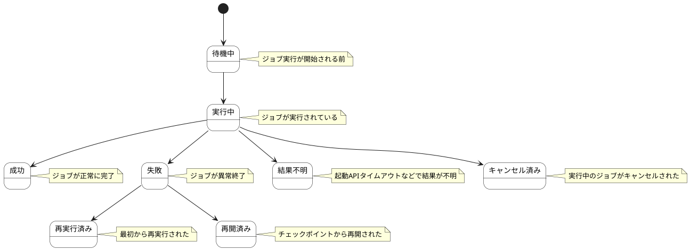

# ジョブ実行 ステートチャート

ジョブ実行情報の状態遷移を示します。

## 状態一覧

| 状態ID | 状態名 | 説明 |
|--------|--------|------|
| ST-JB-01 | 待機中 | ジョブ実行が開始される前 |
| ST-JB-02 | 実行中 | ジョブが実行されている |
| ST-JB-03 | 成功 | ジョブが正常に完了 |
| ST-JB-04 | 失敗 | ジョブが異常終了 |
| ST-JB-05 | 結果不明 | 起動APIタイムアウトなどで結果が不明 |
| ST-JB-06 | 再実行済み | 最初から再実行された |
| ST-JB-07 | 再開済み | チェックポイントから再開された |
| ST-JB-08 | キャンセル済み | 実行中のジョブがキャンセルされた |
