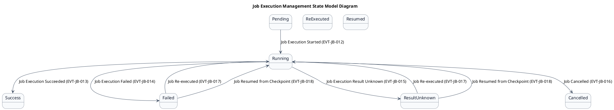
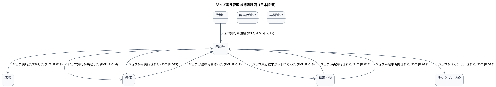

# ステートマシン図

ジョブ実行管理業務領域で扱う情報の状態遷移を示す状態モデル図です。

## 1. 目的

本書は、JB-JB-01 ジョブ実行管理業務領域のシステムレイヤーで扱う情報の状態遷移を示す状態モデル図（ステートマシン図）です。

## 2. PlantUML 状態遷移図（英語版）

## 3. 日本語版 状態遷移図

## 4. 状態一覧

| 状態名 (ID)       | 英語名        | 説明                                     |
|-------------------|---------------|------------------------------------------|
| 待機中 (ST-JB-01) | Pending       | ジョブ実行が開始される前                 |
| 実行中 (ST-JB-02) | Running       | ジョブが実行されている                   |
| 成功 (ST-JB-03)   | Success       | ジョブが正常に完了                       |
| 失敗 (ST-JB-04)   | Failed        | ジョブが異常終了                         |
| 結果不明 (ST-JB-05) | ResultUnknown | 起動APIタイムアウトなどで結果が不明       |
| キャンセル済み (ST-JB-08) | Cancelled | 実行中のジョブがキャンセルされた         |
| 再実行済み (ST-JB-06) | ReExecuted | 最初から再実行された                     |
| 再開済み (ST-JB-07) | Resumed     | チェックポイントから再開された           |

## 5. 遷移一覧

| 遷移ID | 元状態       | 遷移先状態 | トリガー                          | 関連ユースケース              | 説明                                     |
|--------|--------------|------------|-----------------------------------|-------------------------------|------------------------------------------|
| TR-JB-01 | 待機中      | 実行中     | ジョブ実行が開始された (EVT-JB-012) | UC-JB-008, UC-JB-009, UC-JB-010 | 手動・API・スケジュール起動で実行開始    |
| TR-JB-02 | 実行中      | 成功       | ジョブ実行が成功した (EVT-JB-013)   | -                             | ジョブが正常に完了                       |
| TR-JB-03 | 実行中      | 失敗       | ジョブ実行が失敗した (EVT-JB-014)   | -                             | ジョブが異常終了                         |
| TR-JB-04 | 実行中      | 結果不明   | ジョブ実行結果が不明になった (EVT-JB-015) | -                          | 起動APIタイムアウトなどで結果が不明      |
| TR-JB-05 | 実行中      | キャンセル済み | ジョブがキャンセルされた (EVT-JB-016) | UC-JB-018                   | 運用管理者がキャンセルを要求             |
| TR-JB-06 | 失敗        | 実行中     | ジョブが再実行された (EVT-JB-017)   | UC-JB-019                     | 失敗したジョブを最初から再実行           |
| TR-JB-07 | 結果不明    | 実行中     | ジョブが再実行された (EVT-JB-017)   | UC-JB-019                     | 結果不明のジョブを再実行                 |
| TR-JB-08 | 失敗        | 実行中     | ジョブが途中再開された (EVT-JB-018) | UC-JB-020                     | チェックポイントから再開                 |
| TR-JB-09 | 結果不明    | 実行中     | ジョブが途中再開された (EVT-JB-018) | UC-JB-020                     | 結果不明のジョブをチェックポイントから再開 |

## 6. 参照情報

- ステート一覧: `02.ステート/ステート一覧.tsv`
- 関連ユースケース: `03.システム境界/01.ユースケース/ユースケース一覧.md`
- イベント一覧: `03.イベント/イベント一覧.md`
