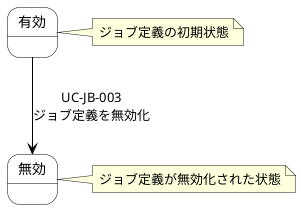

# ステートマシン図 - ジョブ定義

ジョブ定義の状態遷移をPlantUMLで視覚化します。

## 状態遷移図

## 状態一覧

| 状態名 | 説明                         | 遷移元 | 遷移先 | トリガーUC |
|--------|------------------------------|--------|--------|------------|
| 有効   | ジョブ定義の初期状態         | -      | 無効   | UC-JB-003  |
| 無効   | ジョブ定義が無効化された状態 | 有効   | -      | -          |
